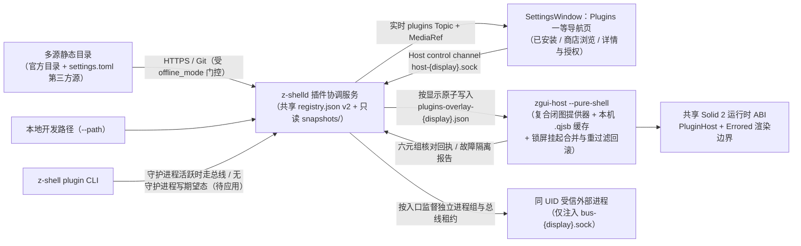
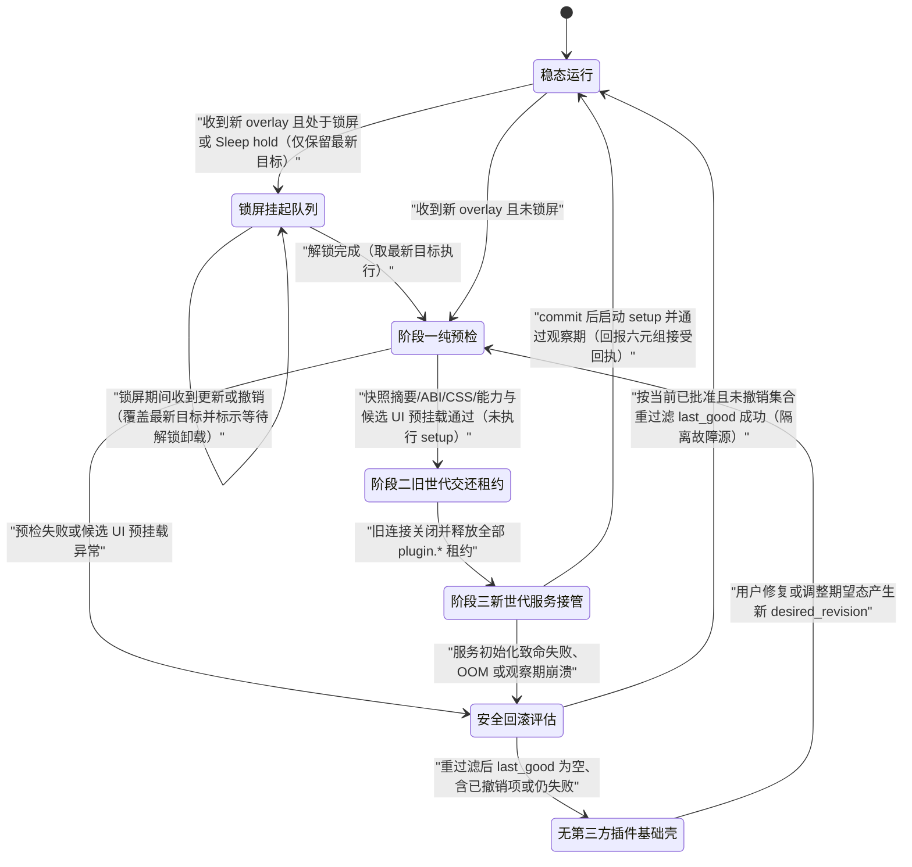
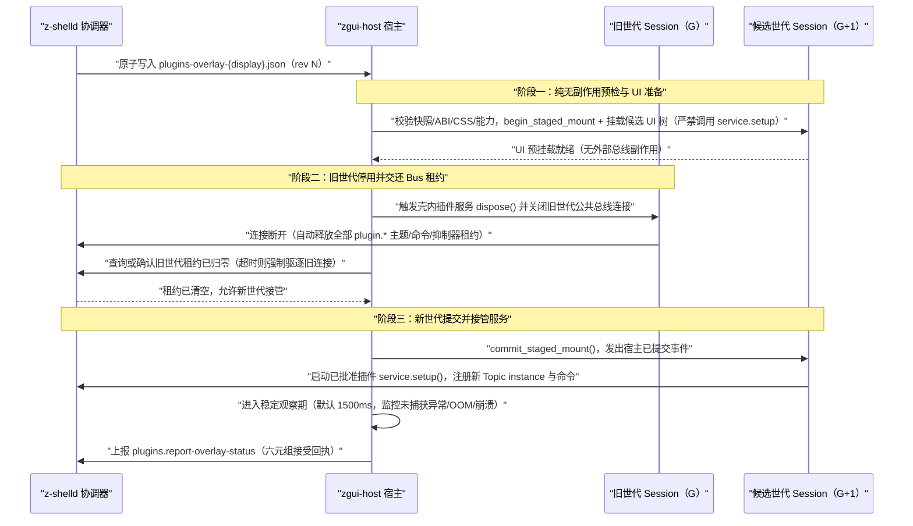

# z-shell 插件生态准备与内置插件商店架构方案

> **关联决策与权威基线**：
> - 架构决策草案：[ADR-0007：运行时动态插件加载、显式全权信任边界与去中心化插件商店架构](adr/0007-runtime-plugin-loading-and-store-architecture.md)（显式重开 [ADR-0005](adr/0005-toml-config-state-split-and-plugin-manifest.md) 的静态合成部分，同时完整保留其三层 TOML 状态分离、`plugin.toml` 单一事实源与 `sessionLock` 硬禁令）
> - 既有契约与规范：[plugin-manifest-v1.md](plugin-manifest-v1.md)、[GLOSSARY.md](../GLOSSARY.md)、[DESIGN.md](../DESIGN.md)、[CODING_STANDARDS.md](../CODING_STANDARDS.md)
> - 交付范围声明：本文档与 ADR-0007 构成跨仓落地的完整设计蓝图与分阶段路线图，不在此阶段修改业务源码、测试或既有契约文件；相关规范修订节点统一安排在 Phase 0–Phase 5 中与代码协同落地。

---

## 1. 两仓现状审计与真实缺口盘点

在制定方案前，我们对 `z-shell` 与同级宿主仓库 `../zgui-js` 的真实源码进行了逐项核查。现有系统已经打下良好基础（`plugin.toml` 静态校验、SHA-256 内容摘要、`flock` 原子注册表、双套接字 **Bus** 架构、4 个第一方参考插件以及 `SettingsWindow` 820×600 M3 框架），但距离“无 Bun 发行版终端可直接通过内置商店安全安装、审批、热生效与卸载第三方插件”仍存在 **12 处结构性缺口**，汇总如下：

| 维度 | 仓别与精确源码位置 | 现状事实 | 面向插件生态与商店的真实缺口 |
|---|---|---|---|
| **锁屏热重载安全** | `../zgui-js/crates/zgui-host/src/session_host/surfaces.rs:70–114` | `mount_shell` 在 `lock_state.is_retained()` 或 `has_active_lock()` 时仅跳过 `capture_dev_state`，仍会继续执行换代与旧世代退役 | 锁屏期间触发插件变更会冲击活跃的 `ext_session_lock_v1` 会话，缺少挂起合并队列与解锁后按最新目标生效机制 |
| **候选挂载副作用** | `../zgui-js/crates/zgui-host/src/session.rs:907–918` | `begin_staged_mount` / `commit_staged_mount` 仅延迟出站网络（`work.begin_staged_network`）与 compute workers（`work.begin_staged_workers`） | 无法自动撤销或延迟候选世代通过 **Bus** 建立的 `plugin.*` 主题/命令注册与抑制器租约，新旧世代并行启动 `service.setup()` 会导致资源名冲突与租约竞态 |
| **动态模块加载限制** | `../zgui-js/packages/build/src/validate.ts:763–776` | `ImportExpression` 强制动态 `import()` 必须使用静态字符串字面量，且打包后要求命中闭图 chunk 边 | 业务侧无法直接 `import(dynamicEntryPath)`；若贸然放宽普通 `import()` 又会破坏整包静态可审计性，需要由宿主提供受控的 `entryId` 加载原语 |
| **模块解析器闭图** | `../zgui-js/crates/zgui-host/src/package.rs:809–833` | `resolve_sealed_import` 仅接受 `./` 与 `../` 相对导入，明确拒绝非相对裸标识符（bare specifiers） | 独立预构建的第三方插件 `.mjs` 无法将 `solid-js`、`@hewel/zgui/*`、`@z-shell/sdk/*` 等共享运行时解析到宿主内建模块表 |
| **字节码编译与安全** | `../zgui-js/crates/js-runtime/src/lib.rs:348–390, 416–431` | `CompileDirLoader` 从磁盘路径直接重读文件编译；`load_verified_bytecode_module` 调用 `unsafe { Module::load(ctx, bytes) }` | 存在编译期 TOCTOU 风险（校验与编译未共用内存字节），且缺乏面向本机动态插件的四要素 `.qjsb` 缓存键与损坏自动回退机制 |
| **宿主能力契约漂移** | `../zgui-js/crates/zgui-host/src/package.rs:135–182, 228–238` 与 `../zgui-js/schemas/package.schema.json:45–68` | `package.rs` 已支持 `clipboard`/`sqlite`/`files`/`network`，但 `package.schema.json` 仍缺失这 4 项；且 `NetworkCapabilities` 用整包全局布尔控制 `allow_insecure_http` / `allow_private_networks` | 1）schema 与 Rust 宿主漂移，构建校验会拒绝合法能力；2）跨插件合并若直接对布尔取“或”，会让单个插件的私网/明文 HTTP 权限污染所有其他来源 |
| **渲染错误边界符号** | `../zgui-js/packages/ui/src/index.ts:17` | Solid 2 UI 包真实导出的是 `Errored`（来自 `#solid`），不导出 Solid 1 的错误边界别名 | 壳内 `PluginHost` 尚未为每个插件 UI 实例包裹 `<Errored>`，单个插件渲染异常会波及整个壳体；且设计必须严格对齐真实符号 `Errored` |
| **多显示注册表耦合** | `crates/z-shell-config/src/paths.rs:70–78, 173–187` | `bus-<display>.sock` 与 `host-<display>.sock` 按 `WAYLAND_DISPLAY` 隔离，但 `$XDG_STATE_HOME/z-shell/plugins/registry.json` 与 `plugins.lock` 全局共享 | 尚未分离“跨显示共享期望态”与“按显示会话运行时叠加/观测态”，多显示并发时会导致状态覆盖与迟到回执错乱 |
| **v1 注册表与合成耦合** | `crates/z-shell-plugins/src/registry.rs:145–170, 257–282` 与 `packages/composer/src/compose.ts:163–175` | v1 注册表缺卸载操作、`sync` 仅在能力扩张时禁用而不校验代码摘要变更、无来源防接管；`compose.ts` 硬编码 `schema_version === 1` 且要求本地 Bun 重打包整壳 | 发行版无 Bun 环境不可用；v1 若直接升为 v2 会造成历史批准静默升级为全权信任；缺少写入端平滑退场方案 |
| **离线早退与多源缺口** | `crates/z-shell-plugins/src/git.rs:79–97` | `OfflinePolicy::Offline` 在 `git::prepare` 入口直接早退返回 `GitError::Offline`；仅支持仓库根目录 `plugin.toml` | 离线状态下无法命中本地已核验只读快照；不支持多源静态目录、HTTPS 压缩归档或 Git monorepo `subdir` 钉死 |
| **总线同 UID 安全边界** | `crates/z-shell-bus/src/server.rs:148–200` | `BusServer` 对 `bus-<display>.sock` 与 `host-<display>.sock` 均通过 `SO_PEERCRED` 校验同 UID | 任何同 UID 进程都具备连接特权通道的 OS 权限，因此必须诚实界定安全边界：壳内插件为显式全权信任，外部进程首期定位于故障/堆隔离而非 OS 沙箱 |
| **扩展点与商店 UI 缺口** | `apps/shell/src/plugins/PluginHost.tsx`、`apps/shell/src/plugins/services.ts`、`apps/shell/src/surfaces/StatusBar.tsx:763`、`apps/shell/src/store.ts:90–96, 335–350` | `PluginHost` 静态读取 `composed.ts`，仅接通 `service`/`layer`/`settings_page`/`widget`/`panel`，缺失 `shortcut` 与 `launcher_provider` 前端接线；`StatusBar` 仅单槽位列表；`SettingsWindow` 尚无一等 `Plugins` 管理与商店页 | 无法承载完整插件扩展点与 Bar 左/中/右三段编排；用户无法在桌面壳内完成浏览、搜索、审查、授权、更新与卸载闭环 |

---

## 2. 运行时动态加载与 `zgui-js` 跨仓扩展契约

### 2.1 总体架构与按显示会话生效链路

新架构以 **“预构建静态分发产物 + 宿主校验受控动态加载 + 本机内存同图 `.qjsb` 缓存 + 按显示会话隔离生效”** 为核心，彻底解耦终端用户环境与 Bun/源码仓。



### 2.2 插件预构建分发产物布局

插件作者在发布阶段（使用第 9 章定义的 `@z-shell/plugin-cli build`）将 TSX/TS 源码与 CSS Modules 预构建为自包含、确定性的静态产物包，目录布局如下：

```text
<plugin-root>/
├── plugin.toml                 # 单一事实源清单（声明元数据、能力、配置 schema 与各入口）
├── dist/
│   ├── manifest.build.json     # 构建产物索引：列出全部 .mjs / .css / .map / assets 相对路径与 SHA-256 摘要、shared_runtime_abi
│   ├── entries/
│   │   ├── service.mjs         # ES2022 预构建模块（外置共享运行时）
│   │   ├── widget.mjs
│   │   └── settings-page.mjs
│   ├── chunks/                 # 插件内部代码分割共享 chunk（仅允许相对导入）
│   ├── styles/
│   │   └── plugin.css          # 预编译 Lightning CSS（已按插件 ID 命名空间化）
│   └── maps/                   # 可选 .mjs.map SourceMap（用于诊断还原）
├── assets/                     # 可选静态图标、截图（供本地或目录索引引用）
└── bin/                        # 可选：仅当存在 execution = "external_process" 入口时，固定快照内可执行体
```

关键约束：
1. **禁止远端 `.qjsb`**：`dist/` 目录及 `manifest.build.json` 中严禁包含任何 `.qjsb` 字节码文件；`z-shelld` 校验快照时若发现 `.qjsb` 后缀文件直接拒绝导入。
2. **闭图一致性**：`plugin.toml` 中每个壳内入口声明的 `bundle`（如 `dist/entries/widget.mjs`）及其样式表 `styles` 必须全部在 `manifest.build.json` 中登记并匹配快照内容摘要；严禁引用快照根目录外的路径或逃逸符号链接。
3. **无 Bun 终端运行**：`z-shelld` 与 `zgui-host` 均为纯 Rust 原生二进制，安装、校验、加载、缓存 `.qjsb`、切换世代与卸载全程零 Bun、零 Node 依赖。

### 2.3 受控宿主加载入口与复合闭图 `VerifiedModuleProvider`

为了在不削弱 `../zgui-js/packages/build/src/validate.ts:763–776` 对普通动态 `import()` 必须使用静态字符串字面量约束的前提下实现运行时插件加载，两仓建立如下接口契约：

1. **受控加载原语 `loadApprovedPluginEntry(entryId)`**：
   - `zgui-host` 在启用插件叠加模式（`--plugins-overlay <path>`）时，向 JS 运行时桥接层注册原生只读能力接口，由 `@hewel/zgui` 导出高层安全封装 `loadApprovedPluginEntry<T>(entryId: string): Promise<T>` 与 `listApprovedPluginEntries(): readonly ApprovedPluginEntryMeta[]`。
   - 调用方（`apps/shell/src/plugins/PluginHost.tsx`）仅可传入宿主当前世代已核验批准的规范 `EntryId`（`<author>/<plugin>:<entry>`）。若传入任意文件路径、URL 或未在当前世代 overlay 清单中的 `entryId`，原生宿主直接同步拒绝并抛出明确错误。
   - `validate.ts:763–776` 对普通 `import(...)` 表达式的静态字面量与闭图边检查**完全保持原样，不做任何放宽**。
2. **复合闭图模块提供器（`CompositeVerifiedModuleProvider`）**：
   - 扩展 `../zgui-js/crates/js-runtime/src/lib.rs:442–447` 的 `VerifiedModuleProvider`，在 `zgui-host` 中实现三层路由：
     - **共享运行时层（Bare Specifier 白名单）**：当插件模块或基础壳模块导入共享运行时表中的精确裸标识符时，解析为宿主内置已注册的唯一共享模块实例，确保整个 QuickJS Context 内只存在一份 Solid 2 响应式图、一个 `UiBridge` 和一套 `@z-shell/sdk/primitives` 状态层。
     - **基础壳体闭图层**：壳体自身模块的相对导入（`./`、`../`）继续严格按基础壳 `manifest.json` 的 `artifactDigests` 校验。
     - **插件只读快照闭图层**：位于虚拟命名空间 `zshell-plugin://<plugin_id>/<rel_path>` 下的插件模块，其相对导入仅允许解析到同一插件只读快照内且在 `manifest.build.json` 中登记并校验通过的 `.mjs` 文件；禁止跨插件直接相对导入，也禁止回溯读取宿主文件系统或工作目录。

### 2.4 完整共享 Solid 2 运行时 ABI 表

壳体与全部壳内插件共享如下 **10 个受控裸模块标识符**（插件构建时将其标记为 `external`，由宿主在运行期提供唯一单例）：

| 共享模块标识符 | 职责与核心导出 | 是否纳入壳内共享表 |
|---|---|---|
| `solid-js` | Solid 2 核心响应式原语（`createSignal`、`createMemo`、`createEffect`、`createStore` 等） | 是 |
| `@hewel/zgui` | 原生组件、表面原语与错误边界（`Errored`、`Show`、`For`、`Button`、`LayerSurface`、`PopupSurface`、`WindowSurface`、`mountStylesheet`、`loadApprovedPluginEntry` 等） | 是 |
| `@hewel/zgui/renderer` | Solid 2 自定义渲染器指令（JSX 编译产物依赖的 `template`、`insert`、`createComponent`、`setProperty` 等低层指令） | 是 |
| `@hewel/zgui/primitives` | 无样式交互原语（`createVirtualFocus`、`MenuRootPrimitive`、`MenuListPrimitive`、`MenuItemPrimitive` 等） | 是 |
| `@hewel/zgui/jsx-runtime` | 自动 JSX 运行时入口（`jsx`、`jsxs`、`Fragment`） | 是 |
| `@hewel/zgui-services` | 宿主原生服务绑定（受当前世代合并能力约束的 UDS、命令、网络、文件、剪贴板、SQLite 客户端） | 是 |
| `@z-shell/sdk` | `z-shell` 总线客户端与协议类型（`ZShellClient`、主题订阅、命令调用、抑制器租约封装） | 是 |
| `@z-shell/sdk/zgui` | 面向 `zgui-js` 的壳体集成 Hooks（`useDaemonMedia`、`PluginSettingsProps` 等） | 是 |
| `@z-shell/sdk/primitives` | `z-shell` 统一 M3 桌面组件库（`M3Button`、`M3Switch`、`M3Slider`、`M3SegmentedControl`、`M3FilterChip`、`M3Dialog` 等） | 是 |
| `@z-shell/plugin-api` | 插件定义辅助与类型契约（`definePlugin`、`createPluginContext`、`PLUGIN_API_LEVEL` 等） | 是 |
| `@z-shell/sdk/bun` | 基于 Bun 专属 Socket/子进程 API 的传输层（仅供外部进程使用） | **否（显式禁止壳内插件导入，构建校验与宿主解析双层拒绝）** |

**ABI 兼容性声明**：
- `shared_runtime_abi` 采用独立单调整数（首期为 `1`），由壳体基础包 `manifest.json` 与插件 `dist/manifest.build.json` 共同声明；
- 宿主在加载候选世代预检阶段核对三项版本：`plugin_api <= shell_max_plugin_api`、`shared_runtime_abi == host_shared_runtime_abi`、`min_shell_version <= current_shell_version`。任一不兼容在预检阶段静默拒绝并向 UI 返回清晰不兼容诊断，绝不冒险载入导致运行时符号缺失。

### 2.5 内存同图 `.qjsb` 本机按需编译缓存

针对 `../zgui-js/crates/js-runtime/src/lib.rs:348–390, 416–431` 的现状缺口，设计“内存同图编译 + 四要素缓存键 + 故障安全回退”机制：

1. **消除编译期磁盘 TOCTOU**：在 `js-runtime` 新增 `compile_verified_module_bytecode(canonical_name: &str, provider: &dyn VerifiedModuleProvider) -> Result<Vec<u8>, Diagnostic>`。编译期 `Resolver` / `Loader` 直接从同一份已在内存中通过 SHA-256 核验的模块图读取字节，不再回退 `std::fs::read_to_string` 读盘。
2. **四要素确定性缓存键**：本机缓存目录位于 `$XDG_CACHE_HOME/z-shell/plugin-bytecode/`（权限 `0700`），每条缓存由四要素联合哈希定位：
   ```text
   cache_key = sha256(
     quickjs_abi_tag            || "\0" ||
     canonical_module_name      || "\0" ||
     module_sha256              || "\0" ||
     resolved_import_graph_digest
   )
   ```
   其中 `resolved_import_graph_digest` 对当前模块在闭图内全部静态导入边的 `(specifier, target_canonical_name, target_module_sha256)` 排序摘要，保证任何上游内部 chunk 变动都会令缓存自动失效。
3. **带完整性头部的原子缓存文件**：每个缓存文件包含固定头（魔数 `ZSQB` + 格式版本 + `quickjs_abi_tag` + `cache_key` + payload 长度 + payload SHA-256）与 QuickJS 字节码主体，通过同目录 `0600` 唯一临时文件 + `fsync` + `rename` 原子落盘，并配置总容量上限（默认 `64 MiB`）与按 `atime`/`mtime` LRU 淘汰。
4. **Fail-Safe 回退源码编译**：读取缓存时若出现文件缺失、权限不符（非当前 UID 拥有或允许组/其他写）、头部魔数/`quickjs_abi_tag`/`cache_key` 不匹配或 payload SHA-256 校验失败，**立即删除该坏缓存文件并透明回退至源码编译**，绝不将未通过校验的字节送入 `unsafe { Module::load }`。

### 2.6 Lightning CSS 预检、挂载与卸载

- 插件构建期通过 Lightning CSS 编译其组件样式并输出至 `dist/styles/*.css`，校验器强制要求：
  - 仅允许使用受支持的语义 Token（`var(--color-*)`、`var(--font-*)`、`var(--shadow-level-*)` 等）与带插件作用域前缀的类名（如 `.zsp-<author>-<plugin>-*`）；
  - 禁止覆盖 `:root`、全局标签选择器或壳体保留前缀（`.zshell-*`），避免污染壳体主题和基础表面样式。
- `zgui-host` 在阶段一预检时基于同一快照校验通过的字节加载并解析插件 CSS，生成世代级样式句柄；当插件停用或世代退役时，对应样式表随旧世代或插件清理回调确定性卸载，不留样式残留。

---

## 3. 诚实安全模型、按入口外部进程运行契约与无损能力合并

### 3.1 壳内 UI 与同上下文服务：显式全权信任模型

经核查 `apps/shell/package.json:12–26` 与 `crates/z-shell-bus/src/server.rs:148–200`，壳体自身运行在单一 QuickJS Context 中，同时持有 `sessionLock` 与 **Host control channel**（`host-<display>.sock`）。在单一 JS 上下文内，任何已加载的 ESM 模块均可通过共享运行时对象或协议连接触及同上下文资源，**单 QuickJS Context 与文件 `0600` 权限均不构成针对恶意代码的沙箱**。

因此，方案确立**诚实的显式全权信任模型**（对标 GNOME Shell 扩展与 VS Code 扩展）：

1. **授权透明度契约**：内置商店的授权确认弹窗与 CLI `approve` 提示**必须明确告知用户**：“启用此第三方插件后，其壳内代码将与 `z-shell` 桌面壳共享同一运行上下文与信任级别（包含宿主控制通道权限）。请仅安装并启用来自可信来源的插件。”绝不在 UI 或文档中暗示“进程内沙箱”或“能力列表可阻止恶意 JS 绕过”。
2. **`plugin.toml` 能力清单与 `sessionLock` 硬禁令的真实价值**：
   - **最小必要宿主能力开放**：壳体默认不持有 `network`、`files`、`sqlite`、`commands` 等额外宿主权限；仅当用户显式审批某插件的对应声明后，宿主才按需开放对应系统调用面，降低意外泄露面与供应链误用风险。
   - **声明式审计与升级护栏**：每次升级均可静态比对能力 Diff，让用户直观发现“一个简单状态栏插件突然新增外网或命令执行声明”等异常信号。
   - **`sessionLock` 硬禁令延续 ADR-0005**：`plugin.toml` 的 `[host_capabilities]` 继续 `deny_unknown_fields` 并永久拒绝 `session_lock`，普通插件永远不得通过清单扩展锁屏表面能力。
3. **`<Errored>` 渲染错误边界的诚实边界**：
   - `PluginHost` 必须使用 `@hewel/zgui` 真实导出的 `<Errored>`（而非未导出的其他错误边界符号）包裹每个插件的 `widget`、`panel`、`settings_page`、`shortcut` 与 `layer` 实例，并在降级回退视图中展示该插件的故障徽章、错误摘要与“打开插件管理 / 禁用”入口。
   - 同时必须明确声明 `<Errored>` 的技术边界：它能隔离同步/响应式渲染期 JS 异常，**但无法隔离共享的 64 MiB QuickJS 堆耗尽（OOM）、主线程死循环或底层原生崩溃**。此类致命故障由第 4 章的世代观察期监督与故障回滚状态机兜底，重度或高风险后台逻辑应迁移至 `external_process` 入口。

### 3.2 按入口声明的同 UID 受信外部进程契约

为了兼容像 `z-shell/theme-bridges` 这样“既有壳内 `settings_page`，又需要独立后台逻辑访问外部文件/长驻守护”的**混合插件**，执行模式不放在整包级，而放在 **Plugin entry** 级（首期适用于 `[[service]]`）：

```toml
[[service]]
id = "bridge-daemon"
execution = "external_process"        # 默认 "in_session"
executable = "bin/theme-bridge-srv"   # 相对路径，严格位于只读快照内，经 SHA-256 摘要固定
args = ["--stdio-health"]             # 静态字面量参数数组，禁止 shell 展开与动态插值
ready_check = { kind = "bus_hello", timeout_ms = 5000 }
restart_policy = "on_failure"         # "never" | "on_failure"（指数退避 500ms→1s→2s→4s，60s 内连续失败 5 次熔断隔离）
title = "External Theme Bridges"
```

**首期安全边界诚实定位**：
- 鉴于 `crates/z-shell-bus/src/server.rs:148–200` 的 `SO_PEERCRED` 仅校验 Unix UID，同 UID 的外部进程理论上仍具备 OS 层连接 `host-<display>.sock` 的能力。因此，首期 `external_process` 明确界定为**同 UID 受信后台进程**：其核心价值是**隔离 64 MiB QuickJS 堆限制、隔离崩溃与阻塞故障域、以及承载原生 Rust/独立二进制后台运行时**，**不承诺构成面向不可信代码的 OS 安全沙箱**。
- **远期演进方向（非首期路线图）**：未来可在 `z-shelld` 进程启动器中引入基于 `bwrap` 或 Linux user/mount namespace 的可选沙箱后端，仅将 `bus-<display>.sock` 绑定挂载至子进程命名空间并彻底屏蔽 `host-<display>.sock` 与宿主敏感目录。

**`z-shelld` 进程组监督与零残余回收契约**：
1. **固定快照与只读执行**：`z-shelld` 仅从经内容摘要核验的只读快照目录（`$XDG_STATE_HOME/z-shell/plugins/snapshots/<plugin_id>/<digest>/`）内解析 `executable`（拒绝目录穿越、外部符号链接与非普通文件），并在启动前二次核验可执行文件摘要。
2. **最小环境变量白名单**：启动子进程时执行 `env_clear()`，仅注入明确白名单：`HOME`、`XDG_CONFIG_HOME`、`XDG_STATE_HOME`、`XDG_CACHE_HOME`、`XDG_RUNTIME_DIR`、`WAYLAND_DISPLAY`、`LANG`/`LC_ALL`、`PATH`（最小系统路径）、`Z_SHELL_BUS_SOCKET=<bus-<display>.sock>`、`Z_SHELL_PLUGIN_ID`、`Z_SHELL_ENTRY_ID`、`Z_SHELL_PLUGIN_SNAPSHOT_DIR`。**显式禁止注入 `Z_SHELL_HOST_SOCKET` 或任何指向 `host-<display>.sock` 的路径环境变量**。
3. **独立进程组与就绪探测**：子进程通过 `setsid()` / `setpgid(0, 0)` 拥有独立进程组（PGID = PID）；`z-shelld` 关联该进程的 **Bus** 客户端连接 ID，等待其在 `ready_check.timeout_ms` 内于 **Public bus channel** 完成 `hello` 并声明预期 `plugin.*` 租约（或退出码检查）。
4. **停用、崩溃、卸载与守护进程退出零残余回收**：
   - 当插件被禁用、撤销、卸载、更新换代，或 `z-shelld` 收到关闭信号时，监督器立即向目标进程组 `-pgid` 发送 `SIGTERM`；
   - 在宽限期（默认 `2000ms`）内等待组内全部进程退出；超时仍存活则向 `-pgid` 发送 `SIGKILL` 并 `waitpid` 回收僵尸进程；
   - 同时由 **Bus** 核心原子撤销该连接持有的全部 `plugin.*` 主题（销毁其 **Topic instance**）、已注册 **Control command** 与抑制器租约，确保**零残余子进程、零残余总线租约**。
   - 若外部进程启动前未等待锁屏结束？注意：对于已撤销插件的外部进程，即使处于锁屏期间，`z-shelld` 也应**立即**终止其外部进程并撤销其总线租约（外部进程不承载锁屏表面，终止它不会破坏 `ext_session_lock_v1`），无需等待解锁！仅壳内 UI/同上下文服务的卸载需遵循锁屏挂起队列。

### 3.3 `zgui-js` 契约先行对齐与逐来源无损能力合并

针对第 1 章发现的能力漂移与布尔污染缺陷，制定以下刚性规范：

1. **先对齐 `package.rs` 与 `package.schema.json`（Phase 0 阻塞项）**：
   - 在向第三方插件开放 `clipboard`、`sqlite`、`files`、`network` 四类能力之前，必须在 `../zgui-js/schemas/package.schema.json:45–68` 中补齐这四项的完整 JSON Schema 定义，使其与 `../zgui-js/crates/zgui-host/src/package.rs:228–238` 的结构体与校验规则完全一致，并增加跨语言 Schema 回归测试。
2. **废弃简单布尔“或”合并，改用逐来源网络策略（或无损冲突拒绝）**：
   - 现有 `package.rs:135–182` 将 `allow_insecure_http` 与 `allow_private_networks` 设为整个 `NetworkCapabilities` 的全局开关。如果插件 A 请求 `https://api.example.com`（严格公网 HTTPS），插件 B 请求 `http://127.0.0.1:8080`（需私网 + 明文 HTTP），简单布尔“或”合并会令整个壳体对 `api.example.com` 及其重定向链也放宽私网/明文约束，造成隐式权限扩散。
   - **目标模型（`zgui-js` Phase 1 扩展）**：在 `NetworkCapabilities` 中引入逐来源规则列表 `originRules: [{ origin, allowInsecureHttp, allowPrivateNetworks }]`（保持向后兼容，旧全局字段仅在显式配置时生效且不再用于跨插件合并），由 `OriginPolicy` 按精确 `origin` 独立判定私网与明文权限，实现多插件能力合并的**严格无损性**。
   - **过渡期无损护栏**：在逐来源规则尚未合入 `zgui-js` 主分支前的任何中间里程碑，若两个同时启用的插件在 `allow_insecure_http` / `allow_private_networks` 上存在布尔冲突，合并器必须**直接拒绝冲突合并并向用户报错提示冲突插件**，严禁静默以布尔“或”放宽权限。
3. **计算并展示“壳体净新增宿主权限”**：
   - 在授权弹窗与 CLI `audit` 报告中，除列出该插件自身声明的 `[host_capabilities]` 与 `[bus_permissions]` 外，还必须基于“当前已启用插件 + 基础壳的有效宿主能力集合”计算并高亮展示 **`net_added_shell_capabilities`（本次启用将为整个 `z-shell` 进程净新增的宿主能力）**，例如标明“壳体将首次获得访问 `https://api.open-meteo.com` 的出站网络权限”或“壳体将首次获得执行本地命令 `ai-usagebar` 的权限”，帮助用户直观评估真实风险增量。

---

## 4. 多显示状态分离、三阶段世代交接与安全回滚状态机

### 4.1 全局期望态与按显示会话观测态分离

一台机器可能同时运行多个 Wayland 会话（如 `wayland-0` 主桌面与 `wayland-1` 嵌套预览/双会话）。因此必须严格拆解两层状态：

1. **跨显示共享期望态（Durable Desired State）**：
   - 存储位置：`$XDG_STATE_HOME/z-shell/plugins/registry.json`（schema v2），受 `$XDG_STATE_HOME/z-shell/plugins/plugins.lock` 跨显示 `flock` 保护，采用 `0600` 唯一临时文件 + `fsync` + `rename` + 父目录 `fsync` 原子写入。
   - 核心字段：全局单调递增整数 `desired_revision`、已安装插件集合（只读快照路径、来源身份、审批绑定记录、用户期望 `enabled`/`revoked` 标志）。**绝不将某个显示会话的临时运行观测结果（如 `accepted_build_id`、锁屏挂起状态或单显示故障回滚状态）回写污染共享注册表**。
2. **按显示会话运行态（Per-Display Runtime Overlay & Live Observation）**：
   - 叠加文件：`$XDG_RUNTIME_DIR/z-shell/plugins-overlay-<display>.json`（`0600` 原子替换），由对应该 `WAYLAND_DISPLAY` 的 `z-shelld` 实例独占写入，并仅被同一显示的 `zgui-host` 读取监听。
   - 内存观测态（**Live state**）：保存在对应 `z-shelld` 实例内存中，记录当前显示会话的 `applied_desired_revision`、当前生效的 `overlay_id` / `ui_generation`、每个插件的实际生效状态（`active` / `disabled` / `revoked` / `pending_unlock_unload` / `host_unloaded` / `quarantined` / `pending_apply`）、外部进程 PID/健康状态与最近诊断错误，通过 `plugins` **Topic** 实时广播给该显示的 UI 与 CLI。
3. **六元组回执核对与迟到回执拒收**：
   - 每当 `zgui-host` 完成一次候选叠加挂载或回滚后，通过 **Host control channel** 上报 `plugins.report-overlay-status`，必须携带完整六元组：
     ```json
     {
       "display": "wayland-0",
       "daemon_instance_id": "dinst_01J...",
       "shell_build_id": "sha256:...",
       "ui_generation": 14,
       "desired_revision": 42,
       "overlay_id": "ovl_01J..."
     }
     ```
   - `z-shelld` 校验：`display` 与当前实例一致、`daemon_instance_id` 等于自身当前 **Daemon instance**、`shell_build_id` 匹配基础壳、且 `(ui_generation, desired_revision)` 不倒退于已接受水位。任何旧世代、旧 **Daemon instance** 或已过期的迟到回执一律记录警告并静默拒收，防止状态倒流。

### 4.2 撤销三态与锁屏期挂起合并规则

为了诚实反映“用户已点击撤销，但当前正处于锁屏界面”的时间窗口，系统严格区分三个状态，在总线 `plugins` Topic 与 UI 中清晰表达：

| 状态标识 | 语义定义 | 对新世代/回滚的约束 |
|---|---|---|
| `revoked` | 期望态中已撤销该插件审批（`approved = null, revoked = true, enabled = false`）；外部进程已由 `z-shelld` 立即终止 | 任何时候不得启用，且**永久禁止**在故障回滚中被复活 |
| `pending_unlock_unload` | 撤销或停用发生在锁屏期间（`ext_session_lock_v1` 活跃或持有 **Sleep hold**）；期望态已持久化且新 overlay 已排入待处理队列，但为保障锁屏表面不断裂，壳内旧世代将在解锁后第一时间卸载 | 锁屏期间不中断锁屏表面；解锁后立即应用不含该插件的最新目标并迁移至 `host_unloaded` |
| `host_unloaded` | 宿主已完成新一轮世代切换并回报匹配六元组的接受回执，确认该插件已从当前显示会话的 QuickJS 上下文中彻底卸载 | 生命周期收敛终态；若用户后续重新审批并启用，须从头走完整审批与加载链路 |

**锁屏期合并规则**：
- 当 `zgui-host` 处于锁屏状态（`platform_lock_state(cx)` 有效或 `shell_windows.has_active_lock()` 为真，或 `z-shelld` 处于 **Sleep hold**）时，任何由 `plugins-overlay-<display>.json` 变更触发的热重载请求都不得立即调用 `mount_shell` 替换当前世代；
- 宿主仅维护一个**单槽位最新目标队列（Coalescing Pending Slot）**：锁屏期间连续收到 `desired_revision = 41, 42, 43` 时，仅覆盖保留最新的 `43`；
- 收到解锁完成信号（锁屏表面安全释放）后，宿主直接对最新的 `43` 启动三阶段世代交接，跳过中间所有过时版本。

### 4.3 锁屏延迟、三阶段交接与防复活回滚状态机



### 4.4 三阶段无竞态世代交接时序

由于 `../zgui-js/crates/zgui-host/src/session.rs:907–918` 仅延迟出站网络与 compute workers，若候选世代在 `mount()` 期间即执行插件 `service.setup()`，新旧两个世代会同时向 `z-shelld` 注册相同的 `plugin.<author>.<plugin>.*` 主题、**Control command** 或抑制器，造成 `AlreadyRegistered` 错误或租约误释放。因此引入严格的三阶段交接：



### 4.5 重过滤防复活回滚与候选组合隔离策略

1. **重过滤防复活不变量（核心安全不变量）**：
   - `zgui-host` 在内存中记录最近一次通过观察期的叠加快照 `last_good`。
   - 一旦当前候选世代在阶段一或阶段三失败，进入“安全回滚评估”时，宿主**严禁直接恢复原始 `last_good`**。必须先读取当前期望态中的“已批准且未撤销插件 ID 集合”，将 `last_good` 中任何已被撤销（`revoked`）或降权/移除的插件剔除，得到 `filtered_last_good`。
   - 若 `filtered_last_good` 与原 `last_good` 相同，直接回滚至 `last_good`；若剔除了已撤销插件，则按 `filtered_last_good` 重新构造安全叠加并启动；若 `filtered_last_good` 为空或再次失败，直接无条件降级至**无第三方插件基础壳（Safe Base Shell）**——确保锁屏、电源菜单、系统设置与插件商店管理页永远可访问、可排障。
2. **故障归因与候选组合隔离（Candidate Batch Quarantine）**：
   - **单插件变更失败（可唯一归因）**：若本次 `desired_revision` 相比 `last_good` 仅新增启用或更新了单个插件 `P`，且预检/观察期失败（或在连续启动崩溃计数达到阈值），系统将 `P` 标记为 `quarantined`（附带精确阶段、错误栈或 OOM/崩溃原因），并在通知与商店中展示“安全隔离”状态。
   - **多插件批量变更失败（无法唯一归因）**：若一次 `desired_revision` 同时变更了多个插件（例如批量升级 3 个插件或同时启用 2 个存在冲突的插件），且失败属于整会话崩溃、堆 OOM 或无明确单模块栈帧的系统级错误，**系统绝不猜测或武断隔离单个无辜插件**；而是将整个候选组合 `(overlay_id, desired_revision, changed_plugin_digests)` 标记为 `candidate_batch_quarantined` 并回滚至 `filtered_last_good`，在 UI 中以清晰横幅列出该批次涉及的变更插件，引导用户逐项重试启用或回退。

---

## 5. 契约规范与 v1 → v2 平滑迁移

### 5.1 `plugin.toml` 扩展契约（兼容 `plugin_api = 1..2`）

延续 [ADR-0005](adr/0005-toml-config-state-split-and-plugin-manifest.md) 确立的“`plugin.toml` 单一事实源 + `deny_unknown_fields` 静态解析（绝不执行插件代码）”原则，在 [plugin-manifest-v1.md](plugin-manifest-v1.md) 基础上向后兼容地扩展以下字段：

```toml
id = "acme/weather"
name = "Weather"
version = "1.2.0"
plugin_api = 2                       # 1 = 兼容旧形态，2 = 支持预构建运行时加载与按入口执行模式
author = "acme"
license = "MIT"
description = "桌面实时天气状态栏小部件与预报弹窗"
min_shell_version = "0.2.0"          # 可选：声明最低兼容壳体版本

[store]                              # 新增：商店展示元数据（纯声明式，不参与权限判断）
category = "widgets"                 # "widgets" | "productivity" | "system" | "appearance" | "compositor" | "launcher"
tags = ["weather", "bar", "forecast"]
homepage = "https://example.invalid/acme-weather"
repository = "https://example.invalid/acme-weather.git"
icon = "assets/icon.svg"             # 相对路径，严格位于插件根目录内
screenshots = ["assets/bar.png", "assets/panel.png"]

[build]                              # plugin_api >= 2 必需：声明预构建产物契约
manifest = "dist/manifest.build.json"
shared_runtime_abi = 1

[host_capabilities]                  # 继续 deny_unknown_fields，永久禁止声明 session_lock
commands = []
image_prefixes = []
unix_sockets = []
named_sockets = []
shell_surfaces = false
control_channel = false
clipboard = { read_outside_gesture = false }
sqlite = { databases = [] }
files = { directories = [] }

  [[host_capabilities.network_origins]]
  origin = "https://api.open-meteo.com"
  allow_insecure_http = false
  allow_private_networks = false

[bus_permissions]
topics_read = ["settings", "theme"]
topics_publish = ["plugin.acme.weather.current"]
commands_register = ["plugin.acme.weather.refresh"]
inhibitors = false

[[service]]
id = "poller"
execution = "in_session"             # "in_session"（默认）| "external_process"
entry = "src/service.ts"             # 开发源码入口（供 @z-shell/plugin-cli build 使用）
bundle = "dist/entries/poller.mjs"   # 运行时实际加载的预构建 ESM 入口
title = "Weather Poller"
# 当 execution = "external_process" 时，改用以下字段（不可同时声明 bundle）：
# executable = "bin/weather-daemon"
# args = ["--bus"]
# ready_check = { kind = "bus_hello", timeout_ms = 5000 }
# restart_policy = "on_failure"

[[widget]]
id = "bar-temp"
entry = "src/widget.tsx"
bundle = "dist/entries/bar-temp.mjs"
styles = ["dist/styles/plugin.css"]
default_zone = "right"               # "left" | "center" | "right"（仅作初始建议，由用户配置覆盖）
title = "Weather Indicator"
```

硬校验补充规则：
- `execution = "in_session"` 入口必须声明合法 `bundle`（`.mjs`），严禁指向 `.qjsb`；`execution = "external_process"` 仅允许用于 `[[service]]`（UI 类入口必须为 `in_session`），必须声明快照内相对路径 `executable` 与静态字符串数组 `args`。
- `network_origins` 要求每个 `origin` 规范化、去重，与对齐后的 `zgui-js` 逐来源策略一一对应。

### 5.2 `registry.json` v2 与按显示 `plugins-overlay-<display>.json` v1

#### 共享注册表 `$XDG_STATE_HOME/z-shell/plugins/registry.json`（`schema_version: 2`）

```json
{
  "schema_version": 2,
  "desired_revision": 42,
  "plugins": {
    "acme/weather": {
      "id": "acme/weather",
      "name": "Weather",
      "version": "1.2.0",
      "plugin_api": 2,
      "shared_runtime_abi": 1,
      "source_identity": "catalog:official|https://github.com/hewel/z-shell-plugins.git|plugins/weather",
      "source": {
        "kind": "catalog",
        "catalog_source_id": "official",
        "transport": "archive",
        "url": "https://cdn.example.invalid/plugins/acme-weather-1.2.0.tar.zst",
        "archive_sha256": "sha256:...",
        "subdir": "plugins/weather",
        "snapshot_path": "/home/user/.local/state/z-shell/plugins/snapshots/acme__weather/sha256_abcd..."
      },
      "content_digest": "sha256:abcd...",
      "enabled": true,
      "revoked": false,
      "migration_reapproval_required": false,
      "requested_capabilities": { "host": {}, "bus": {} },
      "approval": {
        "approved_source_identity": "catalog:official|https://github.com/hewel/z-shell-plugins.git|plugins/weather",
        "approved_digest": "sha256:abcd...",
        "approved_capabilities": { "host": {}, "bus": {} },
        "approved_at": "2026-11-25T15:00:00Z"
      },
      "quarantine": null
    }
  }
}
```

#### 按显示运行时叠加文件 `$XDG_RUNTIME_DIR/z-shell/plugins-overlay-<display>.json`（`schema_version: 1`）

由对应 `WAYLAND_DISPLAY` 的 `z-shelld` 实例根据共享注册表动态计算并原子替换，仅供该显示的 `zgui-host` 消费：

```json
{
  "schema_version": 1,
  "overlay_id": "ovl_01J...",
  "display": "wayland-0",
  "daemon_instance_id": "dinst_01J...",
  "desired_revision": 42,
  "shell_build_id": "sha256:...",
  "revoked_plugin_ids": ["untrusted/demo"],
  "effective_host_capabilities": {
    "commands": [],
    "imagePrefixes": [],
    "unixSockets": [],
    "namedSockets": [],
    "shellSurfaces": false,
    "controlChannel": false,
    "network": {
      "originRules": [
        { "origin": "https://api.open-meteo.com", "allowInsecureHttp": false, "allowPrivateNetworks": false }
      ]
    }
  },
  "active_in_session_plugins": [
    {
      "id": "acme/weather",
      "version": "1.2.0",
      "content_digest": "sha256:abcd...",
      "snapshot_root": "/home/user/.local/state/z-shell/plugins/snapshots/acme__weather/sha256_abcd...",
      "build_manifest": "dist/manifest.build.json",
      "styles": ["dist/styles/plugin.css"],
      "entries": [
        { "entry_id": "acme/weather:poller", "kind": "service", "bundle": "dist/entries/poller.mjs" },
        { "entry_id": "acme/weather:bar-temp", "kind": "widget", "bundle": "dist/entries/bar-temp.mjs" }
      ]
    }
  ]
}
```

### 5.3 v1 → v2 平滑迁移与 `packages/composer` 写入端退场顺序

1. **禁止 v1 静默升权迁移**：
   - 当新版 `crates/z-shell-plugins` 检测到 `$XDG_STATE_HOME/z-shell/plugins/registry.json` 为 `schema_version: 1` 时，在 `plugins.lock` 保护下先完整备份为 `registry.v1.bak.json`，再将其原子迁移为 `schema_version: 2`。
   - **硬性安全规则**：v1 记录中的 `approved_capabilities` 与 `enabled = true` **绝不允许静默继承为 v2 的全权信任批准**。迁移过程中，所有历史插件统一置为 `enabled = false`、`approval = null`、`migration_reapproval_required = true`，同时原样保留其 `source` 与本地源码目录（绝不删除用户的旧 TS/TSX 源码目录），待用户在商店或 CLI 中显式复审（若尚未构建 `dist/` 则提示使用 `@z-shell/plugin-cli build` 构建）后重新批准启用。
2. **写入端平滑退场顺序（消除双写漂移）**：
   - **Stage A（Phase 1）**：`crates/z-shell-plugins` 成为 `registry.json` v2 的唯一写入端，并支持从 v1 自动单向迁移；`packages/composer/src/compose.ts:163–175` 仅保留作开发调试只读工具，禁止写入注册表。
   - **Stage B（Phase 2–3）**：`zgui-host` 与 `PluginHost` 切换至按显示 `plugins-overlay-<display>.json` 动态加载；`apps/shell/src/plugins/composed.ts` 退化为空默认回退存根。
   - **Stage C（Phase 4–5）**：正式下线 `packages/composer` 的整壳静态合成路径，将其 `plugin.toml` 解析、校验、摘要与打包能力沉淀至面向插件作者的独立工具 `@z-shell/plugin-cli`。

### 5.4 显式更新、跨源硬拒接管与安全卸载规则

1. **显式更新绑定用户所见摘要（绝不静默自动更新）**：
   - 不论是在内置商店点击「更新」还是执行 `z-shell plugin upgrade <id>` / `sync <id>`，均须在操作前展示来源身份、版本变化与新旧 `content_digest`；提交指令必须携带 `(expected_from_digest, expected_to_digest)`。
   - 若 `source_identity` 一致且新声明能力被原 `approved_capabilities` 完全覆盖，用户此次显式更新动作即视为确认并批准新的不可变快照，更新后保持原启用状态；
   - 若新版本存在**任何新增或扩大的能力**（或来源元数据变化），强制置为 `enabled = false`、`approval = null` 并弹出完整能力 Diff 要求二次确认。
2. **跨源同名插件硬拒绝接管**：
   - 每个已安装插件在注册表中持久化其规范 `source_identity`：
     - 目录源：`catalog:<catalog_source_id>|<canonical_repo_or_index_origin>|<subdir>`
     - Git 源：`git:<normalized_git_url>|<subdir>`
     - 本地路径源：`path:<canonical_abs_path>`
   - 当用户尝试安装与已存在插件相同 `PluginId` 但 `source_identity` 不同的包时，`z-shelld` 与 CLI **硬拒绝覆盖或接管**，返回 `SourceConflict`，引导用户先显式卸载旧源插件，再从新源安装。
3. **安全卸载绝不删本地源码**：
   - 卸载流程顺序：终止该插件的全部 `external_process` 进程组与总线租约 → 在注册表中移除条目并递增 `desired_revision` → 写入新 `plugins-overlay-<display>.json` 触发壳内卸载（锁屏时标记 `pending_unlock_unload`）→ 清理 `$XDG_STATE_HOME/z-shell/plugins/snapshots/<plugin_id>/` 下的内部只读快照与对应 `.qjsb` 字节码缓存。
   - 对于 `source.kind == "path"` 的本地开发插件，**卸载操作永远只删除注册表索引与内部快照副本，绝不触碰或删除用户磁盘上的本地源码目录**。
   - `settings.toml` 中的 `[plugin_settings."<id>"]` 默认保留，仅当用户显式传入 `--purge-settings` 或在卸载弹窗中勾选“同时清除配置”时才清理。

### 5.5 去中心化多源静态目录、Git `subdir` 与归档防攻击规范

#### 多源配置（`settings.toml`）

```toml
[[plugins.sources]]
id = "official"
name = "z-shell Official Catalog"
kind = "https_json"                   # "https_json" | "git_json" | "local_file"
url = "https://plugins.z-shell.org/catalog-v1.json"
enabled = true
priority = 100                        # 数值越小优先级越高，展示时显式标注来源名

[[plugins.sources]]
id = "community-lab"
name = "Community Lab"
kind = "git_json"
url = "https://git.example.invalid/community/z-shell-catalog.git"
ref_name = "main"
index_path = "catalog-v1.json"
enabled = true
priority = 200
```

#### 静态目录索引 Schema（`catalog-v1.json`）

```json
{
  "schema_version": 1,
  "source_id": "official",
  "updated_at": "2026-11-25T08:00:00Z",
  "plugins": [
    {
      "id": "acme/weather",
      "name": "Weather",
      "author": "acme",
      "summary": "桌面实时天气状态栏小部件与预报弹窗",
      "category": "widgets",
      "tags": ["weather", "bar"],
      "homepage": "https://example.invalid/acme-weather",
      "icon_url": "https://plugins.z-shell.org/media/acme-weather/icon.svg",
      "icon_sha256": "sha256:...",
      "screenshots": [
        { "url": "https://plugins.z-shell.org/media/acme-weather/bar.png", "sha256": "sha256:...", "caption": "状态栏紧凑视图" }
      ],
      "latest_version": "1.2.0",
      "yanked": false,
      "advisories": [],
      "releases": [
        {
          "version": "1.2.0",
          "plugin_api": 2,
          "shared_runtime_abi": 1,
          "min_shell_version": "0.2.0",
          "content_digest": "sha256:abcd...",
          "artifact": {
            "kind": "archive",
            "url": "https://plugins.z-shell.org/releases/acme-weather-1.2.0.tar.zst",
            "archive_sha256": "sha256:...",
            "size_bytes": 184320
          },
          "declared_capabilities_preview": {
            "host": { "networkOrigins": ["https://api.open-meteo.com"] },
            "bus": { "topicsPublish": ["plugin.acme.weather.current"] }
          }
        }
      ]
    }
  ]
}
```

#### Git monorepo `subdir` 与归档解压安全防线

1. **Git monorepo `subdir` 钉死**：扩展 `crates/z-shell-plugins/src/git.rs` 支持可选 `subdir`（禁止绝对路径、`..` 与空段），通过 `git archive` / `ls-tree` 仅导出 `<rev>:<subdir>` 子树并检验所有符号链接严格留在导出子树内，再计算 `content_digest` 并比对目录声明的期望摘要。
2. **归档防 zip-slip / tar-bomb 规则**（支持 `.tar.zst` / `.tar.gz`）：
   - 下载前校验 `Content-Length` 与流式字节上限（默认单包归档 `<= 32 MiB`）；下载完成后先校验 `archive_sha256`，不匹配立即丢弃。
   - 流式解包至同文件系统隔离临时目录，逐条检查归档条目：
     - 仅允许普通文件与目录，**拒绝**符号链接（或仅允许解析目标严格在包根内的相对符号链接）、硬链接、FIFO、字符/块设备节点、setuid/setgid 权限位；
     - 拒绝任何以 `/` 开头或含 `..` / `\` / NUL 的路径（防 zip-slip）；
     - 强制总解压字节上限（默认 `<= 64 MiB`）、最大文件数（默认 `<= 2048`）、单文件上限（`<= 16 MiB`）与最大解压膨胀比（默认 `<= 20:1`，防 tar-bomb）；
     - 拒绝任何 `.qjsb` 文件，静态解析 `plugin.toml` 与 `dist/manifest.build.json` 后重算目录 `content_digest`，必须与目录索引声明的 `content_digest` 完全一致，最后以只读权限（目录 `0500`、普通文件 `0400`、声明为 `external_process` 的可执行体 `0500`）原子 `rename` 进入 `snapshots/<plugin_id>/<digest>/`。

### 5.6 `[general].offline_mode` 全场景行为矩阵与诚实边界声明

改写 `crates/z-shell-plugins/src/git.rs:79–97` “入口直接早退”的粗粒度策略，全面落地以下可观察离线矩阵：

| 场景 | `[general].offline_mode = true` 时的精确行为 | 返回码 / UI 反馈 |
|---|---|---|
| **刷新远程目录索引** | 绝不发起任何 HTTPS/Git 请求；继续展示本地 `$XDG_CACHE_HOME/z-shell/catalog-cache/` 中上次已校验缓存的索引 | 返回 `cached: true, stale: true`，界面顶部显示“离线模式：正在浏览本地缓存目录（上次同步时间）”横幅 |
| **本地已核验快照缓存命中**（如重新安装或切换至本机 `snapshots/` 中已存在且 SHA-256 校验通过的版本） | **允许执行**：离线复验本地快照 `content_digest` 与 `plugin.toml` 后正常走审批与启用链路，不访问网络 | 成功，标注 `resolved_from: "local_verified_cache"` |
| **缓存未命中的远程安装/更新** | 拒绝发起网络下载或 `git fetch`，不改动既有安装与启用状态 | 返回确定性错误 `OfflineModeBlocked`，UI 禁用远程安装按钮并说明原因 |
| **本地 `--path` 开发插件安装/同步** | **允许执行**：纯本地磁盘校验、生成不可变快照与摘要比对，不访问网络 | 正常完成 |
| **在线下载/拉取中途切换 `offline_mode = true`** | `z-shelld` 监听 `settings.toml` 热重载事件，通过 `CancellationToken` **立即中止**全部进行中的 HTTP 下载与 `git fetch` 子进程（杀进程组），清理对应 `staging/` 临时目录，不写入半截快照或脏注册表 | 请求立刻返回 `OfflineAborted`，UI 将进行中进度条收敛为“已因切换离线模式中止”提示 |
| **目录截图与图标加载** | 仅读取 `$XDG_CACHE_HOME/z-shell/catalog-cache/media/` 已核验缓存；未命中时返回占位图，绝不联网拉取 | 渲染 Material 图标占位，零网络请求 |

**诚实边界声明**：`[general].offline_mode` 严格约束 `z-shelld` 本身的所有目录同步、下载、Git 拉取与媒体缓存请求，并同步推送至 `zgui-host` 以暂停壳内通过 `zgui-js` 网络服务发起的新建出站请求；但对于用户已显式授权 `commands` 或 `external_process` 独立进程的插件，操作系统层面无法阻止外部二进制自行建立套接字（除非未来引入 OS 级网络命名空间沙箱），此边界在设置说明与文档中如实呈现。

---

## 6. `z-shelld` Bus 协议与 CLI 全生命周期

### 6.1 实时 `plugins` **Topic** 契约（区分期望态与本显示观测态）

在 `z-shelld` 中新增常驻核心 **Topic** `plugins`（遵循 `GLOSSARY.md` 的 **Subscription snapshot** 与 **Source baseline** 语义）：

- 订阅 `plugins` 后立即返回当前 **Subscription snapshot**；随后每当共享 `registry.json`（通过 `inotify` + `flock` 监听跨显示/CLI 变更）、本地 `plugins-overlay-<display>.json`、宿主回执或外部进程健康状态发生变化时，实时递增修订号推送增量更新。
- 面向公开通道隐藏敏感字段（如本地源码绝对路径与插件 `secret = true` 配置值），核心数据结构如下：

```json
{
  "display": "wayland-0",
  "daemon_instance_id": "dinst_01J...",
  "offline_mode": false,
  "desired_revision": 42,
  "applied_desired_revision": 42,
  "active_overlay_id": "ovl_01J...",
  "active_ui_generation": 14,
  "host_locked": false,
  "pending_overlay_revision": null,
  "quarantined_batch": null,
  "plugins": [
    {
      "id": "acme/weather",
      "name": "Weather",
      "version": "1.2.0",
      "source_id": "official",
      "source_badge": "official_catalog_listed",
      "digest_verified": true,
      "content_digest": "sha256:abcd...",
      "desired_enabled": true,
      "revoked": false,
      "migration_reapproval_required": false,
      "runtime_state": "active",
      "entries": [
        { "entry_id": "acme/weather:poller", "kind": "service", "execution": "in_session", "state": "running" },
        { "entry_id": "acme/weather:bar-temp", "kind": "widget", "execution": "in_session", "state": "mounted" }
      ],
      "external_processes": [],
      "last_error": null
    }
  ]
}
```

其中 `runtime_state` 枚举严格对应第 4 章状态机：`active` | `disabled` | `revoked` | `pending_unlock_unload` | `host_unloaded` | `quarantined` | `pending_apply`。

### 6.2 目录按需查询与 **Daemon media token**（`MediaRef`）截图缓存

目录数据体积较大且按需访问，**不塞入高频 `plugins` Topic**，而是通过独立请求-响应 **Control command** 提供：
- `plugins.catalog.list`：支持分页、关键词 `query`、分类 `category`、`source_id` 过滤，返回轻量卡片摘要与每个条目的 `icon: MediaRef | null`、`installed_version`、`update_available`；
- `plugins.catalog.detail`：返回完整版本列表、发布说明、能力预览、安全通告（`advisories`）、以及截图列表（每项携带短生命周期 **Daemon media token** `MediaRef`）；
- `plugins.catalog.refresh`：在 `offline_mode == false` 时并发刷新启用的目录源，支持 ETag/`If-None-Match` 条件缓存；
- `plugins.catalog.fetch-blob`：供 `zgui-host`（通过 `@z-shell/sdk/zgui` 的 `useDaemonMedia`）按 **Daemon media token** 在 QuickJS 堆外安全拉取并解码为 **Host image handle**（`zgui-blob://<id>`）。`z-shelld` 对远端图标/截图严格校验 `sha256`、允许的 MIME 类型（`image/png`、`image/jpeg`、`image/webp`、`image/svg+xml` 经安全清洗或栅格化）与单图大小上限（`<= 2 MiB`），磁盘缓存上限 `64 MiB` 按 LRU 淘汰。

### 6.3 **Host control channel** 特权写命令与防 TOCTOU 两阶段提交

**Public bus channel**（`bus-<display>.sock`）对所有插件安装/审批/启停/卸载/更新操作**严格只读**（调用写命令一律返回 `PermissionDenied`）。所有状态变更命令仅在 **Host control channel**（`host-<display>.sock`）上开放：

| 命令名 | 权限通道 | 防 TOCTOU 与核心语义 |
|---|---|---|
| `plugins.stage-install` | Host control | 按 `source_id` + `plugin_id` + `version`（或 `--path`/`--git`/`--archive`）拉取/校验并暂存至 `staging/<staging_id>`，计算真实 `content_digest`、完整能力清单及 **`net_added_shell_capabilities`**，返回 `staging_id` 与待确认快照摘要（不改动注册表） |
| `plugins.commit-install` | Host control | 必传 `staging_id`、`expected_source_identity`、`expected_to_digest`、`expected_capabilities_hash`、`enable_after_approve: bool`。校验与暂存区完全一致后原子提交快照、写入 `registry.json` v2、递增 `desired_revision` 并下发按显示 overlay；任一字段不匹配返回 `ToctouMismatch` 并清理暂存 |
| `plugins.stage-upgrade` | Host control | 拉取同源目标版本至 `staging/<staging_id>`，校验 `source_identity` 未漂移，返回 `expected_from_digest`、`expected_to_digest`、`capability_diff`、`requires_reapproval: bool` |
| `plugins.commit-upgrade` | Host control | 必传 `staging_id`、`expected_from_digest`、`expected_to_digest`、`approved_capability_diff_hash`（若扩权则必须显式确认）。绝不允许跨源替换或绕过摘要比对 |
| `plugins.approve` | Host control | 必传 `plugin_id`、`expected_source_identity`、`expected_digest`、`expected_capabilities_hash`，完成审批绑定 |
| `plugins.enable` / `plugins.disable` | Host control | 切换期望启用状态，递增 `desired_revision` 并触发目标显示及广播其他在线显示会话更新 overlay |
| `plugins.revoke` | Host control | 清除审批并设 `revoked = true, enabled = false`；立即终止该插件所有外部进程；非锁屏立即触发壳内卸载，锁屏期标示 `pending_unlock_unload` |
| `plugins.remove` | Host control | 支持 `purge_settings: bool`；先停用与回收外部进程，清理注册表/内部快照/`.qjsb` 缓存，绝不删除 `--path` 源码目录 |
| `plugins.retry-quarantined` | Host control | 清除单插件隔离或 `candidate_batch_quarantined` 标记并重新生成新 `desired_revision` 尝试加载 |
| `plugins.report-overlay-status` | Host control | `zgui-host` 专属回执通道，按六元组校验并更新本显示会话的观测态与诊断记录 |

### 6.4 CLI 扩展子命令与无守护进程 `pending_apply` 诚实语义

在 `crates/z-shell-cli/src/main.rs` 现有 `z-shell plugin` 命令族基础上扩展：
- 查询与发现：`list [--json]`、`search <query>`、`info <id>`、`sources list|refresh`、`audit <id>`、`doctor`（校验快照完整性、缓存状态、ABI 兼容性与遗留 v1 迁移项）；
- 生命周期管理：`add --path <dir>` / `add --git <url> --ref <ref> [--subdir <rel>]` / `add --archive <url-or-file> --sha256 <hash>`、`install <id>[@ver] [--source <src>]`、`approve <id>`、`enable <id>`、`disable <id>`、`revoke <id>`、`upgrade <id> [--all]`、`sync <id>`、`remove <id> [--purge-settings]`。

**无守护进程运行时的诚实 `pending_apply` 语义**：
- 当执行变更型 CLI 命令且能连接到当前显示的活跃 `z-shelld`（通过受保护的同 UID 本地管理通路或 `--use-host-socket`）时，走 `z-shelld` 实时协调并在短超时内回报实际宿主应用状态（如 `active` 或 `pending_unlock_unload`）。
- 当当前环境**没有运行中的 `z-shelld`**（例如系统安装阶段、TTY 排障、发行版构建脚本或离线配置期），CLI 通过 `PluginManager` 获取 `plugins.lock` `flock` 直接原子更新 `registry.json` v2 并递增 `desired_revision`，但**明确禁止输出“已生效 / active”**；其标准输出与 `--json` 负载必须如实返回：
  ```json
  {
    "plugin_id": "acme/weather",
    "desired_revision": 43,
    "apply_status": "pending_apply",
    "note": "No active z-shelld instance detected; changes are persisted to desired state and will be applied when a session starts."
  }
  ```

---

## 7. `PluginHost` 扩展点补齐与布局编排

### 7.1 动态加载宿主替换静态 `composed.ts`

重构 `apps/shell/src/plugins/PluginHost.tsx` 与 `apps/shell/src/plugins/services.ts`：
1. **启动与渲染流程**：在 `zgui-host` 启动新世代时，`PluginHost` 通过 `listApprovedPluginEntries()` 读取本世代已核验的壳内入口元数据，并使用 `loadApprovedPluginEntry(entryId)` 加载对应默认导出（完全不再依赖构建期生成的静态 `composed.ts` 映射表）。
2. **三阶段交接钩子**：`PluginHost` 将 UI 渲染挂载与服务启动彻底解耦：
   - 阶段一（`mount()`）：仅加载并挂载 UI 入口（`widget`、`shortcut`、`panel`、`settings_page`、`layer`）与样式表，绝不调用 `service.setup()`；
   - 阶段三（监听宿主发出的 `onSessionCommitted` 事件后）：才通过动态服务控制器启动全部 `execution = "in_session"` 的 `[[service]]` 入口，保证旧世代的 **Bus** 租约已在阶段二完全释放。

### 7.2 补齐全部 7 类扩展点（新增 `shortcut` 与 `launcher_provider`）

| 入口类型 | 当前状态 | 目标接线与运行时契约 |
|---|---|---|
| `service` | 已有（仅壳内） | 扩展支持 `in_session`（阶段三启动 + 异常隔离）与 `external_process`（由 `z-shelld` 监督并透出状态） |
| `widget` | 已有（单槽位） | 升级为支持 `StatusBar` 左/中/右三段放置、排序与按输出覆写 |
| `panel` | 已有 | 复用统一 `PluginPanelFrame` 与 `resolvePopoverGeometry`，增加 `<Errored>` 包裹 |
| `settings_page` | 已有 | 保留在 `SettingsWindow` 左侧 `PLUGINS` 动态区，支持从插件商店详情页直接跳转 |
| `layer` | 已有 | 保持 `LayerSurface` 独立渲染并增加 `<Errored>` 包裹；`store.ts:272` 不再硬编码查询静态 `composedPlugins` |
| **`shortcut`** | **缺失** | **新增接入 `QuickSettingsPanel.tsx`**：注册至 `store.ts` 的 `pluginShortcuts` 信号；渲染在控制中心 2 列快捷磁贴网格末尾区域，严格对齐 `DESIGN.md`（`50px` 高度、`14px` 圆角、`primary-container` 激活态、`surface-container-high` 非激活态、split 变体含 `1px × 22px` 分割线），支持点击切换与打开关联 `panel` |
| **`launcher_provider`** | **缺失** | **新增接线 `crates/z-shell-desktop/src/launcher.rs` 与 `LauncherOverlay.tsx`**：无论是 `in_session` 还是 `external_process` 插件，均通过 `Bus` 注册启动器提供器（复用 `launcher.rs:26–28` 已有的 `MAX_PROVIDERS_PER_CLIENT = 8`、`QUERY_TIMEOUT = 750ms`、`ACTIVATION_TIMEOUT = 2s` 与 `MAX_ITEMS = 48` 保护）；`LauncherOverlay` 展示提供器结果分组、前缀提示（如 `w ` 触发天气、插件自定义前缀）、图标（`MediaRef` -> `Host image handle`）与二级动作 |

### 7.3 StatusBar 左/中/右三段编排与 1280px 碰撞护栏

针对 `apps/shell/src/surfaces/StatusBar.tsx:763` 当前仅做单列表过滤的局限：
1. **声明式布局配置（`settings.toml`）**：
   ```toml
   [bar.plugins]
   left = ["z-shell/niri-overview:status"]
   center = []
   right = ["z-shell/nosleep:bar-indicator", "z-shell/ai-usage:bar-quota"]
   hidden = []
   ```
   未显式列出的新启用 `widget` 自动按 `plugin.toml` 的 `default_zone`（缺省为 `"right"`）与规范 `EntryId` 字典序追加，用户可在 `SettingsWindow -> Bar & layout` 或插件卡片中拖拽/调整三段位置与顺序（写回 `settings.toml`）。
2. **1280px 宽度碰撞护栏**：
   - `StatusBar.tsx` 保持 `DESIGN.md` 的 Top Bar Collision Guard：左右段均保持 `minWidth: "0px"` 与弹性收缩；插件小部件胶囊外层施加 `maxWidth` 上限（如水平 Bar 单个小部件 `<= 180px`、文字强制 `text-overflow: ellipsis`），确保在 `1280×720` 与 `1366×768` 屏幕上绝不与居中 `Clock Island` 发生重叠。

### 7.4 单插件 `<Errored>` 渲染隔离与服务异常隔离

- **UI 渲染隔离**：`PluginHost` 为每一个挂载的插件 UI 实例（`widget`、`shortcut`、`panel`、`settings_page`、`layer`）独立包裹 `@hewel/zgui` 导出的 `<Errored fallback={(err, reset) => ...}>`。当某插件抛出渲染期异常时：
  - 其余插件与壳体核心 UI（Bar、控制中心、锁屏、设置窗口）继续正常运行；
  - 故障位置渲染轻量级 M3 错误占位（`error-container` + `on-error-container` 图标徽章），点击可一键跳转至 `SettingsWindow -> Plugins` 对应插件详情页查看堆栈、重试（`reset`）或禁用；
  - 同步通过 **Host control channel** 上报诊断事件至 `z-shelld`，便于 `z-shell plugin doctor` 与状态横幅呈现。
- **壳内服务异常隔离**：`services.ts` 对每个服务的 `setup(ctx)` 同步异常、返回 Promise 拒绝以及 `cleanup()` 异常均进行独立 `try/catch` 捕获与计数，标记该入口状态为 `failed` 并上报 `z-shelld`，不阻断同世代其他插件服务启动。

### 7.5 4 个第一方参考插件迁移路径

现有 `plugins/` 下 4 个第一方参考插件将作为 Phase 3–4 的端到端验证标杆，全部迁出静态合成、转为 `plugin_api = 2` 预构建产物：

| 插件 | 当前入口组成 | 迁移策略与重点验证目标 |
|---|---|---|
| `z-shell/nosleep` | `service` + `widget` + `panel` + `settings_page` | 保持 `in_session`；补充预构建 `dist/`、`[store]` 元数据，验证 `bus_permissions.inhibitors = true` 的三阶段交接（换代期间抑制器租约零丢失、零竞态）与 `widget` 三段编排 |
| `z-shell/ai-usage` | `service` + `widget` + `panel` + `settings_page` | 保持 `in_session`；验证 `host_capabilities.commands = ["ai-usagebar"]` 的净新增权限展示与升级能力 Diff |
| `z-shell/niri-overview` | `service` + `layer` + `settings_page` | 保持 `in_session`；验证 `shell_surfaces = true`、`named_sockets = ["niri"]`、`layer` 动态挂载及移除 `apps/shell/src/store.ts:272` 对静态 `composedPlugins` 的耦合（遵守 `zshell/no-core-plugin-id-branching`） |
| **`z-shell/theme-bridges`（混合形态标杆）** | `service` + `settings_page` | **重点验证混合插件形态**：将负责写入 Zen Browser Chrome 目录与连接 `shojiwm-*.sock` 的 `[[service]]` 迁移为 `execution = "external_process"`，同时保留 `[[settings_page]]` 为壳内 `in_session` 渲染；完整验证 `z-shelld` 进程组监督、最小环境变量（不含 `host-*.sock`）、停用/卸载零残余进程与零残余总线租约，以及壳内设置页通过 `settings.patch-plugin` 热更新外部进程配置 |

---

## 8. `SettingsWindow` 820×600 内置插件商店 UX 与 `DESIGN.md` 合规规范

### 8.1 信息架构与空间预算（严格遵守 Single-Owner IA）

遵循 [DESIGN.md](../DESIGN.md) 的 **Single-Owner IA** 与 **Settings & Monitor Windows (`820px × 600px`)** 规格，插件管理与内置商店不另开独立窗口，而是原生融入 `apps/shell/src/surfaces/SettingsWindow.tsx`：

- **外框规格**：固定 `820px × 600px` 100% 实心 `surface-container`（Level 3，禁止 `backdropFilter`，禁止客户端外框阴影与外圆角，遵守 `prefer-no-csd`）。
- **左侧导航栏（`216px`，`surface`）**：
  - 在 `SHELL` 组内新增一等导航项 **`Plugins`**（位于 `Power & battery` 下方，Material Icon `extension`，带角标显示可用更新数或需复审数），通过既有 `SlidingNavPill` 平滑滑动切换；
  - 保留下方分割线与 `PLUGINS` 动态导航组，仅列出当前已启用插件贡献的 `settings_page` 入口，与一等 `Plugins` 管理/商店页职责清晰分离。
- **右侧内容面板（`604px`）**：
  - **顶栏区**：标题 `Plugins` + `@z-shell/sdk/primitives` 的 `M3SegmentedControl`（切换 **「已安装」** 与 **「发现」** 两个主视图）+ 右侧轻量操作按钮（刷新目录、管理源、`+ 本地/Git 安装`）。
  - **状态横幅区（条件展示，绝不伪造状态）**：按优先级显示真实系统状态横幅：
    - 离线模式横幅（`offline_mode = true`：标明正在查看本地缓存目录与上次同步时间）；
    - 待复审迁移横幅（`migration_reapproval_required`：列出 v1 迁移后待复审插件并一键跳转审批）；
    - 等待解锁卸载横幅（`pending_unlock_unload`：如实说明已撤销插件将在解锁后由宿主卸载）；
    - 批量隔离横幅（`candidate_batch_quarantined`：列出回滚原因与涉及插件，提供逐个启用或清除隔离按钮）；
    - 待应用横幅（`pending_apply`：提示当前期望修订尚未被活跃显示会话接管）。

### 8.2 「已安装」与「发现」双视图交互设计

1. **「发现（Discover）」视图（`604px` 净宽 2 列卡片网格）**：
   - **顶部复合搜索栏**：复用 `Launcher` / `WallpaperLibraryView` 的复合输入模式（遵循 `zshell/composite-input-focus` 与 `Esc` 清空），紧接一行可横向切换的 `M3FilterChip`（分类：`全部`、`状态栏`、`快捷磁贴`、`启动器`、`系统服务`、`外观与合成器`；以及来源过滤）。
   - **2 列卡片网格**：每张卡片宽约 `270px`、`surface-container-high`、`16px` 圆角（`--zgui-corner-shape: superellipse(2.83)`）、`1px solid outline-variant`，包含：
     - `36×36px` 图标井（`MediaRef` -> `Host image handle`，缺省为 Material 图标）+ 标题 + 一行来源与诚实徽章（如 **「官方目录收录」**）；
     - 最多两行摘要（`ellipsis`）；
     - 底部状态行：版本号（`JetBrains Mono` `11px`）、扩展点标签（如 `Widget`、`Service`）与主操作按钮（`安装` / `已安装` / `更新` / `需复审`，矩形圆角 `10px`，严禁 `999px` 胶囊按钮）。
   - **键盘导航**：接入 `@hewel/zgui/primitives` 的 `createVirtualFocus` 与 `scrollIntoView`，支持方向键在 2 列网格间移动、`Enter` 钻入详情页、`Esc` 返回。
2. **「已安装（Installed）」视图**：
   - 顶部紧凑筛选条（全部 / 已启用 / 有更新 / 异常与隔离），下方按单列信息行（`surface-container-high`、`16px` 圆角）呈现每个已安装插件：名称、版本、来源标签、运行态徽章（`运行中` / `已禁用` / `外部进程` / `已隔离` / `等待解锁卸载` / `待复审`）、`M3Switch` 启停开关、以及快捷按钮（`详情与权限`、`插件设置`（若有 `settings_page`）、`更新`、`卸载`）。
3. **钻入详情页（`SharedAxisXPane`）**：
   - 复用 `SettingsWindow.tsx:49–63` 的 `SharedAxisXPane`（与 `Appearance ↔ Wallpaper library` 完全一致的 M3 Shared Axis X 动效，受 `[theme].motion_scheme` 约束，`reduced` 退化为 `≤120ms` 淡入淡出）。
   - 页面结构：顶部返回条 + 身份头部（图标、名称、作者、版本、来源地址、诚实徽章：**“官方目录收录”** + **“内容摘要匹配”**，绝不冒充作者签名）+ 主操作区（安装/更新/启停/撤销/卸载）+ **截图画廊**（横向可滚动缩略图条，通过 `useDaemonMedia` 消费 `MediaRef` 加载 `zgui-blob://<id>`，点击可弹窗大图查看）+ 扩展点清单（列出包含的 `widget`/`shortcut`/`service` 及其 `in_session`/`external_process` 运行方式）+ 能力与安全说明区（可折叠查看完整 `[host_capabilities]`、`[bus_permissions]` 与 `content_digest`）。

### 8.3 一站式全权信任授权弹窗与升级能力 Diff 二次确认

- **安装/首次启用一站式授权弹窗（`M3Dialog`，宽 `520px` 居中遮罩，严格无滚屏冗余或内部受控滚动）**：
  1. **信任域诚实声明卡片**：
     - 含壳内入口时明确提示：“此插件将在 `z-shell` 桌面壳同一运行上下文中执行，**享有与壳体同等的运行信任**（包含宿主控制通道权限），并非沙箱隔离环境。请仅启用您信任的插件。”
     - 若含 `external_process` 入口，同步说明：“其后台服务将以您的用户身份作为独立外部进程运行（隔离壳体堆内存与崩溃，非 OS 安全沙箱）。”
  2. **壳体净新增宿主权限高亮区**：醒目列出 `net_added_shell_capabilities`（例如首次新增的命令名、本地目录、逐来源网络地址）；若本次未为壳体新增任何宿主能力则如实显示“未新增额外宿主权限（复用壳体既有权限）”。
  3. **完整声明清单与指纹**：分组列出 `[host_capabilities]`、`[bus_permissions]`、规范 `source_identity` 与 `content_digest` 前后缀（`JetBrains Mono` 等宽字体，支持复制完整 SHA-256）。
  4. **操作按钮**：`取消`（tonal）与 `确认授权并启用`（高明确性主操作，点击即提交 `plugins.commit-install` 并绑定 `staging_id` + 摘要哈希，彻底消除审批与落盘间的 TOCTOU）。
- **升级能力 Diff 二次确认**：
  - 同源无扩权更新：在更新确认弹窗中展示版本变化（如 `1.1.0 → 1.2.0`）、新旧 `content_digest` 与“权限无变化”，用户点击「确认更新」即批准新不可变快照；
  - 能力扩张更新：弹窗切换为风险警示头部（`error-container` 提示条），以 `+ 新增` / `- 移除` 逐行 Diff 高亮新增宿主与总线权限，必须用户显式勾选/确认后方可执行 `plugins.commit-upgrade`。

### 8.4 `DESIGN.md` L1–L4 合规对齐检查表

| 检查层 | 关键合规项 | 商店 UI 落地方案 |
|---|---|---|
| **L1 (`oxlint`)** | `no-raw-colors`、`valid-color-roles`、`calm-active-surface` | 全部使用 31 个语义 CSS 变量；选中卡片与激活导航项采用 `primary-container` + `on-primary-container`，保留实心 `primary` 仅用于 ≤10% 焦点徽章与主按钮 |
| **L1 (`oxlint`)** | `no-duplicate-primitives`、`no-pill-action-button`、`no-mobile-copy` | 复用 `@z-shell/sdk/primitives` 的 `M3Button`/`M3Switch`/`M3SegmentedControl`/`M3FilterChip`/`M3Dialog`；所有操作按钮圆角 `8px`/`10px`；文案一律桌面语境（“点击 / Click”），禁绝移动端措辞 |
| **L1 (`oxlint`)** | `no-unblurred-translucent-surface`、`no-flush-surface-shadow`、`no-core-plugin-id-branching` | `SettingsWindow` 保持 100% 实心 `surface-container`；商店与 `PluginHost` 绝不硬编码任何第一方插件 ID 分支 |
| **L1 (`oxlint`)** | `composite-input-focus`、`no-outline-none`、`min-hit-target-size`、`m3-motion-tokens` | 复合搜索框正确代理焦点并保留 `2px solid var(--color-primary)` 焦点环；所有可点元素 ≥ `24×24px`；全部动效接入 `motion.ts` M3 Spring/Easing |
| **L2 & L3** | CSS Module Token 同步 + WCAG 2.2 Dark/Light 对比度 | 商店样式全部使用语义变量，在全部 10 个种子 × 6 变体 × Dark/Light 模式下自动满足 ≥4.5:1 文本与 ≥3:1 非文本对比度 |
| **L4 (Preview)** | `apps/shell/tests/design-preview.test.ts` 双模式回归 | 新增 `SettingsWindow -> Plugins`（已安装、发现网格、详情钻入、授权确认弹窗、隔离与离线横幅）在 Dark 与 Light 模式下的 `820×600` 像素/几何截图回归用例 |

---

## 9. 非源码发行版部署、开发者工具链、实施路线图与验收矩阵

### 9.1 非源码发行版打包与 XDG 目录布局（终端完全免 Bun）

发行版打包（Arch AUR / NixOS / Fedora / Debian 等）彻底摆脱源码仓与 Bun 运行时依赖，文件布局清晰隔离只读系统资产与用户可写数据：

| 类别 | 路径 | 权限与所有权 | 内容说明 |
|---|---|---|---|
| **原生二进制** | `/usr/bin/z-shelld`、`/usr/bin/z-shell`、`/usr/bin/zgui-host` | `0755` root 只读 | 纯 Rust 原生可执行文件（零 Bun/Node 依赖） |
| **只读壳体资产** | `/usr/share/z-shell/shell-dist/` | `0755` / `0644` 只读 | 预构建好的 `apps/shell` `zgui-js` 封印包（`manifest.json`、`.mjs`、`.css`、字体与静态资源） |
| **内置默认源配置** | `/usr/share/z-shell/default-sources.toml` | `0644` 只读 | 官方目录源默认配置（用户可在 `settings.toml` 覆写或禁用） |
| **用户声明式配置** | `$XDG_CONFIG_HOME/z-shell/settings.toml` | `0600` 用户读写 | 含 `[[plugins.sources]]`、`[bar.plugins]`、`[plugin_settings."<id>"]`、`[general].offline_mode` |
| **跨显示共享期望态** | `$XDG_STATE_HOME/z-shell/plugins/{registry.json,plugins.lock,snapshots/,git-cache/}` | 目录 `0700`、快照只读 `0500/0400`、`registry.json` `0600` | 共享期望态注册表 v2、跨显示 `flock` 锁、不可变内容寻址快照与 Git 裸仓缓存 |
| **本机可重建缓存** | `$XDG_CACHE_HOME/z-shell/{plugin-bytecode/,catalog-cache/}` | `0700` / `0600` | 四要素键本机 `.qjsb` 字节码缓存、静态目录 JSON 与媒体缩略图缓存（随时可清空重建） |
| **按显示会话运行态** | `$XDG_RUNTIME_DIR/z-shell/{bus-<display>.sock,host-<display>.sock,plugins-overlay-<display>.json,media/}` | 目录 `0700`、文件/套接字 `0600` | 单显示会话隔离的 Bus 套接字、按显示动态叠加文件与短期媒体缓存 |

### 9.2 开发者生态：SDK 独立发包、脚手架与目录治理 CI

1. **SDK 与 API 独立发包策略**：
   - 将仓库内 `packages/plugin-api`（`@z-shell/plugin-api`）与 `packages/sdk`（`@z-shell/sdk`，导出 `.`、`./zgui`、`./primitives`、`./bun`）从 `private: true` 演进为公开版本化包（发布至 npm 与 JSR），并配套 `@hewel/zgui` 类型定义作为 `peerDependencies`。
   - 明确版本契约：npm semver 表达 TypeScript 类型与工具包迭代；`plugin.toml` 的整数 `plugin_api` 与 `dist/manifest.build.json` 的 `shared_runtime_abi` 表达运行时 ABI 兼容水位。
2. **脚手架与构建校验 CLI（`create-z-shell-plugin` + `@z-shell/plugin-cli`）**：
   - `bun create z-shell-plugin`（`create-z-shell-plugin`）：交互式生成规范模板（支持 `widget+panel`、`shortcut`、`launcher_provider`、`in_session service` 与 `hybrid external_process + settings_page` 五种模板），内置 `oxlint` 设计规则子集与 TypeScript 严格配置。
   - `@z-shell/plugin-cli`（承接 `packages/composer` 退场后的插件构建职责）：
     - `z-shell-plugin build`：调用 `zgui-js` 构建管线与 Lightning CSS，自动将第 2.4 节的全部 10 个共享运行时模块标记为 `external`、拦截 `@z-shell/sdk/bun` 误入壳内入口、执行命名空间 CSS 检查、生成 `dist/manifest.build.json` 与所有文件 SHA-256 摘要，并禁止产出 `.qjsb`；
     - `z-shell-plugin validate`：静态校验 `plugin.toml`、产物闭图、能力声明与 `DESIGN.md` 基础红线；
     - `z-shell-plugin dev --watch`：监听源码变更自动重构建并通过 `z-shell plugin sync <id>` 触发当前显示会话热重载（保持开发期流畅 DX）；
     - `z-shell-plugin pack`：生成确定性 `.tar.zst` 归档并输出可直接提交至官方目录 PR 的 `catalog-v1.json` 片段（含 `archive_sha256` 与 `content_digest`）。
3. **官方静态目录治理与自动化 PR CI**：
   - 官方目录独立托管为公开 Git 仓库，社区作者通过 Pull Request 提交或更新插件条目；CI 流水线自动执行全套无信任门禁：
     1. JSON Schema 校验 `catalog-v1.json` 格式、必填字段与语义化版本单调性；
     2. 拉取提交声明的归档（防 zip-slip/tar-bomb）或 Git `rev + subdir`，校验 `archive_sha256` 与 `content_digest` 完全一致；
     3. 静态解析 `plugin.toml` 与 `dist/manifest.build.json`：严禁 `.qjsb`、严禁 `session_lock`、验证 `shared_runtime_abi` 与 `plugin_api` 合法、扫描 `.mjs` 确认所有裸导入均落入 10 项共享运行时白名单（拒绝 `@z-shell/sdk/bun`）、验证 CSS 命名空间合规；
     4. 校验截图与图标的尺寸、MIME、哈希与无恶意脚本；
     5. 支持维护者快速合入 `yanked: true` 下架与 `advisories: [{ id, severity, affected_versions, message }]` 安全通告——客户端下次刷新目录时在「已安装」页醒目警告受影响插件并引导禁用或升级。

### 9.3 Phase 0–Phase 5 跨仓分阶段实施路线图

| 阶段 | 涉及仓库 | 核心交付内容 | 前置依赖与规范同步节点 |
|---|---|---|---|
| **Phase 0：契约对齐与基线固化** | `zgui-js`、`z-shell` | 1. 补齐 `../zgui-js/schemas/package.schema.json` 中缺失的 `clipboard`/`sqlite`/`files`/`network` 四类能力并与 `package.rs` 对齐；<br>2. 在 `zgui-js` 设计并落地逐来源网络规则 `originRules`（或先合入跨插件布尔冲突拒绝守卫）；<br>3. 评审通过并接受 `ADR-0007`； | **阻塞所有后续能力透出**；本阶段同步修订 `GLOSSARY.md`（新增按显示叠加、外部进程入口等词汇并更新 `Plugin composer` 词条）与 `SCOPE.md` |
| **Phase 1：`zgui-js` 动态加载与安全状态机底座** | `zgui-js` | 1. 新增 `CompositeVerifiedModuleProvider`、10 项共享运行时表与受控原语 `loadApprovedPluginEntry(entryId)`（保持 `validate.ts:763–776` 不放宽）；<br>2. 新增 `compile_verified_module_bytecode` 内存同图编译与四要素本机 `.qjsb` 缓存（含坏缓存回退）；<br>3. 新增 `--plugins-overlay <path>` 监听、锁屏挂起合并队列、重过滤防复活 `last_good` 回滚与 Safe Base Shell 降级；<br>4. 暴露 `onSessionCommitted` 三阶段交接回调与六元组状态回执钩子 | 依赖 Phase 0；单测覆盖锁屏挂起、防复活回滚、坏 `.qjsb` 回退与逐来源网络策略 |
| **Phase 2：`z-shell` 注册表 v2、多源快照与进程监督** | `z-shell` | 1. `crates/z-shell-plugins` 升级 `registry.json` v2、v1→v2 禁止静默升权迁移、跨源硬拒、安全卸载、Git `subdir`、防 zip-slip/tar-bomb 归档解包、以及全场景 `offline_mode` 矩阵；<br>2. `z-shelld` 实现插件协调器：按显示写入 `plugins-overlay-<display>.json`、六元组回执核对、候选组合隔离、`external_process` 进程组监督与零残余回收；<br>3. 上线实时 `plugins` Topic、目录按需查询、`MediaRef` 截图缓存、Host control 两阶段提交命令及新版 CLI（含无守护进程 `pending_apply`） | 依赖 Phase 1；本阶段同步发布 `docs/plugin-manifest-v2.md` 并更新 `docs/plugin-manifest-v1.md` 标注历史状态与迁移指引 |
| **Phase 3：`PluginHost` 扩展点补齐与第一方插件迁移** | `z-shell` | 1. `PluginHost.tsx` / `services.ts` 切换至 `loadApprovedPluginEntry` 与三阶段交接，为全部 UI 入口包裹 `@hewel/zgui` 的 `<Errored>`；<br>2. 补齐 `shortcut`（接入 `QuickSettingsPanel.tsx`）、`launcher_provider`（接线 `launcher.rs` 与 `LauncherOverlay.tsx`）及 `StatusBar.tsx` 三段编排与 1280px 碰撞护栏；<br>3. 推出 `@z-shell/plugin-cli` 并将 4 个第一方插件迁移至 `plugin_api = 2`（含混合形态 `z-shell/theme-bridges`） | 依赖 Phase 2；验证无 Bun 环境下 4 个第一方插件完整运行与热启停 |
| **Phase 4：`SettingsWindow` 内置商店 UI 与全量设计合规** | `z-shell` | 1. 在 `SettingsWindow.tsx` 落地一等 `Plugins` 导航页、已安装/发现双视图、`2 列卡片网格` + `createVirtualFocus`、`SharedAxisXPane` 详情页与 `MediaRef` 截图画廊；<br>2. 落地上架诚实徽章（“官方目录收录”+“内容摘要匹配”）、一站式全权信任与壳体净新增权限弹窗、升级能力 Diff 二次确认及全套真实状态横幅；<br>3. 补全 `design-preview.test.ts` Dark/Light L4 回归并全绿通过 L1–L4 | 依赖 Phase 3；下线 `packages/composer` 整壳合成旧入口 |
| **Phase 5：非源码发行版打包与开放生态治理** | `z-shell`、官方目录仓 | 1. 完善发行版打包脚本（只读 `shell-dist/` + 原生二进制，验证全新无 Bun 容器/虚拟机开箱即用）；<br>2. 发布 `@z-shell/plugin-api`、`@z-shell/sdk`、`@z-shell/plugin-cli` 与 `create-z-shell-plugin`；<br>3. 上线官方目录仓库、自动化 PR 校验 CI 与 `yanked`/`advisories` 应急处置手册 | 依赖 Phase 4；正式面向社区开放插件投稿 |

### 9.4 可观察验收场景矩阵（覆盖全部阻断与高风险边界）

以下 10 项验收场景作为 Phase 1–Phase 5 端到端集成测试的强制准出门禁，全部须以自动化测试或可复现的无头/Wayland 集成测试验证通过：

| 编号 | 验收场景 | 触发步骤 | 可观察的强制预期结果 |
|---|---|---|---|
| **AC-01** | **锁屏期撤销防复活与锁屏零中断** | 1. 插件 A 已启用；2. 激活 `ext_session_lock_v1` 锁屏（并测试持有 **Sleep hold** 变体）；3. 锁屏期间撤销插件 A 并启用故意构造预检失败的插件 B；4. 完成认证解锁 | 锁屏期间锁屏表面不闪烁、不断开、绝不触发意外解锁；A 的外部进程立即终止，UI 侧显示 `pending_unlock_unload`；解锁后仅处理最新目标，B 失败触发回滚时经重过滤剔除已撤销的 A，**A 绝不复活**，最终安全回滚至不含 A 的集合或无第三方插件基础壳 |
| **AC-02** | **三阶段世代交接零租约竞态** | 启用持有 `plugin.*` 主题、命令与抑制器的 `z-shell/nosleep` 后，触发叠加更新换代（阶段一→二→三） | 阶段一预挂载期间不产生任何 `AlreadyRegistered` 错误；阶段二旧世代连接关闭后 `z-shelld` 确认租约归零；阶段三新世代 `commit_staged_mount` 后接管，分配新 **Topic instance** 且抑制器租约平滑重建 |
| **AC-03** | **批量变更失败的候选组合隔离** | 同时启用/更新 3 个插件（其中构造无法归因至单模块的整会话 OOM 或崩溃），触发单次叠加切换 | 宿主安全回滚至经重过滤的 `last_good`；注册表/观测态标记 `candidate_batch_quarantined`（记录涉及的 3 个插件与 `overlay_id`），**不武断将单个无辜插件单独隔离**，商店顶部展示清晰批量隔离横幅 |
| **AC-04** | **多显示六元组回执与迟到回执拒收** | 同时启动 `wayland-0` 与 `wayland-1` 两套 `z-shelld` + `zgui-host`；变更共享注册表并人为注入旧 `ui_generation` 或旧 `daemon_instance_id` 的迟到 `plugins.report-overlay-status` | 两显示各自生成独立的 `plugins-overlay-<display>.json` 互不覆盖；迟到回执被 `z-shelld` 明确拒收并记入警告日志，`applied_desired_revision` 与插件状态绝不倒退 |
| **AC-05** | **无守护进程 CLI 待应用语义** | 停止所有 `z-shelld` 进程，执行 `z-shell plugin enable <id> --json` | 命令成功更新共享 `registry.json` v2 并递增 `desired_revision`，输出 `apply_status: "pending_apply"`（绝不谎称 `active`）；随后启动 `z-shelld` 时自动生成 overlay 并收敛至 `active` |
| **AC-06** | **受控加载入口与内存同图 `.qjsb` 坏缓存回退** | 1. 尝试在业务代码中动态 `import(varPath)`；2. 正常通过 `loadApprovedPluginEntry(entryId)` 加载并生成 `.qjsb` 缓存；3. 篡改 `$XDG_CACHE_HOME/z-shell/plugin-bytecode/` 缓存文件字节或放入远端 `.qjsb` | 1. `validate.ts` 静态构建直接拒绝非常量动态 `import()`；2. 快照含 `.qjsb` 在导入时直接被拒；3. 本机损坏缓存被检测到后自动删除并透明回退源码编译，宿主进程零崩溃、绝不进入未校验的 `Module::load` |
| **AC-07** | **v1→v2 禁静默升权、显式更新摘要校验与跨源硬拒** | 1. 准备含已启用插件的 v1 `registry.json`（含本地 `--path` 源码）升级启动；2. 尝试提交 `expected_to_digest` 与暂存区不符的 `commit-upgrade`；3. 从另一目录源安装同名 `PluginId`；4. 卸载本地 `--path` 插件 | 1. 迁移后历史插件强制禁用且标 `migration_reapproval_required = true`，原本地源码完好无损；2. 摘要不符返回 `ToctouMismatch`；3. 跨源同名返回 `SourceConflict` 硬拒接管；4. 卸载后内部快照清空，用户本地 `--path` 源码目录完整保留 |
| **AC-08** | **混合插件外部进程零残余回收** | 启用混合形态 `z-shell/theme-bridges`（`service` 为 `external_process`，`settings_page` 为 `in_session`），验证其子进程环境变量与子孙进程创建后，依次执行停用、崩溃注入与卸载 | 子进程环境中不存在 `host-<display>.sock` 路径；停用/卸载后整个进程组（含派生子进程）彻底退出（零残余 PID），`z-shelld` 中对应 `plugin.*` 主题与命令租约立即清零；壳内 `settings_page` 同步卸载 |
| **AC-09** | **逐来源网络策略无损合并与 Schema 对齐** | 1. 用 `package.schema.json` 校验含 `clipboard`/`sqlite`/`files`/`network` 的包清单；2. 同时启用请求 `https://public.example`（严格公网 HTTPS）与 `http://127.0.0.1:8080`（私网+明文）的两个插件 | 1. Schema 校验与 `package.rs` 100% 一致通过；2. 访问 `http://public.example` 或通过前者重定向至私网地址仍被宿主拒绝（零布尔污染）；授权弹窗准确展示壳体净新增宿主权限 |
| **AC-10** | **全场景 `offline_mode`、诚实徽章与 L1–L4 UI 合规** | 1. 开启 `offline_mode = true`，依次测试刷新目录、本地已核验快照命中安装、缓存未命中安装；2. 在线大包下载中途热切 `offline_mode = true`；3. 运行 `bun run lint` 与 `SettingsWindow -> Plugins` Dark/Light 预览测试 | 1. 刷新返回带过期提示的本地缓存，命中快照离线成功，未命中明确报 `OfflineModeBlocked`；2. 中途切离线立即中止传输并清空 `staging/`；3. 官方源仅展示“官方目录收录”+“内容摘要匹配”；4. L1–L4 检查全部通过，无 Bun 环境完整运行商店闭环 |
