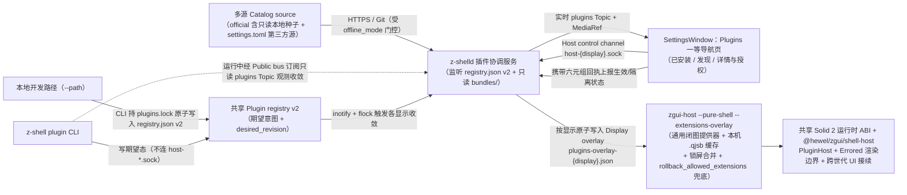
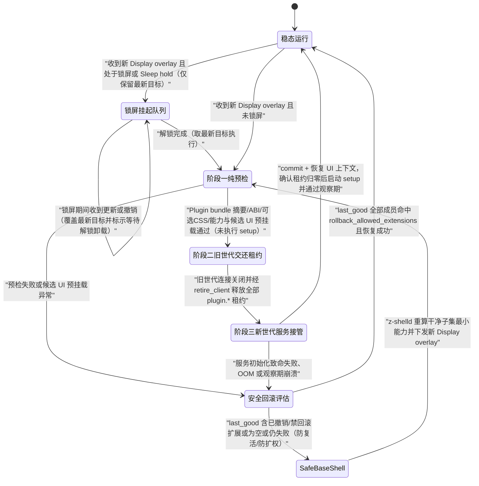
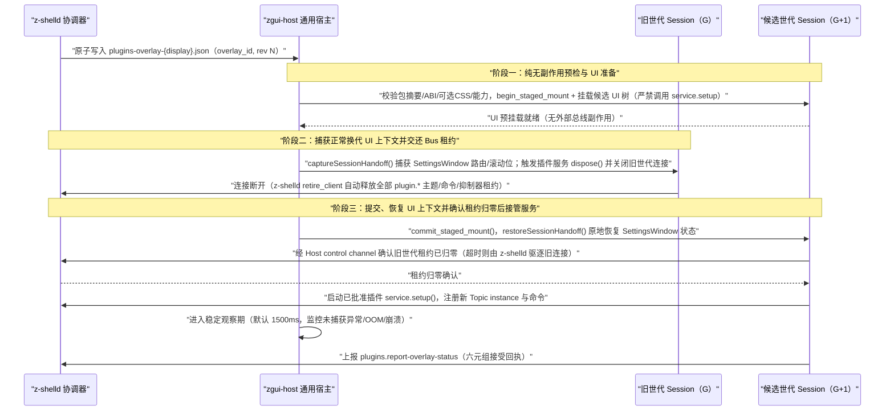

# z-shell 插件生态准备与内置插件商店架构方案

> **关联决策与权威基线**：
> - 架构决策草案：[ADR-0007：运行时动态插件加载、显式全权信任边界与去中心化插件商店架构](adr/0007-runtime-plugin-loading-and-store-architecture.md)（显式重开 [ADR-0005](adr/0005-toml-config-state-split-and-plugin-manifest.md) 的静态合成部分，完整保留其三层 TOML 状态分离、`plugin.toml` 单一事实源、`PluginId → EntryId → InstanceId` 作用域与 `sessionLock` 硬禁令；并严格保持 [ADR-0001](adr/0001-single-rust-daemon-and-ndjson-bus.md) 与 [ADR-0004](adr/0004-cross-process-lock-and-idle-coordination.md) 对 **Host control channel** 仅限原生宿主独占的通道边界）
> - 既有契约与规范：[plugin-manifest-v1.md](plugin-manifest-v1.md)、[GLOSSARY.md](../GLOSSARY.md)（已同步新增 **Plugin bundle**、**Plugin registry**、**Catalog source**、**Display overlay**、**Safe base shell** 等正交词条）、[DESIGN.md](../DESIGN.md)、[CODING_STANDARDS.md](../CODING_STANDARDS.md)
> - 交付范围声明：本文档与 ADR-0007 构成跨仓落地的完整设计蓝图与分阶段路线图，不在此阶段修改业务源码、测试或既有 `plugin-manifest-v1.md` / `SCOPE.md`；代码实现与配套规范修订统一按 Phase 0–Phase 5 协同落地。

---

## 1. 两仓现状审计与真实缺口盘点

在制定方案前，我们对 `z-shell` 与同级宿主仓库 `../zgui-js` 的真实源码进行了逐项核查。现有系统已经打下良好基础（`plugin.toml` 静态校验、SHA-256 内容摘要、`flock` 原子注册表、双套接字 **Bus** 架构、4 个第一方参考插件以及 `SettingsWindow` 820×600 M3 框架），但距离“无 Bun 发行版终端可直接通过内置商店安全安装、审批、热生效与卸载第三方插件”仍存在 **12 处结构性缺口**，汇总如下：

| 维度 | 仓别与精确源码位置 | 现状事实 | 面向插件生态与商店的真实缺口 |
|---|---|---|---|
| **锁屏热重载安全** | `../zgui-js/crates/zgui-host/src/session_host/surfaces.rs:70–114` | `mount_shell` 在 `lock_state.is_retained()` 或 `has_active_lock()` 时仅跳过 `capture_dev_state`，仍会继续执行换代与旧世代退役 | 锁屏期间触发插件变更会冲击活跃的 `ext_session_lock_v1` 会话，缺少挂起合并队列与解锁后按最新目标生效机制 |
| **候选挂载副作用** | `../zgui-js/crates/zgui-host/src/session.rs:907–918` | `begin_staged_mount` / `commit_staged_mount` 仅延迟出站网络（`work.begin_staged_network`）与 compute workers（`work.begin_staged_workers`） | 无法自动撤销或延迟候选世代通过 **Bus** 建立的 `plugin.*` 主题/命令注册与抑制器租约，新旧世代并行启动 `service.setup()` 会导致资源名冲突与租约竞态 |
| **动态模块加载限制** | `../zgui-js/packages/build/src/validate.ts:763–776` | `ImportExpression` 强制动态 `import()` 必须使用静态字符串字面量，且打包后要求命中闭图 chunk 边 | 业务侧无法直接 `import(dynamicEntryPath)`；若贸然放宽普通 `import()` 又会破坏整包静态可审计性，需要由宿主通过基础壳独占子路径提供受控的 `entryId` 加载原语 |
| **模块解析器闭图** | `../zgui-js/crates/zgui-host/src/package.rs:809–833` | `resolve_sealed_import` 仅接受 `./` 与 `../` 相对导入，明确拒绝非相对裸标识符（bare specifiers） | 独立预构建的第三方插件 `.mjs` 无法将 `solid-js`、`@hewel/zgui/*`、`@z-shell/sdk/*` 等共享运行时解析到宿主内建模块表 |
| **字节码编译与安全** | `../zgui-js/crates/js-runtime/src/lib.rs:348–390, 416–431` | `CompileDirLoader` 从磁盘路径直接重读文件编译；`load_verified_bytecode_module` 调用 `unsafe { Module::load(ctx, bytes) }` | 存在编译期 TOCTOU 风险（校验与编译未共用内存字节），且缺乏面向本机动态插件的四要素 `.qjsb` 缓存键与损坏自动回退机制 |
| **宿主能力契约漂移** | `../zgui-js/crates/zgui-host/src/package.rs:135–182, 228–238` 与 `../zgui-js/schemas/package.schema.json:45–68` | `package.rs` 已支持 `clipboard`/`sqlite`/`files`/`network`，但 `package.schema.json` 仍缺失这 4 项；且 `NetworkCapabilities` 用整包全局布尔控制 `allow_insecure_http` / `allow_private_networks` | 1）schema 与 Rust 宿主漂移，构建校验会拒绝合法能力；2）跨插件合并若直接对布尔取“或”，会让单个插件的私网/明文 HTTP 权限污染所有其他来源；3）`theme-bridges` 的文件操作与 `ai-usage` 的 HTTP 拉取因缺宿主能力对齐而尚未闭环 |
| **渲染错误边界与样式现状** | `../zgui-js/packages/ui/src/index.ts:17`、`apps/shell/dist/manifest.json:42–46`、`apps/shell/package.json:31,35` | Solid 2 UI 包真实导出的是 `Errored`（来自 `#solid`）；壳体实际已启用 `lightningcss-v1`，但 `apps/shell/package.json` 仍残留零引用的 `@stylexjs/stylex` / `styleq`；4 个现网插件均无 `.css` 文件 | 壳内 `PluginHost` 尚未为每个插件 UI 实例包裹 `<Errored>`（且 `services.ts` 未接入错误回调）；插件样式契约须以可选 Lightning CSS Modules 为准并清理壳体残留旧依赖 |
| **多显示状态与守护端缺口** | `crates/z-shell-config/src/paths.rs:70–78, 173–187`、`crates/z-shelld/src/lib.rs:110–116, 350–386` | `bus-<display>.sock` 与 `host-<display>.sock` 按 `WAYLAND_DISPLAY` 隔离，但 `registry.json` 全局共享；`z-shelld` 仅启动时发一次 `plugins` `SourceBaseline` 并仅开放只读 `plugins.list` / `plugins.audit` | 尚未分离“跨显示共享期望态（**Plugin registry**）”与“按显示 **Display overlay** / 运行观测态”，缺少 `inotify` 监听收敛、按显示故障隔离与商店提交命令 |
| **v1 注册表与合成耦合** | `crates/z-shell-plugins/src/registry.rs:145–170, 257–282` 与 `packages/composer/src/compose.ts:163–175` | v1 注册表缺卸载操作、`sync` 仅在能力扩张时禁用而不校验代码摘要变更、无来源防接管；`compose.ts` 硬编码 `schema_version === 1` 且要求本地 Bun 重打包整壳 | 发行版无 Bun 环境不可用；v1 若直接升为 v2 会造成历史批准静默升级为全权信任；缺少写入端平滑退场方案 |
| **离线早退与多源缺口** | `crates/z-shell-plugins/src/git.rs:79–97` | `OfflinePolicy::Offline` 在 `git::prepare` 入口直接早退返回 `GitError::Offline`；仅支持仓库根目录 `plugin.toml` | 离线状态下无法命中本地已核验只读 **Plugin bundle**；不支持多源静态目录、HTTPS 压缩归档或 Git monorepo `subdir` 钉死 |
| **总线同 UID 安全边界** | `crates/z-shell-bus/src/server.rs:148–200` | `BusServer` 对 `bus-<display>.sock` 与 `host-<display>.sock` 均通过 `SO_PEERCRED` 校验同 UID | 任何同 UID 进程都具备连接特权通道的 OS 权限，且在维持 `host-<display>.sock` 仅限 `zgui-host` 独占前提下，必须诚实界定安全边界：壳内插件为显式全权信任 |
| **扩展点与商店 UI 缺口** | `apps/shell/src/plugins/PluginHost.tsx`、`apps/shell/src/plugins/services.ts`、`apps/shell/src/surfaces/StatusBar.tsx:763`、`apps/shell/src/store.ts:90–96, 335–350` | `PluginHost` 静态读取 `composed.ts`，仅接通 `service`/`layer`/`settings_page`/`widget`/`panel`，缺失 `shortcut` 与 `launcher_provider` 前端接线；`StatusBar` 仅单槽位列表；`SettingsWindow` 尚无一等 `Plugins` 管理与商店页 | 无法承载完整插件扩展点与 Bar 左/中/右三段编排；用户无法在桌面壳内完成浏览、搜索、审查、授权、更新与卸载闭环 |

---

## 2. 运行时动态加载与通用 `zgui-js` 跨仓扩展契约

### 2.1 总体架构与按显示会话生效链路

新架构以 **“预构建静态分发产物 + 通用宿主校验受控动态加载 + 本机内存同图 `.qjsb` 缓存 + 按显示会话隔离生效”** 为核心，彻底解耦终端用户环境与 Bun/源码仓。其中 `zgui-host` 保持为**与 `z-shell` 领域解耦的通用运行时扩展宿主**，`z-shell` 独占 `daemon_instance_id`、`desired_revision`、撤销策略、干净子集重算与六元组状态回执。



### 2.2 插件预构建分发产物布局

插件作者在发布阶段（使用第 9 章定义的 `@z-shell/plugin-cli build`）将 TSX/TS 源码与可选 `*.module.css` 预构建为自包含、确定性的静态 **Plugin bundle**，目录布局如下：

```text
<plugin-root>/
├── plugin.toml                 # 单一事实源清单（声明元数据、能力、配置 schema 与各入口）
├── dist/
│   ├── manifest.build.json     # 构建产物索引：列出全部 .mjs / 可选 .css / .map / assets 相对路径与 SHA-256 摘要、shared_runtime_abi
│   ├── entries/
│   │   ├── service.mjs         # ES2022 预构建模块（外置共享运行时）
│   │   ├── widget.mjs
│   │   └── settings-page.mjs
│   ├── chunks/                 # 插件内部代码分割共享 chunk（仅允许相对导入）
│   ├── styles/                 # 可选：仅当插件使用 *.module.css 时生成（纯行内样式 + primitives 插件无此目录）
│   │   └── plugin.css          # 预编译 Lightning CSS（由构建器自动哈希作用域化）
│   └── maps/                   # 可选 .mjs.map SourceMap（用于诊断还原）
└── assets/                     # 可选静态图标、截图（供本地或目录索引引用）
```

关键约束：
1. **禁止远端 `.qjsb`**：`dist/` 目录及 `manifest.build.json` 中严禁包含任何 `.qjsb` 字节码文件；`z-shelld` 校验导入包时若发现 `.qjsb` 后缀文件直接拒绝导入。
2. **闭图一致性**：`plugin.toml` 中每个壳内入口声明的 `bundle`（如 `dist/entries/widget.mjs`）及其可选样式表 `styles` 必须全部在 `manifest.build.json` 中登记并匹配 **Plugin bundle** 内容摘要；严禁引用包根目录外的路径或逃逸符号链接。
3. **无 Bun 终端运行**：`z-shelld`、`z-shell` 与 `zgui-host` 均为纯 Rust 原生二进制，安装、校验、加载、缓存 `.qjsb`、切换世代与卸载全程零 Bun、零 Node 依赖。

### 2.3 通用 `zgui-js` 边界、受控加载入口与复合闭图 `CompositeVerifiedModuleProvider`

为了在不削弱 `../zgui-js/packages/build/src/validate.ts:763–776` 对普通动态 `import()` 必须使用静态字符串字面量约束、同时不把 `z-shell` 领域语义渗入通用 `zgui-js` 的前提下实现运行时插件加载，两仓建立如下通用接口契约：

1. **基础壳独占子路径 `@hewel/zgui/shell-host` 与受控加载原语**：
   - `zgui-host` 在启用通用扩展叠加模式（`--extensions-overlay <path>`）时，向 JS 运行时桥接层注册原生只读扩展能力接口；`loadApprovedPluginEntry<T>(entryId: string): Promise<T>`、`listApprovedPluginEntries(): readonly ApprovedExtensionEntryMeta[]` 与 `SessionLockSurface` 统一收口于仅基础壳可导入的内部子路径 **`@hewel/zgui/shell-host`**。
   - 调用方（`apps/shell/src/plugins/PluginHost.tsx`）仅可传入宿主当前世代已核验批准的规范 `EntryId`（`<author>/<plugin>:<entry>`）。若传入任意文件路径、URL 或未在当前世代 **Display overlay** 清单中的 `entryId`，原生宿主直接同步拒绝并抛出明确错误。
   - `@hewel/zgui/shell-host` 明确排除在插件共享运行时白名单之外，`@z-shell/plugin-cli validate`、官方目录 CI 与宿主 `CompositeVerifiedModuleProvider` 三层共同禁止第三方插件导入该子路径（诚实定位于防误用护栏，见第 3.1 节）。
   - `validate.ts:763–776` 对普通 `import(...)` 表达式的静态字面量与闭图边检查**完全保持原样，不做任何放宽**。
2. **通用复合闭图模块提供器（`CompositeVerifiedModuleProvider`）**：
   - 扩展 `../zgui-js/crates/js-runtime/src/lib.rs:442–447` 的 `VerifiedModuleProvider`，在 `zgui-host` 中实现通用三层路由（不包含 `z-shell` 专属业务术语）：
     - **共享运行时层（Bare Specifier 白名单）**：当扩展模块或基础壳模块导入共享运行时表中的精确裸标识符时，解析为宿主内置已注册的唯一共享模块实例（`registry.shell_host` 仅对基础壳入口开放），确保整个 QuickJS Context 内只存在一份 Solid 2 响应式图、一个 `UiBridge` 和一套 `@z-shell/sdk/primitives` 状态层。
     - **基础壳体闭图层**：壳体自身模块的相对导入（`./`、`../`）继续严格按基础壳 `manifest.json` 的 `artifactDigests` 校验。
     - **扩展只读闭图层**：位于通用虚拟命名空间 `zgui-ext://<ext_id>/<rel_path>` 下的扩展模块，其相对导入仅允许解析到同一扩展只读目录内且在 `build_manifest`（如 `dist/manifest.build.json`）中登记并校验通过的 `.mjs` 文件；禁止跨扩展直接相对导入，也禁止回溯读取宿主文件系统或工作目录。
3. **跨世代内存 UI 状态接续钩子**：
   - 为避免用户在商店启停插件触发换代时 `SettingsWindow` 闪烁消失或丢失当前页面状态，`zgui-host` 提供通用的内存态接续接口（暴露于 `@hewel/zgui/shell-host`）：`registerSessionHandoff(capture: () => JsonValue | null)` 与 `takeSessionHandoff(): JsonValue | null`。
   - 仅在正常世代切换（`G → G+1`）时在 Rust 宿主内存中传递有界大小（如 `<= 64 KiB`）的 JSON 状态（绝不写入磁盘），在候选崩溃或回滚至 **Safe base shell** 时自动清空丢弃。

### 2.4 完整共享 Solid 2 运行时 ABI 表与双正交版本门禁

壳体与全部壳内插件共享如下 **10 个受控裸模块标识符**（插件构建时将其标记为 `external`，由宿主在运行期提供唯一单例）：

| 共享模块标识符 | 职责与核心导出 | 是否纳入插件共享表 |
|---|---|---|
| `solid-js` | Solid 2 核心响应式原语（`createSignal`、`createMemo`、`createEffect`、`createStore` 等） | 是 |
| `@hewel/zgui` | 原生组件、表面原语与错误边界（`Errored`、`Show`、`For`、`Button`、`LayerSurface`、`PopupSurface`、`WindowSurface`、`mountStylesheet` 等；不含锁屏与动态加载特权入口） | 是 |
| `@hewel/zgui/renderer` | Solid 2 自定义渲染器指令（JSX 编译产物依赖的 `template`、`insert`、`createComponent`、`setProperty` 等低层指令） | 是 |
| `@hewel/zgui/primitives` | 无样式交互原语（`createVirtualFocus`、`MenuRootPrimitive`、`MenuListPrimitive`、`MenuItemPrimitive` 等） | 是 |
| `@hewel/zgui/jsx-runtime` | 自动 JSX 运行时入口（`jsx`、`jsxs`、`Fragment`） | 是 |
| `@hewel/zgui-services` | 宿主原生服务绑定（受当前世代合并能力约束的 UDS、命令、网络、文件、剪贴板、SQLite 客户端） | 是 |
| `@z-shell/sdk` | `z-shell` 总线客户端与协议类型（`ZShellClient`、主题订阅、命令调用、抑制器租约封装） | 是 |
| `@z-shell/sdk/zgui` | 面向 `zgui-js` 的壳体集成 Hooks（`useDaemonMedia`、`PluginSettingsProps` 等） | 是 |
| `@z-shell/sdk/primitives` | `z-shell` 统一 M3 桌面组件库（`M3Button`、`M3Switch`、`M3Slider`、`M3SegmentedControl`、`M3FilterChip`、`M3Dialog` 等） | 是 |
| `@z-shell/plugin-api` | 插件定义辅助与类型契约（`definePlugin`、`createPluginContext`、`PLUGIN_API_LEVEL` 等） | 是 |
| `@hewel/zgui/shell-host` | `SessionLockSurface`、`loadApprovedPluginEntry`、`listApprovedPluginEntries`、`registerSessionHandoff`、`takeSessionHandoff` | **否（仅基础壳可导入，防误用护栏）** |
| `@z-shell/sdk/bun` | 基于 Bun 专属 Socket/子进程 API 的传输层（供外部测试/工具使用） | **否（显式禁止壳内插件导入，构建校验与宿主解析双层拒绝）** |

**双正交版本兼容性契约**（避免单点版本更新导致生态大面积失效与多门禁重叠）：
- **`plugin_api`（`plugin.toml`，累加整数）**：约束 `plugin.toml` 清单与 `@z-shell/plugin-api` 领域契约（`1` = 旧静态合成形态，`2` = 运行时预构建形态），预检判定 **`plugin_api <= shell_max_plugin_api`**。
- **`shared_runtime_abi`（`dist/manifest.build.json`，`"<major>.<minor>"` 字符串）**：约束外置 10 项共享运行时模块 ABI（首期为 `"1.0"`），采用向上兼容语义判定 **`host.major == plugin.major && host.minor >= plugin.minor`**，确保基础壳与 `@z-shell/sdk/primitives` 新增非破坏性组件或小版本演进时旧已构建插件无需重打包即可持续工作；仅破坏性 ABI 变更才递增 `major`。
- **`min_shell_version`（可选字符串）**：仅作为商店详情页展示信息与提示文案，**不再作为第三道硬性阻塞门禁**。

### 2.5 内存同图 `.qjsb` 本机按需编译缓存

针对 `../zgui-js/crates/js-runtime/src/lib.rs:348–390, 416–431` 的现状缺口，设计“内存同图编译 + 四要素缓存键 + 故障安全回退”机制：

1. **消除编译期磁盘 TOCTOU**：在 `js-runtime` 新增 `compile_verified_module_bytecode(canonical_name: &str, provider: &dyn VerifiedModuleProvider) -> Result<Vec<u8>, Diagnostic>`。编译期 `Resolver` / `Loader` 直接从同一份已在内存中通过 SHA-256 核验的模块图读取字节，不再回退 `std::fs::read_to_string` 读盘。
2. **通用缓存目录参数与四要素确定性缓存键**：`zgui-host` 通过通用 CLI 参数 `--bytecode-cache-dir <dir>` 接收本机缓存目录（`z-shell` 传入 `$XDG_CACHE_HOME/z-shell/plugin-bytecode/`，权限 `0700`），每条缓存由四要素联合哈希定位：
   ```text
   cache_key = sha256(
     quickjs_abi_tag            || "\0" ||
     canonical_module_name      || "\0" ||
     module_sha256              || "\0" ||
     resolved_import_graph_digest
   )
   ```
   其中 `resolved_import_graph_digest` 对当前模块在闭图内全部静态导入边的 `(specifier, target_canonical_name, target_module_sha256)` 排序摘要，保证任何上游内部 chunk 变动都会令缓存自动失效。
3. **带完整性头部的原子缓存文件**：每个缓存文件包含固定头（魔数 `ZSQB` + 格式版本 + `quickjs_abi_tag` + `cache_key` + payload 长度 + payload SHA-256）与 QuickJS 字节码主体，通过同目录 `0600` 唯一临时文件 + `fsync` + `rename` 原子落盘，并配置总容量上限（默认 `64 MiB`）与按 `atime`/`mtime` LRU 淘汰。
4. **Fail-Safe 回退源码编译**：读取缓存时若出现文件缺失、权限不符（非当前 UID 拥有或允许组/其他写）、头部魔数/`quickjs_abi_tag`/`cache_key` 不匹配或 payload SHA-256 校验失败，**立即删除该坏缓存文件并透明回退至源码编译**，绝不将未通过校验的字节送入 `unsafe { Module::load }`。

### 2.6 可选 Lightning CSS 样式契约、挂载与卸载

- **`.css` 为可选产物**：遵循现有 4 个第一方插件的实践，完全使用行内 `style={{ ... }}` 与 `@z-shell/sdk/primitives` 的插件无需附带任何 `.css` 文件。
- **自动作用域哈希（不要求作者手写前缀）**：当插件使用 `*.module.css` 时，`@z-shell/plugin-cli build` 调用 Lightning CSS 编译并自动生成包含插件唯一哈希的作用域类名（输出至 `dist/styles/*.css`），构建校验器静态要求：
  - 仅允许引用受支持的语义 Token（`var(--color-*)`、`var(--font-*)`、`var(--shadow-level-*)` 等）；
  - **静态拒绝** `:root`、裸全局元素/标签选择器以及壳体保留前缀 `.zshell-*`，避免污染壳体主题和基础表面样式。
- `zgui-host` 在阶段一预检时基于同一 **Plugin bundle** 校验通过的字节加载并解析可选插件 CSS，生成世代级样式句柄；当插件停用或世代退役时，对应样式表随旧世代清理回调确定性卸载，不留样式残留。同步在 Phase 3 清理 `apps/shell/package.json:31,35` 中已零引用的 `@stylexjs/stylex` 与 `styleq` 历史依赖。

---

## 3. 诚实安全模型、通道独占与无损能力合并

### 3.1 壳内 UI 与同上下文服务：显式全权信任模型

经核查 `apps/shell/package.json:12–26` 与 `crates/z-shell-bus/src/server.rs:148–200`，壳体自身运行在单一 QuickJS Context 中，同时持有 `sessionLock` 与 **Host control channel**（`host-<display>.sock`）。在单一 JS 上下文内，任何已加载的 ESM 模块均可通过共享运行时对象或协议连接触及同上下文资源，**单 QuickJS Context 与文件 `0600` 权限均不构成针对恶意代码的沙箱**。

因此，方案确立**诚实的显式全权信任模型**（对标 GNOME Shell 扩展与 VS Code 扩展）：

1. **授权透明度契约**：内置商店的授权确认弹窗与 CLI `approve` 提示**必须明确告知用户**：“启用此第三方插件后，其壳内代码将与 `z-shell` 桌面壳共享同一运行上下文与信任级别（包含宿主控制通道权限）。请仅安装并启用来自可信来源的插件。”绝不在 UI 或文档中暗示“进程内沙箱”或“能力列表可阻止恶意 JS 绕过”。
2. **`plugin.toml` 能力清单、`sessionLock` 硬禁令与 `@hewel/zgui/shell-host` 的真实价值**：
   - **最小必要宿主能力开放**：壳体默认不持有 `network`、`files`、`sqlite`、`commands` 等额外宿主权限；仅当用户显式审批某插件的对应声明后，宿主才按需开放对应系统调用面，降低意外泄露面与供应链误用风险。
   - **声明式审计与升级护栏**：每次升级均可静态比对能力 Diff，让用户直观发现“一个简单状态栏插件突然新增外网或命令执行声明”等异常信号。
   - **API 层防误用护栏**：`plugin.toml` 的 `[host_capabilities]` 继续 `deny_unknown_fields` 并永久拒绝 `session_lock`；同时 `SessionLockSurface`、`loadApprovedPluginEntry` 与 `listApprovedPluginEntries` 全部隔离在基础壳独占的 `@hewel/zgui/shell-host` 中，在构建期、目录 CI 与宿主解析期拦截插件误导入（同时诚实说明这只是防误用护栏，而非对抗恶意代码的沙箱）。
3. **`<Errored>` 渲染错误边界的诚实边界**：
   - `PluginHost` 必须使用 `@hewel/zgui` 真实导出的 `<Errored>`（而非未导出的其他错误边界符号）包裹每个插件的 `widget`、`panel`、`settings_page`、`shortcut` 与 `layer` 实例，并在降级回退视图中展示该插件的故障徽章、错误摘要与“打开插件管理 / 禁用”入口。
   - 同时必须明确声明 `<Errored>` 的技术边界：它能隔离同步/响应式渲染期 JS 异常，**但无法隔离共享的 64 MiB QuickJS 堆耗尽（OOM）、主线程死循环或底层原生崩溃**。此类致命故障由第 4 章的世代观察期监督与 **Safe base shell** 兜底回滚状态机处置。

### 3.2 通道独占边界与未来演进范围（首期暂缓 `external_process` 二进制）

1. **严格保持 `host-<display>.sock` 仅限 `zgui-host` 独占**：
   - 延续 [ADR-0001](adr/0001-single-rust-daemon-and-ndjson-bus.md) 与 [ADR-0004](adr/0004-cross-process-lock-and-idle-coordination.md)，**Host control channel**（`host-<display>.sock`）仅面向受信的 `zgui-js` 原生宿主开放（承载锁屏 ACK、PAM 解锁、Polkit 及 `SettingsWindow` 内置商店的交互式操作与叠加态回执）。
   - `z-shell plugin` CLI **绝不连接 `host-<display>.sock`**（`crates/z-shell-cli/src/main.rs:262–268` 保持拒绝 `--host`）。所有 CLI 生命周期变更统一持 `plugins.lock` `flock` 原子更新共享 **Plugin registry**（`registry.json` v2），由运行中的 `z-shelld` 自动监听收敛（CLI 可通过 **Public bus channel** 订阅只读 `plugins` **Topic** 观察收敛进度）。
2. **首期暂缓 `external_process` 打包二进制与 OS 沙箱（远期演进方向）**：
   - 若在 Store v1 引入插件自带的 `external_process` 原生可执行文件（如 `bin/...`），一方面会迫使 `catalog-v1.json` 膨胀为多架构/libc 分发矩阵（违背首期“纯静态、跨架构一次预构建”的高效交付目标），另一方面在 `z-shell-bus`（`SO_PEERCRED`）尚未配合 OS 级挂载命名空间隔离前，同 UID 外部进程仍能直接接触 `host-<display>.sock`。
   - 因此，**Store v1 聚焦纯预构建 ES2022 `.mjs` + 可选 Lightning CSS 的 `in_session` 入口**。`z-shell/theme-bridges` 服务继续以 `in_session` 运行，通过 Phase 0 对齐后的 `zgui-js` `files`（读写 `zen_chrome_dir` 下的 `userChrome.css` 与恢复记录）及 `unix_sockets`（连接 `shojiwm`）能力完整闭环。
   - **远期演进路线（另行以独立 ADR 立项）**：当未来出现必须隔离 64 MiB QuickJS 堆或运行独立原生后台守护的生态需求时，再统一引入多架构目录产物矩阵、`z-shelld` 进程组监督器以及基于 `bwrap` / Linux user+mount namespace 屏蔽 `host-<display>.sock` 与敏感目录的 OS 沙箱。

### 3.3 `zgui-js` 契约先行对齐与逐来源无损能力合并

针对第 1 章发现的能力漂移与布尔污染缺陷，制定以下刚性规范：

1. **先对齐 `package.rs` 与 `package.schema.json`（Phase 0 阻塞项）**：
   - 在向第三方插件开放 `clipboard`、`sqlite`、`files`、`network` 四类能力之前，必须在 `../zgui-js/schemas/package.schema.json:45–68` 中补齐这四项的完整 JSON Schema 定义，使其与 `../zgui-js/crates/zgui-host/src/package.rs:228–238` 的结构体与校验规则完全一致，并增加跨语言 Schema 回归测试。
2. **废弃简单布尔“或”合并，改用逐来源网络策略（或无损冲突拒绝）**：
   - 现有 `package.rs:135–182` 将 `allow_insecure_http` 与 `allow_private_networks` 设为整个 `NetworkCapabilities` 的全局开关。如果插件 A 请求 `https://api.example.com`（严格公网 HTTPS），插件 B 请求 `http://127.0.0.1:8080`（需私网 + 明文 HTTP），简单布尔“或”合并会令整个壳体对 `api.example.com` 及其重定向链也放宽私网/明文约束，造成隐式权限扩散。
   - **目标模型（`zgui-js` Phase 1 扩展）**：在 `NetworkCapabilities` 中引入逐来源规则列表 `originRules: [{ origin, allowInsecureHttp, allowPrivateNetworks }]`（保持向后兼容，旧全局字段仅在显式配置时生效且不再用于跨插件合并），由 `OriginPolicy` 按精确 `origin` 独立判定私网与明文权限，实现多插件能力合并的**严格无损性**。
   - **过渡期无损护栏**：在逐来源规则尚未合入 `zgui-js` 主分支前的任何中间里程碑，若两个同时启用的插件在 `allow_insecure_http` / `allow_private_networks` 上存在布尔冲突，合并器必须**直接拒绝冲突合并并向用户报错提示冲突插件**，严禁静默以布尔“或”放宽权限。
3. **计算并展示“壳体净新增宿主权限”**：
   - 在授权弹窗与 CLI `audit` 报告中，除列出该插件自身声明的 `[host_capabilities]` 与 `[bus_permissions]` 外，还必须基于“当前已启用插件 + 基础壳的有效宿主能力集合”计算并高亮展示 **`net_added_shell_capabilities`（本次启用将为整个 `z-shell` 进程净新增的宿主能力）**，例如标明“壳体将首次获得访问 `https://api.open-meteo.com` 的出站网络权限”或“壳体将首次获得执行本地命令 `ai-usagebar` 的权限”，帮助用户直观评估真实风险增量。

---

## 4. 多显示状态分离、三阶段无缝换代与安全回滚状态机

### 4.1 全局期望态与按显示运行态分离

一台机器可能同时运行多个 Wayland 会话（如 `wayland-0` 主桌面与 `wayland-1` 嵌套预览/双会话）。因此必须严格拆解两层状态：

1. **跨显示共享期望态（**Plugin registry**，Durable Desired State）**：
   - 存储位置：`$XDG_STATE_HOME/z-shell/plugins/registry.json`（schema v2），受 `$XDG_STATE_HOME/z-shell/plugins/plugins.lock` 跨显示 `flock` 保护，采用 `0600` 唯一临时文件 + `fsync` + `rename` + 父目录 `fsync` 原子写入。
   - 核心字段：全局单调递增整数 `desired_revision`、已安装插件集合（不可变 **Plugin bundle** 路径、来源身份、审批绑定记录、用户期望 `enabled`/`revoked` 标志）。**绝不将任何显示会话的运行观测结果（如 `accepted_build_id`、锁屏挂起状态、单显示故障回滚或 `quarantine` 隔离记录）回写污染共享注册表**。
2. **按显示会话运行态（**Display overlay**、**Live state** 与按显示崩溃守卫）**：
   - 叠加文件（**Display overlay**）：`$XDG_RUNTIME_DIR/z-shell/plugins-overlay-<display>.json`（`0600` 原子替换），由对应该 `WAYLAND_DISPLAY` 的 `z-shelld` 实例通过 `inotify` + `flock` 监听 `registry.json` 变更后独占计算并写入，仅供同一显示的 `zgui-host` 读取监听。
   - 按显示观测态与隔离记录：保存在对应 `z-shelld` 实例内存 **Live state** 中（可选配合 `$XDG_STATE_HOME/z-shell/plugins/runtime-<display>.json` 持久化当前显示的崩溃循环守卫，按 `(plugin_id, content_digest)` 或候选组合键记录，绝不写入共享 `registry.json`），记录当前显示的 `applied_desired_revision`、当前生效的 `overlay_id` / `ui_generation`、每个插件的实际生效状态（`active` / `disabled` / `revoked` / `pending_unlock_unload` / `host_unloaded` / `quarantined` / `pending_apply`）与最近诊断错误，通过 `plugins` **Topic** 实时广播给该显示的 UI 与 CLI。
3. **六元组回执核对与迟到回执拒收**：
   - 每当 `zgui-host` 完成一次候选叠加挂载或安全降级后，壳体 `PluginHost` 经 **Host control channel** 上报 `plugins.report-overlay-status`（结合 `zgui-host` 提供的通用 `overlay_id` / `ui_generation` 状态与叠加文件透传的 `z-shell` 元数据），必须携带完整六元组：
     ```json
     {
       "display": "wayland-0",
       "daemon_instance_id": "dinst_01J...",
       "shell_build_id": "sha256:...",
       "ui_generation": 14,
       "desired_revision": 42,
       "overlay_id": "ovl_01J..."
     }
     ```
   - `z-shelld` 校验：`display` 与当前实例一致、`daemon_instance_id` 等于自身当前 **Daemon instance**、`shell_build_id` 匹配基础壳、且 `(ui_generation, desired_revision)` 不倒退于已接受水位。任何旧世代、旧 **Daemon instance** 或已过期的迟到回执一律记录警告并静默拒收，防止状态倒流。

### 4.2 撤销三态与锁屏期挂起合并规则

为了诚实反映“用户已点击撤销，但当前正处于锁屏界面”的时间窗口，系统严格区分三个状态，在总线 `plugins` **Topic** 与 UI 中清晰表达：

| 状态标识 | 语义定义 | 对新世代/回滚的约束 |
|---|---|---|
| `revoked` | 期望态中已撤销该插件审批（`approved = null, revoked = true, enabled = false`） | 任何时候不得启用，且**永久禁止**在故障回滚中被复活；不包含在 **Display overlay** 的 `rollback_allowed_extensions` 白名单中 |
| `pending_unlock_unload` | 撤销或停用发生在锁屏期间（`ext_session_lock_v1` 活跃或持有 **Sleep hold**）；期望态已持久化且新 **Display overlay** 已排入待处理队列，但为保障锁屏表面不断裂，壳内旧世代将在解锁后第一时间卸载 | 锁屏期间不中断锁屏表面；解锁后立即应用不含该插件的最新目标并迁移至 `host_unloaded` |
| `host_unloaded` | 宿主已完成新一轮世代切换并回报匹配六元组的接受回执，确认该插件已从当前显示会话的 QuickJS 上下文中彻底卸载 | 生命周期收敛终态；若用户后续重新审批并启用，须从头走完整审批与加载链路 |

**锁屏期合并规则**：
- 当 `zgui-host` 处于锁屏状态（`platform_lock_state(cx)` 有效或 `shell_windows.has_active_lock()` 为真，或 `z-shelld` 处于 **Sleep hold**）时，任何由 `plugins-overlay-<display>.json` 变更触发的热重载请求都不得立即调用 `mount_shell` 替换当前世代；
- 宿主仅维护一个**单槽位最新目标队列（Coalescing Pending Slot）**：锁屏期间连续收到 `desired_revision = 41, 42, 43` 时，仅覆盖保留最新的 `43`；
- 收到解锁完成信号（锁屏表面安全释放）后，宿主直接对最新的 `43` 启动三阶段世代交接，跳过中间所有过时版本。

### 4.3 锁屏延迟、三阶段无缝换代与安全回滚状态机



### 4.4 三阶段无竞态世代交接时序（含 UI 状态接续）

由于 `../zgui-js/crates/zgui-host/src/session.rs:907–918` 仅延迟出站网络与 compute workers，若候选世代在 `mount()` 期间即执行插件 `service.setup()`，新旧两个世代会同时向 `z-shelld` 注册相同的 `plugin.<author>.<plugin>.*` 主题、**Control command** 或抑制器，造成 `AlreadyRegistered` 错误或租约误释放。同时为保障用户操作 `SettingsWindow` 启停插件时界面不突然丢失，三阶段交接配合内存 UI 状态接续如下：



### 4.5 `rollback_allowed_extensions` 防复活回滚与按显示隔离策略

1. **通用 `rollback_allowed_extensions` 防复活与权限收窄不变量（核心安全不变量）**：
   - `zgui-host` 保持对 `z-shell` 撤销业务无感知，仅在内存中记录最近一次通过观察期的通用叠加状态 `last_good`，并要求每个 **Display overlay** 显式携带白名单 **`rollback_allowed_extensions`**（由 `z-shelld` 根据当前期望态中“已批准且未撤销插件 ID”计算）。
   - 一旦当前候选世代在阶段一或阶段三失败，进入“安全回滚评估”时，`zgui-host` 核对 `last_good` 中的所有扩展是否**全部**包含于当前 **Display overlay** 的 `rollback_allowed_extensions`：
     - 若全部包含：直接安全回滚至 `last_good`（既无已撤销代码，也不会超出当前期望宿主权限）；
     - **只要 `last_good` 包含任意不在 `rollback_allowed_extensions` 中的扩展（例如用户刚刚撤销了插件 A，并同时启用有缺陷的插件 B）：`zgui-host` 严禁恢复 `last_good`**——这同时杜绝了“代码复活”与“已撤销插件曾并入的旧 `effective_host_capabilities` 权限泄露”，立即丢弃 `captureSessionHandoff` 上下文并无条件降级至无第三方插件的 **Safe base shell**，同时向 `z-shelld` 上报失败（锁屏、电源菜单、系统设置与插件商店管理页在 **Safe base shell** 中永远可用）。
   - `z-shelld` 收到失败回执并标记故障隔离后，重新从当前**已批准、未撤销且未隔离**集合计算干净子集与最小 `effective_host_capabilities` 并集，生成新 `overlay_id` 推送新 **Display overlay** 自动收敛至干净稳定态。
2. **故障归因与按显示候选组合隔离（Candidate Batch Quarantine）**：
   - **单插件变更失败（可唯一归因）**：若本次 `desired_revision` 相比前一稳定态仅新增启用或更新了单个插件 `P`，且预检/观察期失败，系统仅在**当前显示的运行态（Live state + 可选 `runtime-<display>.json`）**中将 `(P, content_digest)` 标记为 `quarantined`（附带精确阶段、错误栈或 OOM/崩溃原因），绝不回写污染共享 `registry.json`。
   - **多插件批量变更失败（无法唯一归因）**：若一次 `desired_revision` 同时变更了多个插件且失败属于整会话崩溃、堆 OOM 或无明确单模块栈帧的系统级错误，**系统绝不猜测或武断隔离单个无辜插件**；而是在当前显示运行态中将整个候选组合 `(overlay_id, desired_revision, changed_plugin_digests)` 标记为 `candidate_batch_quarantined`，引导用户在商店横幅中逐项重试启用或清除。

---

## 5. 契约规范与 v1 → v2 平滑迁移

### 5.1 `plugin.toml` 扩展契约（兼容 `plugin_api = 1..2`）

延续 [ADR-0005](adr/0005-toml-config-state-split-and-plugin-manifest.md) 确立的“`plugin.toml` 单一事实源 + `deny_unknown_fields` 静态解析（绝不执行插件代码）”原则，在 [plugin-manifest-v1.md](plugin-manifest-v1.md) 基础上向后兼容地扩展以下字段（首期 Store v1 全部入口均为 `in_session`）：

```toml
id = "acme/weather"
name = "Weather"
version = "1.2.0"
plugin_api = 2                       # 1 = 兼容旧静态形态，2 = 运行时预构建加载（<= shell_max_plugin_api）
author = "acme"
license = "MIT"
description = "桌面实时天气状态栏小部件与预报弹窗"
min_shell_version = "0.2.0"          # 可选：仅作商店展示提示，不作为硬阻塞门禁

[store]                              # 新增：商店展示元数据（纯声明式，不参与权限判断）
category = "widgets"                 # "widgets" | "productivity" | "system" | "appearance" | "compositor" | "launcher"
tags = ["weather", "bar", "forecast"]
homepage = "https://example.invalid/acme-weather"
repository = "https://example.invalid/acme-weather.git"
icon = "assets/icon.svg"             # 相对路径，严格位于插件根目录内
screenshots = ["assets/bar.png", "assets/panel.png"]

[build]                              # plugin_api >= 2 必需：声明预构建产物契约
manifest = "dist/manifest.build.json"
shared_runtime_abi = "1.0"           # "<major>.<minor>" 向上兼容（host.major == plugin.major && host.minor >= plugin.minor）

[host_capabilities]                  # 继续 deny_unknown_fields，永久禁止声明 session_lock
commands = []
image_prefixes = []
unix_sockets = []
named_sockets = []
shell_surfaces = false
control_channel = false
clipboard = { read_outside_gesture = false }
sqlite = { databases = [] }
files = { directories = [] }

  [[host_capabilities.network_origins]]
  origin = "https://api.open-meteo.com"
  allow_insecure_http = false
  allow_private_networks = false

[bus_permissions]
topics_read = ["settings", "theme"]
topics_publish = ["plugin.acme.weather.current"]
commands_register = ["plugin.acme.weather.refresh"]
inhibitors = false

[[service]]
id = "poller"
entry = "src/service.ts"             # 开发源码入口（供 @z-shell/plugin-cli build 使用）
bundle = "dist/entries/poller.mjs"   # 运行时实际加载的预构建 ESM 入口（严禁 .qjsb）
title = "Weather Poller"

[[widget]]
id = "bar-temp"
entry = "src/widget.tsx"
bundle = "dist/entries/bar-temp.mjs"
styles = ["dist/styles/plugin.css"]  # 可选：纯行内样式 + primitives 插件可省略
default_zone = "right"               # "left" | "center" | "right"（仅作初始建议，由用户配置覆盖）
title = "Weather Indicator"
```

硬校验补充规则：
- 所有 `plugin_api >= 2` 入口必须声明合法 `bundle`（`.mjs`），严禁指向 `.qjsb`；`styles` 为可选字段，若声明则必须全部在 `dist/manifest.build.json` 中登记并严格位于 **Plugin bundle** 根内。
- `network_origins` 要求每个 `origin` 规范化、去重，与对齐后的 `zgui-js` 逐来源策略一一对应。

### 5.2 `registry.json` v2 与按显示 `plugins-overlay-<display>.json` v1

#### 共享注册表（**Plugin registry**）`$XDG_STATE_HOME/z-shell/plugins/registry.json`（`schema_version: 2`）

仅保存跨显示共享的期望态与不可变 **Plugin bundle** 引用，**绝不包含任何按显示 `quarantine` 或运行观测字段**：

```json
{
  "schema_version": 2,
  "desired_revision": 42,
  "plugins": {
    "acme/weather": {
      "id": "acme/weather",
      "name": "Weather",
      "version": "1.2.0",
      "plugin_api": 2,
      "shared_runtime_abi": "1.0",
      "source_identity": "catalog:official|https://github.com/hewel/z-shell-plugins.git|plugins/weather",
      "source": {
        "kind": "catalog",
        "catalog_source_id": "official",
        "transport": "archive",
        "url": "https://cdn.example.invalid/plugins/acme-weather-1.2.0.tar.zst",
        "archive_sha256": "sha256:...",
        "subdir": "plugins/weather",
        "bundle_path": "/home/user/.local/state/z-shell/plugins/bundles/acme__weather/sha256_abcd..."
      },
      "content_digest": "sha256:abcd...",
      "enabled": true,
      "revoked": false,
      "migration_reapproval_required": false,
      "requested_capabilities": { "host": {}, "bus": {} },
      "approval": {
        "approved_source_identity": "catalog:official|https://github.com/hewel/z-shell-plugins.git|plugins/weather",
        "approved_digest": "sha256:abcd...",
        "approved_capabilities": { "host": {}, "bus": {} },
        "approved_at": "2026-11-25T15:00:00Z"
      }
    }
  }
}
```

#### 按显示运行时叠加文件（**Display overlay**）`$XDG_RUNTIME_DIR/z-shell/plugins-overlay-<display>.json`（`schema_version: 1`）

由对应 `WAYLAND_DISPLAY` 的 `z-shelld` 实例根据共享 **Plugin registry**、本显示运行态隔离集合与 `settings.toml` 中的 `PluginId → EntryId → InstanceId` 配置动态计算并原子替换。顶层遵循 `zgui-host` 通用扩展叠加契约，`client_metadata` 供壳内 `PluginHost` 消费每实例配置与生成六元组回执：

```json
{
  "schema_version": 1,
  "overlay_id": "ovl_01J...",
  "rollback_allowed_extensions": ["acme/weather"],
  "effective_host_capabilities": {
    "commands": [],
    "imagePrefixes": [],
    "unixSockets": [],
    "namedSockets": [],
    "shellSurfaces": false,
    "controlChannel": false,
    "network": {
      "originRules": [
        { "origin": "https://api.open-meteo.com", "allowInsecureHttp": false, "allowPrivateNetworks": false }
      ]
    }
  },
  "extensions": [
    {
      "id": "acme/weather",
      "version": "1.2.0",
      "shared_runtime_abi": "1.0",
      "content_digest": "sha256:abcd...",
      "bundle_root": "/home/user/.local/state/z-shell/plugins/bundles/acme__weather/sha256_abcd...",
      "build_manifest": "dist/manifest.build.json",
      "styles": ["dist/styles/plugin.css"],
      "entries": [
        { "entry_id": "acme/weather:poller", "kind": "service", "bundle": "dist/entries/poller.mjs" },
        { "entry_id": "acme/weather:bar-temp", "kind": "widget", "bundle": "dist/entries/bar-temp.mjs" }
      ]
    }
  ],
  "client_metadata": {
    "display": "wayland-0",
    "daemon_instance_id": "dinst_01J...",
    "desired_revision": 42,
    "shell_build_id": "sha256:...",
    "revoked_plugin_ids": ["untrusted/demo"],
    "entry_instances": [
      {
        "plugin_id": "acme/weather",
        "entry_id": "acme/weather:bar-temp",
        "instance_id": "default",
        "zone": "right",
        "plugin_settings": { "refresh_seconds": 300 },
        "settings": {}
      }
    ]
  }
}
```

### 5.3 v1 → v2 平滑迁移与 `packages/composer` 写入端退场顺序

1. **禁止 v1 静默升权迁移**：
   - 当新版 `crates/z-shell-plugins` 检测到 `$XDG_STATE_HOME/z-shell/plugins/registry.json` 为 `schema_version: 1` 时，在 `plugins.lock` 保护下先完整备份为 `registry.v1.bak.json`，再将其原子迁移为 `schema_version: 2`。
   - **硬性安全规则**：v1 记录中的 `approved_capabilities` 与 `enabled = true` **绝不允许静默继承为 v2 的全权信任批准**。迁移过程中，所有历史插件统一置为 `enabled = false`、`approval = null`、`migration_reapproval_required = true`，同时原样保留其 `source` 与本地源码目录（绝不删除用户的旧 TS/TSX 源码目录），待用户在商店或 CLI 中显式复审（若尚未构建 `dist/` 则提示使用 `@z-shell/plugin-cli build` 构建）后重新批准启用。
2. **写入端平滑退场顺序（消除双写漂移）**：
   - **Stage A（Phase 1）**：`crates/z-shell-plugins` 成为 `registry.json` v2 的唯一写入端，并支持从 v1 自动单向迁移；`packages/composer/src/compose.ts:163–175` 仅保留作开发调试只读工具，禁止写入注册表。
   - **Stage B（Phase 2–3）**：`zgui-host` 与 `PluginHost` 切换至按显示 **Display overlay**（`plugins-overlay-<display>.json`）动态加载；`apps/shell/src/plugins/composed.ts` 退化为空默认回退存根。
   - **Stage C（Phase 4–5）**：正式下线 `packages/composer` 的整壳静态合成路径，将其 `plugin.toml` 解析、校验、摘要与打包能力沉淀至面向插件作者的独立工具 `@z-shell/plugin-cli`。

### 5.4 显式更新、内置官方本地种子、跨源硬拒与安全卸载规则

1. **显式更新绑定用户所见摘要（绝不静默自动更新）**：
   - **商店 UI 两阶段提交**：内置商店点击「更新」时先执行 `stage-upgrade`，在确认弹窗展示来源身份、版本变化与新旧 `content_digest`；随后 `commit-upgrade` 必须携带 `(expected_from_digest, expected_to_digest, expected_capabilities_hash)`。若 `source_identity` 一致且新声明能力被原 `approved_capabilities` 完全覆盖，用户确认动作即批准新不可变 **Plugin bundle** 并保持启用；若存在任何能力扩张或来源元数据异常，强制置为 `enabled = false`、`approval = null` 并要求能力 Diff 二次确认。
   - **CLI 交互确认与开发 `sync`**：`z-shell plugin upgrade <id>` / `--all` 先在本地暂存新版本并打印版本、`(expected_from_digest → expected_to_digest)` 与能力 Diff 后交互提示 `[y/N]` 确认（`--yes` 仅放行无扩权更新；若发生任何能力扩张必须显式传入 `--approve-capabilities` 或逐项交互确认）；本地 `--path` 开发 `sync <id>` 在能力未扩张时直接刷新不可变 **Plugin bundle** 并保持原启用态（绝不修改用户源码目录）。
2. **第一方内置只读种子与跨源同名硬拒接管**：
   - 随发行版安装至 `/usr/share/z-shell/bundled-plugins/` 的第一方插件（`nosleep`、`ai-usage`、`niri-overview`、`theme-bridges`）定位为 **`official` Catalog source 的内置只读本地种子/镜像**，与在线 `official` 目录共享同一 `catalog:official|...` `source_identity` 命名空间（严格校验 `content_digest`）。因此，用户离线启用内置种子版后，联网从 `official` 源升级可无缝原地更新而不触发跨源冲突；发行版软件包升级更新 `/usr/share/z-shell/bundled-plugins/` 时，**绝不静默覆盖用户已钉死的已安装 Plugin bundle**，而是表现为有新版本可供用户显式更新。
   - 当用户尝试安装与已存在插件相同 `PluginId` 但 `source_identity` 不同的包（例如已安装官方源插件，再从第三方源安装同名包）时，`z-shelld` 与 CLI **硬拒绝覆盖或接管**，返回 `SourceConflict`，引导用户先显式卸载旧源插件，再从新源安装。
   - 规范 `source_identity` 格式：
     - 目录源（含官方内置本地种子）：`catalog:<catalog_source_id>|<canonical_repo_or_index_origin>|<subdir>`
     - Git 源：`git:<normalized_git_url>|<subdir>`
     - 本地路径源：`path:<canonical_abs_path>`
3. **安全卸载绝不删本地源码**：
   - 卸载流程顺序：在共享 **Plugin registry** 中移除条目并递增 `desired_revision` → 监听触发按显示更新 **Display overlay** 并由宿主换代卸载（锁屏时标记 `pending_unlock_unload`）→ 清理 `$XDG_STATE_HOME/z-shell/plugins/bundles/<plugin_id>/` 下的内部只读 **Plugin bundle** 与对应 `.qjsb` 字节码缓存。
   - 对于 `source.kind == "path"` 的本地开发插件，**卸载操作永远只删除注册表索引与内部只读副本，绝不触碰或删除用户磁盘上的本地源码目录**。
   - `settings.toml` 中的 `[plugin_settings."<id>"]` 默认保留，仅当用户显式传入 `--purge-settings` 或在卸载弹窗中勾选“同时清除配置”时才清理。

### 5.5 去中心化多源静态目录、同名冲突策略、Git `subdir` 与归档防攻击

#### 多源配置（`settings.toml`）与同名冲突策略

```toml
[[plugins.sources]]
id = "official"
name = "z-shell Official Catalog"
kind = "https_json"                   # "https_json" | "git_json" | "local_file"
url = "https://plugins.z-shell.org/catalog-v1.json"
local_seed_dir = "/usr/share/z-shell/bundled-plugins"  # 官方源内置只读本地种子目录
enabled = true
priority = 100                        # 数值越小优先级越高，仅用于默认排序与卡片聚焦

[[plugins.sources]]
id = "community-lab"
name = "Community Lab"
kind = "git_json"
url = "https://git.example.invalid/community/z-shell-catalog.git"
ref_name = "main"
index_path = "catalog-v1.json"
enabled = true
priority = 200
```

- **多源同名 `PluginId` 冲突治理**：
  - **商店「发现」UI**：按 `PluginId` 聚合展示并默认突出优先级最高（`priority` 最小）的源，同时在卡片与详情页**显式列出全部提供该 ID 的 Catalog source** 供用户主动切换选择，绝不让第三方高优先级源静默遮蔽官方源条目。
  - **CLI 安装**：`z-shell plugin install <id>` 若未显式传入 `--source <source_id>` 且在多个启用源中均命中该 `<id>`，**拒绝猜测并报错返回冲突源列表**，要求用户显式指定 `--source`。

#### 静态目录索引 Schema（`catalog-v1.json`）

```json
{
  "schema_version": 1,
  "source_id": "official",
  "updated_at": "2026-11-25T08:00:00Z",
  "plugins": [
    {
      "id": "acme/weather",
      "name": "Weather",
      "author": "acme",
      "summary": "桌面实时天气状态栏小部件与预报弹窗",
      "category": "widgets",
      "tags": ["weather", "bar"],
      "homepage": "https://example.invalid/acme-weather",
      "icon_url": "https://plugins.z-shell.org/media/acme-weather/icon.svg",
      "icon_sha256": "sha256:...",
      "screenshots": [
        { "url": "https://plugins.z-shell.org/media/acme-weather/bar.png", "sha256": "sha256:...", "caption": "状态栏紧凑视图" }
      ],
      "latest_version": "1.2.0",
      "yanked": false,
      "advisories": [],
      "releases": [
        {
          "version": "1.2.0",
          "plugin_api": 2,
          "shared_runtime_abi": "1.0",
          "min_shell_version": "0.2.0",
          "content_digest": "sha256:abcd...",
          "artifact": {
            "kind": "archive",
            "url": "https://plugins.z-shell.org/releases/acme-weather-1.2.0.tar.zst",
            "archive_sha256": "sha256:...",
            "size_bytes": 184320
          },
          "declared_capabilities_preview": {
            "host": { "networkOrigins": ["https://api.open-meteo.com"] },
            "bus": { "topicsPublish": ["plugin.acme.weather.current"] }
          }
        }
      ]
    }
  ]
}
```

#### Git monorepo `subdir` 与归档解压安全防线

1. **Git monorepo `subdir` 钉死**：扩展 `crates/z-shell-plugins/src/git.rs` 支持可选 `subdir`（禁止绝对路径、`..` 与空段），通过 `git archive` / `ls-tree` 仅导出 `<rev>:<subdir>` 子树并检验所有符号链接严格留在导出子树内，再计算 `content_digest` 并比对目录声明的期望摘要。
2. **归档防 zip-slip / tar-bomb 规则**（支持 `.tar.zst` / `.tar.gz`）：
   - 下载前校验 `Content-Length` 与流式字节上限（默认单包归档 `<= 32 MiB`）；下载完成后先校验 `archive_sha256`，不匹配立即丢弃。
   - 流式解包至同文件系统隔离临时目录，逐条检查归档条目：
     - 仅允许普通文件与目录，**拒绝**符号链接（或仅允许解析目标严格在包根内的相对符号链接）、硬链接、FIFO、字符/块设备节点、setuid/setgid 权限位；
     - 拒绝任何以 `/` 开头或含 `..` / `\` / NUL 的路径（防 zip-slip）；
     - 强制总解压字节上限（默认 `<= 64 MiB`）、最大文件数（默认 `<= 2048`）、单文件上限（`<= 16 MiB`）与最大解压膨胀比（默认 `<= 20:1`，防 tar-bomb）；
     - 拒绝任何 `.qjsb` 文件，静态解析 `plugin.toml` 与 `dist/manifest.build.json` 后重算目录 `content_digest`，必须与目录索引声明的 `content_digest` 完全一致，最后以只读权限（目录 `0500`、普通文件 `0400`）原子 `rename` 进入 `bundles/<plugin_id>/<digest>/`。

### 5.6 `[general].offline_mode` 全场景行为矩阵与诚实边界声明

改写 `crates/z-shell-plugins/src/git.rs:79–97` “入口直接早退”的粗粒度策略，全面落地以下可观察离线矩阵：

| 场景 | `[general].offline_mode = true` 时的精确行为 | 返回码 / UI 反馈 |
|---|---|---|
| **刷新远程目录索引** | 绝不发起任何 HTTPS/Git 请求；继续展示本地 `$XDG_CACHE_HOME/z-shell/catalog-cache/` 中上次已校验缓存的索引及 `/usr/share/z-shell/bundled-plugins/` 内置官方本地种子 | 返回 `cached: true, stale: true`，界面顶部显示“离线模式：正在浏览本地缓存目录（上次同步时间）”横幅 |
| **本地已核验 **Plugin bundle** / 内置种子命中**（如启用随发行版内置的第一方插件，或重装 `bundles/` 中已存在且 SHA-256 校验通过的版本） | **允许执行**：离线复验本地不可变 **Plugin bundle** 的 `content_digest` 与 `plugin.toml` 后正常走审批与启用链路，零网络请求 | 成功，标注 `resolved_from: "local_verified_cache"` 或 `"bundled_official_seed"` |
| **缓存未命中的远程安装/更新** | 拒绝发起网络下载或 `git fetch`，不改动既有安装与启用状态 | 返回确定性错误 `OfflineModeBlocked`，UI 禁用远程安装按钮并说明原因 |
| **本地 `--path` 开发插件安装/同步** | **允许执行**：纯本地磁盘校验、生成不可变 **Plugin bundle** 与摘要比对，不访问网络 | 正常完成 |
| **在线下载/拉取中途切换 `offline_mode = true`** | `z-shelld` 监听 `settings.toml` 热重载事件，通过 `CancellationToken` **立即中止**全部进行中的 HTTP 下载与 `git fetch` 子进程（杀进程组），清理对应 `staging/` 临时目录，不写入半截包或脏注册表 | 请求立刻返回 `OfflineAborted`，UI 将进行中进度条收敛为“已因切换离线模式中止”提示 |
| **目录截图与图标加载** | 仅读取 `$XDG_CACHE_HOME/z-shell/catalog-cache/media/` 与内置种子资产；未命中时返回占位图，绝不联网拉取 | 渲染 Material 图标占位，零网络请求 |

**诚实边界声明**：`[general].offline_mode` 严格约束 `z-shelld` 本身的所有目录同步、下载、Git 拉取与媒体缓存请求，并同步推送至 `zgui-host` 以暂停壳内通过 `zgui-js` 网络服务发起的新建出站请求；但对于用户已显式授权 `commands` 权限的插件，操作系统层面无法阻止被调用的外部 CLI 工具自行建立网络连接（除非未来引入 OS 级网络命名空间沙箱），此边界在设置说明与文档中如实呈现。

---

## 6. `z-shelld` Bus 协议与 CLI 全生命周期

### 6.1 实时 `plugins` **Topic** 契约（区分期望态与本显示观测态）

在 `z-shelld` 中升级常驻核心 **Topic** `plugins`（遵循 `GLOSSARY.md` 的 **Subscription snapshot** 与 **Source baseline** 语义）：

- 订阅 `plugins` 后立即返回当前 **Subscription snapshot**；随后每当共享 **Plugin registry**（通过 `inotify` + `flock` 监听跨显示/CLI 变更）、本地 **Display overlay**（`plugins-overlay-<display>.json`）或宿主六元组回执发生变化时，实时递增修订号推送增量更新。
- 面向公开通道隐藏敏感字段（如本地源码绝对路径与插件 `secret = true` 配置值），核心数据结构如下：

```json
{
  "display": "wayland-0",
  "daemon_instance_id": "dinst_01J...",
  "offline_mode": false,
  "desired_revision": 42,
  "applied_desired_revision": 42,
  "active_overlay_id": "ovl_01J...",
  "active_ui_generation": 14,
  "host_locked": false,
  "pending_overlay_revision": null,
  "quarantined_batch": null,
  "plugins": [
    {
      "id": "acme/weather",
      "name": "Weather",
      "version": "1.2.0",
      "source_id": "official",
      "source_badge": "official_catalog_listed",
      "digest_verified": true,
      "content_digest": "sha256:abcd...",
      "desired_enabled": true,
      "revoked": false,
      "migration_reapproval_required": false,
      "runtime_state": "active",
      "entries": [
        { "entry_id": "acme/weather:poller", "kind": "service", "state": "running" },
        { "entry_id": "acme/weather:bar-temp", "kind": "widget", "state": "mounted" }
      ],
      "instances": [
        { "entry_id": "acme/weather:bar-temp", "instance_id": "default", "zone": "right" }
      ],
      "last_error": null
    }
  ]
}
```

其中 `runtime_state` 枚举严格对应第 4 章状态机：`active` | `disabled` | `revoked` | `pending_unlock_unload` | `host_unloaded` | `quarantined` | `pending_apply`。

### 6.2 目录按需查询与 **Daemon media token**（`MediaRef`）截图缓存

目录数据体积较大且按需访问，**不塞入高频 `plugins` Topic**，而是通过独立请求-响应 **Control command** 提供：
- `plugins.catalog.list`：支持分页、关键词 `query`、分类 `category`、`source_id` 过滤，按 `PluginId` 聚合并返回所有匹配来源列表、`icon: MediaRef | null`、`installed_version`、`update_available`；
- `plugins.catalog.detail`：返回完整版本列表、全部提供该 `PluginId` 的 **Catalog source** 列表、发布说明、能力预览、安全通告（`advisories`）、以及截图列表（每项携带短生命周期 **Daemon media token** `MediaRef`）；
- `plugins.catalog.refresh`：在 `offline_mode == false` 时并发刷新启用的目录源，支持 ETag/`If-None-Match` 条件缓存；
- `plugins.catalog.fetch-blob`：供 `zgui-host`（通过 `@z-shell/sdk/zgui` 的 `useDaemonMedia`）按 **Daemon media token** 在 QuickJS 堆外安全拉取并解码为 **Host image handle**（`zgui-blob://<id>`）。`z-shelld` 对远端图标/截图严格校验 `sha256`、允许的 MIME 类型（`image/png`、`image/jpeg`、`image/webp`、`image/svg+xml` 经安全清洗或栅格化）与单图大小上限（`<= 2 MiB`），磁盘缓存上限 `64 MiB` 按 LRU 淘汰。

### 6.3 **Host control channel** 特权写命令与防 TOCTOU 两阶段提交

**Public bus channel**（`bus-<display>.sock`）对所有插件安装/审批/启停/卸载/更新操作**严格只读**（调用写命令一律返回 `PermissionDenied`）。所有总线侧状态变更命令仅在 **Host control channel**（`host-<display>.sock`）上面向 `zgui-host`（`SettingsWindow` 与 `PluginHost`）开放：

| 命令名 | 权限通道 | 防 TOCTOU 与核心语义 |
|---|---|---|
| `plugins.stage-install` | Host control | 按 `source_id` + `plugin_id` + `version`（或 `--path`/`--git`/`--archive`）拉取/校验并暂存至 `staging/<staging_id>`，计算真实 `content_digest`、完整能力清单及 **`net_added_shell_capabilities`**，返回 `staging_id` 与待确认 **Plugin bundle** 摘要（不改动注册表） |
| `plugins.commit-install` | Host control | 必传 `staging_id`、`expected_source_identity`、`expected_to_digest`、`expected_capabilities_hash`、`enable_after_approve: bool`。校验与暂存区完全一致后原子提交不可变 **Plugin bundle**、写入 `registry.json` v2、递增 `desired_revision` 并下发按显示 **Display overlay**；任一字段不匹配返回 `ToctouMismatch` 并清理暂存 |
| `plugins.stage-upgrade` | Host control | 拉取同源目标版本至 `staging/<staging_id>`，校验 `source_identity` 未漂移，返回 `expected_from_digest`、`expected_to_digest`、`capability_diff`、`requires_reapproval: bool` |
| `plugins.commit-upgrade` | Host control | 必传 `staging_id`、`expected_from_digest`、`expected_to_digest`、`approved_capability_diff_hash`（若扩权则必须显式确认）。绝不允许跨源替换或绕过摘要比对 |
| `plugins.approve` | Host control | 必传 `plugin_id`、`expected_source_identity`、`expected_digest`、`expected_capabilities_hash`，完成审批绑定 |
| `plugins.enable` / `plugins.disable` | Host control | 切换期望启用状态，递增 `desired_revision` 并触发目标显示及广播其他在线显示会话更新 **Display overlay** |
| `plugins.revoke` | Host control | 清除审批并设 `revoked = true, enabled = false`；非锁屏立即触发壳内卸载，锁屏期标示 `pending_unlock_unload` |
| `plugins.remove` | Host control | 支持 `purge_settings: bool`；清理注册表/内部 **Plugin bundle**/`.qjsb` 缓存并触发宿主卸载，绝不删除 `--path` 源码目录 |
| `plugins.retry-quarantined` | Host control | 清除本显示运行态的单插件隔离或 `candidate_batch_quarantined` 标记并重新计算下发新 **Display overlay** 尝试加载 |
| `host.confirm-generation-drained` | Host control | `G+1` 阶段三确认旧世代 `G` 公共连接已 `retire_client` 且 `plugin.*` 租约归零（超时则由 `z-shelld` 驱逐旧连接） |
| `plugins.report-overlay-status` | Host control | 宿主回执通道，按六元组校验并更新本显示会话的观测态、按显示隔离记录与诊断信息 |

### 6.4 CLI 扩展子命令与无守护进程 `pending_apply` 诚实语义

在 `crates/z-shell-cli/src/main.rs` 现有 `z-shell plugin` 命令族基础上扩展，并**严格维护 ADR-0001/0004 对 `host-<display>.sock` 的独占边界（`z-shell plugin` 绝不连接 `host-<display>.sock`）**：
- 查询与发现：`list [--json]`、`search <query>`、`info <id>`、`sources list|refresh`、`audit <id>`、`doctor`（校验 **Plugin bundle** 完整性、缓存状态、ABI 兼容性与遗留 v1 迁移项）；
- 生命周期管理：
  - `add --path <dir>` / `add --git <url> --ref <ref> [--subdir <rel>]` / `add --archive <url-or-file> --sha256 <hash>`
  - `install <id>[@ver] [--source <src>]`（多源同名冲突且未指定 `--source` 时拒绝猜测并列出候选源）
  - `approve <id>`、`enable <id>`、`disable <id>`、`revoke <id>`、`remove <id> [--purge-settings]`
  - `upgrade <id> [--all] [--yes] [--approve-capabilities]`：本地完成暂存后输出版本、`(expected_from_digest → expected_to_digest)` 与能力 Diff 并交互确认 `[y/N]`（`--yes` 仅放行无扩权更新；发生能力扩张时必须交互确认或显式传入 `--approve-capabilities`）；
  - `sync <id>`：本地 `--path` 开发插件在能力未扩张时直接刷新不可变 **Plugin bundle** 并保持原启用状态，从不触碰用户源码目录。

**持锁落盘 + 公共总线观测 + 诚实 `pending_apply` 语义**：
- 所有变更型 CLI 命令统一通过 `PluginManager` 获取 `plugins.lock` `flock` 原子更新共享 `registry.json` v2 并递增 `desired_revision`。
- 若当前显示存在运行中的 `z-shelld`，CLI 通过 **Public bus channel**（`bus-<display>.sock`）订阅只读 `plugins` **Topic**，等待当前显示会话的 `applied_desired_revision >= target_revision` 后向终端如实回报收敛结果（如 `active`、`pending_unlock_unload` 或 `quarantined`）。
- 当当前环境**没有运行中的 `z-shelld`**（例如系统安装阶段、TTY 排障、发行版构建脚本或离线配置期），CLI **明确禁止输出“已生效 / active”**；其标准输出与 `--json` 负载必须如实返回：
  ```json
  {
    "plugin_id": "acme/weather",
    "desired_revision": 43,
    "apply_status": "pending_apply",
    "note": "No active z-shelld instance detected; changes are persisted to desired state and will be applied when a session starts."
  }
  ```

---

## 7. `PluginHost` 扩展点补齐与布局编排

### 7.1 动态加载宿主替换静态 `composed.ts`

重构 `apps/shell/src/plugins/PluginHost.tsx` 与 `apps/shell/src/plugins/services.ts`：
1. **启动与渲染流程**：在 `zgui-host` 启动新世代时，`PluginHost` 从 `@hewel/zgui/shell-host` 导入 `listApprovedPluginEntries()` 与 `loadApprovedPluginEntry(entryId)` 读取本世代已核验的壳内入口元数据，并结合 **Display overlay** 中 `client_metadata.entry_instances` 展开的完整 `PluginId → EntryId → InstanceId` 描述符与脱敏配置加载对应默认导出（完全不再依赖构建期生成的静态 `composed.ts` 映射表）。
2. **三阶段交接与跨世代 UI 状态接续**：`PluginHost` 将 UI 渲染挂载与服务启动彻底解耦：
   - 阶段一（`mount()`）：仅加载并挂载 UI 入口（`widget`、`shortcut`、`panel`、`settings_page`、`layer`）与可选样式表，绝不调用 `service.setup()`；
   - 阶段二：通过 `@hewel/zgui/shell-host` 的 `registerSessionHandoff` 捕获 `SettingsWindow` 当前路由与滚动位置；旧世代停用插件服务并关闭旧服务连接触发 `z-shelld` `retire_client`；
   - 阶段三：收到宿主提交后，通过 `takeSessionHandoff()` 原地恢复 `SettingsWindow` 上下文，并调用 `host.confirm-generation-drained` 确认前代 `plugin.*` 租约已归零，随后通过动态服务控制器启动全部 `[[service]]` 入口。

### 7.2 补齐全部 7 类扩展点（新增 `shortcut` 与 `launcher_provider`）

| 入口类型 | 当前状态 | 目标接线与运行时契约 |
|---|---|---|
| `service` | 已有（壳内） | 保持纯 `in_session`（阶段三租约归零后启动 + `services.ts` 接入 `onError` 异常隔离上报） |
| `widget` | 已有（单槽位） | 升级为支持 `StatusBar` 左/中/右三段放置、多 **Entry instance** 独立配置与按输出覆写 |
| `panel` | 已有 | 复用统一 `PluginPanelFrame` 与 `resolvePopoverGeometry`，增加 `<Errored>` 包裹 |
| `settings_page` | 已有 | 保留在 `SettingsWindow` 左侧 `PLUGINS` 动态区，支持从插件商店详情页直接跳转 |
| `layer` | 已有 | 保持 `LayerSurface` 独立渲染并增加 `<Errored>` 包裹；`store.ts:272` 不再硬编码查询静态 `composedPlugins` |
| **`shortcut`** | **缺失** | **新增接入 `QuickSettingsPanel.tsx`**：注册至 `store.ts` 的 `pluginShortcuts` 信号；渲染在控制中心 2 列快捷磁贴网格末尾区域，严格对齐 `DESIGN.md`（`50px` 高度、`14px` 圆角、`primary-container` 激活态、`surface-container-high` 非激活态、split 变体含 `1px × 22px` 分割线），支持点击切换与打开关联 `panel` |
| **`launcher_provider`** | **缺失** | **新增接线 `crates/z-shell-desktop/src/launcher.rs` 与 `LauncherOverlay.tsx`**：通过 `Bus` 注册启动器提供器（复用 `launcher.rs:26–28` 已有的 `MAX_PROVIDERS_PER_CLIENT = 8`、`QUERY_TIMEOUT = 750ms`、`ACTIVATION_TIMEOUT = 2s` 与 `MAX_ITEMS = 48` 保护）；`LauncherOverlay` 展示提供器结果分组、前缀提示（如 `w ` 触发天气、插件自定义前缀）、图标（`MediaRef` -> `Host image handle`）与二级动作 |

### 7.3 StatusBar 左/中/右三段编排、`InstanceId` 双形态配置与 1280px 碰撞护栏

针对 `apps/shell/src/surfaces/StatusBar.tsx:763` 当前仅做单列表过滤的局限，并完整保留 ADR-0005 的 `PluginId → EntryId → InstanceId` 作用域：
1. **声明式布局配置（`settings.toml` 兼容简写与多实例对象）**：
   ```toml
   [bar.plugins]
   left = ["z-shell/niri-overview:status"]
   center = []
   right = [
     "z-shell/nosleep:bar-indicator",
     { entry = "z-shell/ai-usage:bar-quota", instance = "primary", output = "DP-1", settings = { compact = true } }
   ]
   hidden = []
   ```
   - 字符串简写自动隐式映射为 `instance = "default"`；对象形式支持同一 `EntryId` 放置多个独立 `instance`、绑定特定 `output` 以及覆盖每实例显示配置（由 `z-shelld` 在生成 **Display overlay** 时按 `plugin.toml` 校验并剔除 `secret = true` 字段后统一展开为 `client_metadata.entry_instances`）。
   - 未显式列出的新启用 `widget` 自动按 `plugin.toml` 的 `default_zone`（缺省为 `"right"`）与规范 `EntryId` 字典序追加，用户可在 `SettingsWindow -> Bar & layout` 或插件卡片中调整三段位置与顺序（写回 `settings.toml`）。
2. **1280px 宽度碰撞护栏**：
   - `StatusBar.tsx` 保持 `DESIGN.md` 的 Top Bar Collision Guard：左右段均保持 `minWidth: "0px"` 与弹性收缩；插件小部件胶囊外层施加 `maxWidth` 上限（如水平 Bar 单个小部件 `<= 180px`、文字强制 `text-overflow: ellipsis`），确保在 `1280×720` 与 `1366×768` 屏幕上绝不与居中 `Clock Island` 发生重叠。

### 7.4 单插件 `<Errored>` 渲染隔离与服务异常隔离

- **UI 渲染隔离**：`PluginHost` 为每一个挂载的插件 UI 实例（`widget`、`shortcut`、`panel`、`settings_page`、`layer`）独立包裹 `@hewel/zgui` 导出的 `<Errored fallback={(err, reset) => ...}>`。当某插件抛出渲染期异常时：
  - 其余插件与壳体核心 UI（Bar、控制中心、锁屏、设置窗口）继续正常运行；
  - 故障位置渲染轻量级 M3 错误占位（`error-container` + `on-error-container` 图标徽章），点击可一键跳转至 `SettingsWindow -> Plugins` 对应插件详情页查看堆栈、重试（`reset`）或禁用；
  - 同步通过 **Host control channel** 上报诊断事件至 `z-shelld`，便于 `z-shell plugin doctor` 与状态横幅呈现。
- **壳内服务异常隔离**：`services.ts` 接入显式 `onError` 回调，对每个服务的 `setup(ctx)` 同步异常、返回 Promise 拒绝以及 `cleanup()` 异常均进行独立 `try/catch` 捕获与计数，标记该入口状态为 `failed` 并上报 `z-shelld`，不阻断同世代其他插件服务启动。

### 7.5 4 个第一方参考插件迁移与验证路径

现有 `plugins/` 下 4 个第一方参考插件全部迁出静态合成、转为 `plugin_api = 2` 预构建产物，并作为 `/usr/share/z-shell/bundled-plugins/` 内置只读 `official` 本地种子交付：

| 插件 | 当前入口组成 | 迁移策略与重点验证目标 |
|---|---|---|
| `z-shell/nosleep` | `service` + `widget` + `panel` + `settings_page` | 保持 `in_session`；补充预构建 `dist/`、`[store]` 元数据，验证 `bus_permissions.inhibitors = true` 的三阶段交接（换代期间抑制器租约零丢失、零竞态）、`widget` 三段编排以及从内置 `official` 本地种子向在线 `official` 源无缝升级 |
| `z-shell/ai-usage` | `service` + `widget` + `panel` + `settings_page` | 保持 `in_session`；验证 `host_capabilities.commands = ["ai-usagebar"]` 与按来源 `network_origins` 能力对齐（打通 `fetchJson`）、净新增权限展示与升级能力 Diff |
| `z-shell/niri-overview` | `service` + `layer` + `settings_page` | 保持 `in_session`；验证 `shell_surfaces = true`、`named_sockets = ["niri"]`、`layer` 动态挂载及移除 `apps/shell/src/store.ts:272` 对静态 `composedPlugins` 的耦合（遵守 `zshell/no-core-plugin-id-branching`） |
| **`z-shell/theme-bridges`** | `service` + `settings_page` | **保持 `in_session` 并验证 Phase 0 文件/套接字能力闭环**：依托对齐后的 `zgui-js` `files`（写入 `zen_chrome_dir` 下的 `userChrome.css` 与恢复记录）与 `unix_sockets`（连接 `shojiwm`）补齐 `zgui-adapter.ts` 的 `readFile`/`writeFileAtomic`/`removeFile` 适配器，完整验证零 `external_process` 二进制前提下的壳内安全运行、配置热更新与彻底卸载 |

---

## 8. `SettingsWindow` 820×600 内置插件商店 UX 与 `DESIGN.md` 合规规范

### 8.1 信息架构、跨世代接续与空间预算（严格遵守 Single-Owner IA）

遵循 [DESIGN.md](../DESIGN.md) 的 **Single-Owner IA** 与 **Settings & Monitor Windows (`820px × 600px`)** 规格，插件管理与内置商店不另开独立窗口，而是原生融入 `apps/shell/src/surfaces/SettingsWindow.tsx`：

- **跨世代原地状态接续**：在商店内启用、禁用、更新或卸载插件触发自动三阶段整会话换代（`G → G+1`）时，`SettingsWindow` 通过 `@hewel/zgui/shell-host` 的 `registerSessionHandoff` / `takeSessionHandoff` 在宿主内存中接续当前打开状态（窗口开启态、`Plugins` 导航路由、已安装/发现子页签、详情页 `pluginId`、搜索关键字与滚动位置），换代后在原位置无缝恢复，不闪烁退出或丢失当前操作上下文。
- **外框规格**：固定 `820px × 600px` 100% 实心 `surface-container`（Level 3，禁止 `backdropFilter`，禁止客户端外框阴影与外圆角，遵守 `prefer-no-csd`）。
- **左侧导航栏（`216px`，`surface`）**：
  - 在 `SHELL` 组内新增一等导航项 **`Plugins`**（位于 `Power & battery` 下方，Material Icon `extension`，带角标显示可用更新数或需复审数），通过既有 `SlidingNavPill` 平滑滑动切换；
  - 保留下方分割线与 `PLUGINS` 动态导航组，仅列出当前已启用插件贡献的 `settings_page` 入口，与一等 `Plugins` 管理/商店页职责清晰分离。
- **右侧内容面板（`604px`）**：
  - **顶栏区**：标题 `Plugins` + `@z-shell/sdk/primitives` 的 `M3SegmentedControl`（切换 **「已安装」** 与 **「发现」** 两个主视图）+ 右侧轻量操作按钮（刷新目录、管理源、`+ 本地/Git 安装`）。
  - **状态横幅区（条件展示，绝不伪造状态）**：按优先级显示真实系统状态横幅：
    - 离线模式横幅（`offline_mode = true`：标明正在查看本地缓存目录与内置官方种子及上次同步时间）；
    - 待复审迁移横幅（`migration_reapproval_required`：列出 v1 迁移后待复审插件并一键跳转审批）；
    - 等待解锁卸载横幅（`pending_unlock_unload`：如实说明已撤销插件将在解锁后由宿主卸载）；
    - 批量隔离横幅（`candidate_batch_quarantined`：列出本显示会话的回滚原因与涉及插件，提供逐个启用或清除隔离按钮）；
    - 待应用横幅（`pending_apply`：提示当前期望修订尚未被活跃显示会话接管）。

### 8.2 「已安装」与「发现」双视图交互设计

1. **「发现（Discover）」视图（`604px` 净宽 2 列卡片网格）**：
   - **顶部复合搜索栏**：复用 `Launcher` / `WallpaperLibraryView` 的复合输入模式（遵循 `zshell/composite-input-focus` 与 `Esc` 清空），紧接一行可横向切换的 `M3FilterChip`（分类：`全部`、`状态栏`、`快捷磁贴`、`启动器`、`系统服务`、`外观与合成器`；以及来源过滤）。
   - **2 列卡片网格（多源按 `PluginId` 聚合）**：按 `PluginId` 聚合展示来自多个启用的 **Catalog source** 的插件，默认突出优先级最高源的元数据，并在来源区显式展示全部提供该 ID 的源标签（点击可切换来源）。每张卡片宽约 `270px`、`surface-container-high`、`16px` 圆角（`--zgui-corner-shape: superellipse(2.83)`）、`1px solid outline-variant`，包含：
     - `36×36px` 图标井（`MediaRef` -> `Host image handle`，缺省为 Material 图标）+ 标题 + 一行来源与诚实徽章（如 **「官方目录收录」**）；
     - 最多两行摘要（`ellipsis`）；
     - 底部状态行：版本号（`JetBrains Mono` `11px`）、扩展点标签（如 `Widget`、`Service`）与主操作按钮（`安装` / `已安装` / `更新` / `需复审`，矩形圆角 `10px`，严禁 `999px` 胶囊按钮）。
   - **键盘导航**：接入 `@hewel/zgui/primitives` 的 `createVirtualFocus` 与 `scrollIntoView`，支持方向键在 2 列网格间移动、`Enter` 钻入详情页、`Esc` 返回。
2. **「已安装（Installed）」视图**：
   - 顶部紧凑筛选条（全部 / 已启用 / 有更新 / 异常与隔离），下方按单列信息行（`surface-container-high`、`16px` 圆角）呈现每个已安装插件：名称、版本、来源标签、运行态徽章（`运行中` / `已禁用` / `已隔离` / `等待解锁卸载` / `待复审`）、`M3Switch` 启停开关、以及快捷按钮（`详情与权限`、`插件设置`（若有 `settings_page`）、`更新`、`卸载`）。
3. **钻入详情页（`SharedAxisXPane`）**：
   - 复用 `SettingsWindow.tsx:49–63` 的 `SharedAxisXPane`（与 `Appearance ↔ Wallpaper library` 完全一致的 M3 Shared Axis X 动效，受 `[theme].motion_scheme` 约束，`reduced` 退化为 `≤120ms` 淡入淡出）。
   - 页面结构：顶部返回条 + 身份头部（图标、名称、作者、版本、**Catalog source** 选择器（存在多源同名时显式切换）与来源地址、诚实徽章：**“官方目录收录”** + **“内容摘要匹配”**，绝不冒充作者签名）+ 主操作区（安装/更新/启停/撤销/卸载）+ **截图画廊**（横向可滚动缩略图条，通过 `useDaemonMedia` 消费 `MediaRef` 加载 `zgui-blob://<id>`，点击可弹窗大图查看）+ 扩展点清单（列出包含的 `widget`/`shortcut`/`service` 等壳内扩展点）+ 能力与安全说明区（可折叠查看完整 `[host_capabilities]`、`[bus_permissions]` 与 `content_digest`）。

### 8.3 一站式全权信任授权弹窗与升级能力 Diff 二次确认

- **安装/首次启用一站式授权弹窗（`M3Dialog`，宽 `520px` 居中遮罩，严格无滚屏冗余或内部受控滚动）**：
  1. **信任域诚实声明卡片**：
     - 明确提示：“此插件将在 `z-shell` 桌面壳同一运行上下文中执行，**享有与壳体同等的运行信任**（包含宿主控制通道权限），并非沙箱隔离环境（`@hewel/zgui/shell-host` 与 `plugin.toml` 权限声明仅作防误用与透明审计护栏）。请仅启用您信任的插件。”
  2. **壳体净新增宿主权限高亮区**：醒目列出 `net_added_shell_capabilities`（例如首次新增的命令名、本地目录、逐来源网络地址）；若本次未为壳体新增任何宿主能力则如实显示“未新增额外宿主权限（复用壳体既有权限）”。
  3. **完整声明清单与指纹**：分组列出 `[host_capabilities]`、`[bus_permissions]`、规范 `source_identity` 与 `content_digest` 前后缀（`JetBrains Mono` 等宽字体，支持复制完整 SHA-256）。
  4. **操作按钮**：`取消`（tonal）与 `确认授权并启用`（高明确性主操作，点击即提交 `plugins.commit-install` 并绑定 `staging_id` + 摘要哈希，彻底消除审批与落盘间的 TOCTOU）。
- **升级能力 Diff 二次确认**：
  - 同源无扩权更新：在更新确认弹窗中展示版本变化（如 `1.1.0 → 1.2.0`）、新旧 `content_digest` 与“权限无变化”，用户点击「确认更新」即批准新不可变 **Plugin bundle**；
  - 能力扩张更新：弹窗切换为风险警示头部（`error-container` 提示条），以 `+ 新增` / `- 移除` 逐行 Diff 高亮新增宿主与总线权限，必须用户显式勾选/确认后方可执行 `plugins.commit-upgrade`。

### 8.4 `DESIGN.md` L1–L4 合规对齐检查表

| 检查层 | 关键合规项 | 商店 UI 落地方案 |
|---|---|---|
| **L1 (`oxlint`)** | `no-raw-colors`、`valid-color-roles`、`calm-active-surface` | 全部使用 31 个语义 CSS 变量；选中卡片与激活导航项采用 `primary-container` + `on-primary-container`，保留实心 `primary` 仅用于 ≤10% 焦点徽章与主按钮 |
| **L1 (`oxlint`)** | `no-duplicate-primitives`、`no-pill-action-button`、`no-mobile-copy` | 复用 `@z-shell/sdk/primitives` 的 `M3Button`/`M3Switch`/`M3SegmentedControl`/`M3FilterChip`/`M3Dialog`；所有操作按钮圆角 `8px`/`10px`；文案一律桌面语境（“点击 / Click”），禁绝移动端措辞 |
| **L1 (`oxlint`)** | `no-unblurred-translucent-surface`、`no-flush-surface-shadow`、`no-core-plugin-id-branching` | `SettingsWindow` 保持 100% 实心 `surface-container`；商店与 `PluginHost` 绝不硬编码任何第一方插件 ID 分支 |
| **L1 (`oxlint`)** | `composite-input-focus`、`no-outline-none`、`min-hit-target-size`、`m3-motion-tokens` | 复合搜索框正确代理焦点并保留 `2px solid var(--color-primary)` 焦点环；所有可点元素 ≥ `24×24px`；全部动效接入 `motion.ts` M3 Spring/Easing |
| **L2 & L3** | CSS Module Token 同步 + WCAG 2.2 Dark/Light 对比度 | 商店样式全部使用语义变量，在全部 10 个种子 × 6 变体 × Dark/Light 模式下自动满足 ≥4.5:1 文本与 ≥3:1 非文本对比度 |
| **L4 (Preview)** | `apps/shell/tests/design-preview.test.ts` 双模式回归 | 新增 `SettingsWindow -> Plugins`（已安装、发现聚合网格、多源切换、详情钻入、授权确认弹窗、隔离与离线横幅）在 Dark 与 Light 模式下的 `820×600` 像素/几何截图回归用例 |

---

## 9. 非源码发行版部署、开发者工具链、实施路线图与验收矩阵

### 9.1 非源码发行版打包与 XDG 目录布局（终端完全免 Bun）

发行版打包（Arch AUR / NixOS / Fedora / Debian 等）彻底摆脱源码仓与 Bun 运行时依赖，文件布局清晰隔离只读系统资产与用户可写数据：

| 类别 | 路径 | 权限与所有权 | 内容说明 |
|---|---|---|---|
| **原生二进制** | `/usr/bin/z-shelld`、`/usr/bin/z-shell`、`/usr/bin/zgui-host` | `0755` root 只读 | 纯 Rust 原生可执行文件（零 Bun/Node 依赖） |
| **只读壳体资产** | `/usr/share/z-shell/shell-dist/` | `0755` / `0644` 只读 | 预构建好的 `apps/shell` `zgui-js` 封印包（`manifest.json`、`.mjs`、`.css`、字体与静态资源） |
| **内置官方插件种子** | `/usr/share/z-shell/bundled-plugins/` | `0755` / `0644` 只读 | 随发行版预构建的第一方插件（`nosleep`、`ai-usage`、`niri-overview`、`theme-bridges`），作为 `official` **Catalog source** 的只读本地种子/镜像 |
| **内置默认源配置** | `/usr/share/z-shell/default-sources.toml` | `0644` 只读 | 官方目录源默认配置（含 `local_seed_dir` 指向 `/usr/share/z-shell/bundled-plugins`，用户可在 `settings.toml` 覆写或禁用） |
| **用户声明式配置** | `$XDG_CONFIG_HOME/z-shell/settings.toml` | `0600` 用户读写 | 含 `[[plugins.sources]]`、`[bar.plugins]`（简写或实例对象）、`[plugin_settings."<id>"]`、`[general].offline_mode` |
| **跨显示共享期望态** | `$XDG_STATE_HOME/z-shell/plugins/{registry.json,plugins.lock,bundles/,git-cache/}` | 目录 `0700`、**Plugin bundle** 只读 `0500/0400`、`registry.json` `0600` | 共享 **Plugin registry** v2、跨显示 `flock` 锁、不可变内容寻址 **Plugin bundle** 与 Git 裸仓缓存 |
| **按显示崩溃守卫（可选）** | `$XDG_STATE_HOME/z-shell/plugins/runtime-<display>.json` | `0600` 用户读写 | 按显示隔离的故障隔离与崩溃循环守卫状态（绝不污染共享 `registry.json`） |
| **本机可重建缓存** | `$XDG_CACHE_HOME/z-shell/{plugin-bytecode/,catalog-cache/}` | `0700` / `0600` | 四要素键本机 `.qjsb` 字节码缓存、静态目录 JSON 与媒体缩略图缓存（随时可清空重建） |
| **按显示会话运行态** | `$XDG_RUNTIME_DIR/z-shell/{bus-<display>.sock,host-<display>.sock,plugins-overlay-<display>.json,media/}` | 目录 `0700`、文件/套接字 `0600` | 单显示会话隔离的 Bus 套接字、按显示 **Display overlay** 与短期媒体缓存 |

### 9.2 开发者生态：SDK 独立发包、脚手架与目录治理 CI

1. **SDK 与 API 独立发包策略**：
   - 将仓库内 `packages/plugin-api`（`@z-shell/plugin-api`）与 `packages/sdk`（`@z-shell/sdk`，导出 `.`、`./zgui`、`./primitives`、`./bun`）从 `private: true` 演进为公开版本化包（发布至 npm 与 JSR），并配套 `@hewel/zgui` 类型定义作为 `peerDependencies`。
   - 明确版本契约：npm semver 表达 TypeScript 类型与工具包迭代；`plugin.toml` 的累加整数 `plugin_api` 表达领域清单契约；`dist/manifest.build.json` 的 `"<major>.<minor>"` `shared_runtime_abi` 表达外置 10 项共享运行时 ABI 兼容水位。
2. **脚手架与构建校验 CLI（`create-z-shell-plugin` + `@z-shell/plugin-cli`）**：
   - `bun create z-shell-plugin`（`create-z-shell-plugin`）：交互式生成规范模板（支持 `widget+panel`、`shortcut`、`launcher_provider`、`in_session service` 与 `settings_page` 等纯预构建模板），内置 `oxlint` 设计规则子集与 TypeScript 严格配置。
   - `@z-shell/plugin-cli`（承接 `packages/composer` 退场后的插件构建职责）：
     - `z-shell-plugin build`：调用 `zgui-js` 构建管线与可选 Lightning CSS（对 `*.module.css` 自动哈希作用域化，无 CSS Modules 时不生成 `.css`），自动将第 2.4 节的全部 10 个共享运行时模块标记为 `external`、拦截 `@hewel/zgui/shell-host` 与 `@z-shell/sdk/bun` 误导入、执行 CSS 禁用规则（拒绝 `:root`/全局标签/`.zshell-*`）检查、生成 `dist/manifest.build.json`（含 `shared_runtime_abi: "1.0"`）与所有文件 SHA-256 摘要，并禁止产出 `.qjsb`；
     - `z-shell-plugin validate`：静态校验 `plugin.toml`、产物闭图、能力声明、禁用导入子路径与 `DESIGN.md` 基础红线；
     - `z-shell-plugin dev --watch`：监听源码变更自动重构建并通过 `z-shell plugin sync <id>` 触发本地 **Plugin bundle** 刷新与当前显示会话热重载（保持开发期流畅 DX）；
     - `z-shell-plugin pack`：生成确定性 `.tar.zst` 归档并输出可直接提交至官方目录 PR 的 `catalog-v1.json` 片段（含 `archive_sha256` 与 `content_digest`）。
3. **官方静态目录治理与自动化 PR CI**：
   - 官方目录独立托管为公开 Git 仓库，社区作者通过 Pull Request 提交或更新插件条目；CI 流水线自动执行全套无信任门禁：
     1. JSON Schema 校验 `catalog-v1.json` 格式、必填字段与语义化版本单调性；
     2. 拉取提交声明的归档（防 zip-slip/tar-bomb）或 Git `rev + subdir`，校验 `archive_sha256` 与 `content_digest` 完全一致；
     3. 静态解析 `plugin.toml` 与 `dist/manifest.build.json`：严禁 `.qjsb`、严禁 `session_lock`、验证 `shared_runtime_abi`（`"major.minor"`）与 `plugin_api` 合法、扫描 `.mjs` 确认所有裸导入均落入 10 项共享运行时白名单（拒绝 `@hewel/zgui/shell-host` 与 `@z-shell/sdk/bun`）、验证可选 CSS 合规；
     4. 校验截图与图标的尺寸、MIME、哈希与无恶意脚本；
     5. 支持维护者快速合入 `yanked: true` 下架与 `advisories: [{ id, severity, affected_versions, message }]` 安全通告——客户端下次刷新目录时在「已安装」页醒目警告受影响插件并引导禁用或升级。

### 9.3 Phase 0–Phase 5 跨仓分阶段实施路线图

| 阶段 | 涉及仓库 | 核心交付内容 | 前置依赖与规范同步节点 |
|---|---|---|---|
| **Phase 0：契约对齐与基线固化** | `zgui-js`、`z-shell` | 1. 补齐 `../zgui-js/schemas/package.schema.json` 中缺失的 `clipboard`/`sqlite`/`files`/`network` 四类能力并与 `package.rs` 对齐；<br>2. 在 `zgui-js` 设计并落地逐来源网络规则 `originRules`（或先合入跨插件布尔冲突拒绝守卫）；<br>3. 评审通过 `ADR-0007`（已完成 `GLOSSARY.md` 与 `ADR-0005` 交叉引用前置同步） | **阻塞所有后续能力透出**；本阶段同步修订 `SCOPE.md` 反映运行时动态加载模型 |
| **Phase 1：`zgui-js` 通用动态加载与安全状态机底座** | `zgui-js` | 1. 新增通用 `CompositeVerifiedModuleProvider`（`zgui-ext://`）、10 项插件共享运行时表、基础壳独占 `@hewel/zgui/shell-host` 子路径（含 `SessionLockSurface`、`loadApprovedPluginEntry`、`registerSessionHandoff`/`takeSessionHandoff`），保持 `validate.ts:763–776` 不放宽；<br>2. 新增 `compile_verified_module_bytecode` 内存同图编译与通用 `--bytecode-cache-dir` 四要素 `.qjsb` 缓存（含坏缓存回退）；<br>3. 新增通用 `--extensions-overlay <path>` 监听、锁屏挂起合并队列、`rollback_allowed_extensions` 防复活/防扩权守卫与 **Safe base shell** 降级；<br>4. 暴露 `beforeCommit` / `onSessionCommitted` 三阶段交接钩子 | 依赖 Phase 0；单测覆盖锁屏挂起、`rollback_allowed_extensions` 降级、坏 `.qjsb` 回退、跨世代内存接续与逐来源网络策略 |
| **Phase 2：`z-shell` 注册表 v2、多源 **Plugin bundle** 与协调器** | `z-shell` | 1. `crates/z-shell-plugins` 升级 `registry.json` v2（不含 `quarantine`）、v1→v2 禁止静默升权迁移、跨源硬拒、安全卸载、Git `subdir`、防 zip-slip/tar-bomb 归档解包、内置 `official` 本地种子合并以及全场景 `offline_mode` 矩阵；<br>2. `z-shelld` 实现插件协调器：`registry.json` `inotify`+`flock` 监听、展开 `[bar.plugins]` 多实例与脱敏配置、按显示写入 **Display overlay**、六元组回执核对、按显示 `runtime-<display>.json` 隔离与阶段二租约归零确认；<br>3. 上线实时 `plugins` Topic、目录按需查询、`MediaRef` 截图缓存、**Host control channel** 两阶段提交命令及新版 CLI（不连 `host-*.sock`，公共 `plugins` Topic 观测收敛 + `pending_apply`） | 依赖 Phase 1；本阶段同步发布 `docs/plugin-manifest-v2.md` 并更新 `docs/plugin-manifest-v1.md` 标注历史状态与迁移指引 |
| **Phase 3：`PluginHost` 扩展点补齐与第一方插件迁移** | `z-shell` | 1. `PluginHost.tsx` / `services.ts` 切换至 `@hewel/zgui/shell-host` 与三阶段交接（含 `registerSessionHandoff`/`takeSessionHandoff` 与 `onError`），为全部 UI 入口包裹 `@hewel/zgui` 的 `<Errored>`；<br>2. 补齐 `shortcut`（接入 `QuickSettingsPanel.tsx`）、`launcher_provider`（接线 `launcher.rs` 与 `LauncherOverlay.tsx`）及 `StatusBar.tsx` 三段编排、`InstanceId` 多实例渲染与 1280px 碰撞护栏；<br>3. 清理 `apps/shell/package.json` 残留 `@stylexjs/stylex`/`styleq`，推出 `@z-shell/plugin-cli` 并将 4 个第一方插件迁移至 `plugin_api = 2`（含 `z-shell/theme-bridges` 壳内 `files`+`unix_sockets` 闭环） | 依赖 Phase 2；验证无 Bun 环境下 4 个第一方插件完整运行与热启停 |
| **Phase 4：`SettingsWindow` 内置商店 UI 与全量设计合规** | `z-shell` | 1. 在 `SettingsWindow.tsx` 落地一等 `Plugins` 导航页、已安装/发现双视图、`2 列聚合卡片网格`（含多源切换）+ `createVirtualFocus`、`SharedAxisXPane` 详情页与 `MediaRef` 截图画廊；<br>2. 落地上架诚实徽章（“官方目录收录”+“内容摘要匹配”）、一站式全权信任与壳体净新增权限弹窗、升级能力 Diff 二次确认及全套真实状态横幅；<br>3. 补全 `design-preview.test.ts` Dark/Light L4 回归并全绿通过 L1–L4 | 依赖 Phase 3；下线 `packages/composer` 整壳合成旧入口 |
| **Phase 5：非源码发行版打包与开放生态治理** | `z-shell`、官方目录仓 | 1. 完善发行版打包脚本（只读 `shell-dist/` + `/usr/share/z-shell/bundled-plugins/` + 原生二进制，验证全新无 Bun 容器/虚拟机离线与在线开箱即用）；<br>2. 发布 `@z-shell/plugin-api`、`@z-shell/sdk`、`@z-shell/plugin-cli` 与 `create-z-shell-plugin`；<br>3. 上线官方目录仓库、自动化 PR 校验 CI 与 `yanked`/`advisories` 应急处置手册 | 依赖 Phase 4；正式面向社区开放插件投稿 |

### 9.4 可观察验收场景矩阵（覆盖全部阻断与高风险边界）

以下 10 项验收场景作为 Phase 1–Phase 5 端到端集成测试的强制准出门禁，全部须以自动化测试或可复现的无头/Wayland 集成测试验证通过：

| 编号 | 验收场景 | 触发步骤 | 可观察的强制预期结果 |
|---|---|---|---|
| **AC-01** | **锁屏期撤销防复活、防扩权与锁屏零中断** | 1. 插件 A 已启用；2. 激活 `ext_session_lock_v1` 锁屏（并测试持有 **Sleep hold** 变体）；3. 锁屏期间撤销插件 A 并启用故意构造预检失败的插件 B；4. 完成认证解锁 | 锁屏期间锁屏表面不闪烁、不断开、绝不触发意外解锁；UI 侧显示 `pending_unlock_unload`；解锁后仅处理最新目标，B 失败触发回滚时因 `last_good` 含不在 `rollback_allowed_extensions` 中的 A，宿主拒绝恢复 `last_good`（既不复活 A，也不残留 A 的宿主能力），直接降级至 **Safe base shell** 并由 `z-shelld` 重算下发不含 A/B 的干净 **Display overlay** |
| **AC-02** | **三阶段换代零租约竞态与 UI 状态接续** | 打开 `SettingsWindow -> Plugins` 停留在特定详情/滚动位，在启用持有 `plugin.*` 主题、命令与抑制器的 `z-shell/nosleep` 后触发更新换代（阶段一→二→三） | 阶段一预挂载期间不产生任何 `AlreadyRegistered` 错误；阶段二通过 `captureSessionHandoff` 捕获 `SettingsWindow` 上下文并关闭旧连接使 `z-shelld` `retire_client` 将租约归零；阶段三 `commit_staged_mount` 后通过 `takeSessionHandoff()` 原地恢复 `SettingsWindow`，确认租约归零后启动 `setup()` 重建新 **Topic instance** |
| **AC-03** | **批量变更失败的按显示候选组合隔离** | 同时启用/更新 3 个插件（其中构造无法归因至单模块的整会话 OOM 或崩溃），触发单次叠加切换 | 宿主安全回滚至允许的 `last_good` 或 **Safe base shell**；**共享 `registry.json` v2 保持纯净不被修改**，仅在当前显示运行态（`Live state` + `runtime-<display>.json`）标记 `candidate_batch_quarantined`（记录涉及的 3 个插件与 `overlay_id`），不武断单独隔离无辜插件，商店顶部展示批量隔离横幅 |
| **AC-04** | **多显示六元组回执与迟到回执拒收** | 同时启动 `wayland-0` 与 `wayland-1` 两套 `z-shelld` + `zgui-host`；变更共享注册表并人为注入旧 `ui_generation` 或旧 `daemon_instance_id` 的迟到 `plugins.report-overlay-status` | 两显示各自生成独立的 `plugins-overlay-<display>.json` 互不覆盖；迟到回执被 `z-shelld` 明确拒收并记入警告日志，`applied_desired_revision` 与插件状态绝不倒退 |
| **AC-05** | **CLI 不碰 `host-*.sock` 与无守护进程 `pending_apply`** | 1. 在 `z-shelld` 运行时拒绝 `z-shell plugin --host` 并执行 `z-shell plugin enable <id> --json`；2. 停止所有 `z-shelld` 后再执行 `z-shell plugin enable <id2> --json` | 1. `--host` 始终被拒绝，CLI 持 `plugins.lock` 写 `registry.json` 并仅通过 **Public bus channel** 订阅只读 `plugins` Topic 观测收敛；2. 无守护进程时原子更新 `registry.json` 并输出 `apply_status: "pending_apply"`（绝不谎称 `active`），随后启动 `z-shelld` 自动收敛为 `active` |
| **AC-06** | **受控加载入口、`@hewel/zgui/shell-host` 隔离与 `.qjsb` 坏缓存回退** | 1. 尝试在业务/插件代码中动态 `import(varPath)` 或导入 `@hewel/zgui/shell-host`；2. 正常通过 `PluginHost` 加载生成 `.qjsb` 缓存；3. 篡改 `$XDG_CACHE_HOME/z-shell/plugin-bytecode/` 缓存文件字节或放入远端 `.qjsb` | 1. `validate.ts`、`@z-shell/plugin-cli validate` 与 `CompositeVerifiedModuleProvider` 分别拒绝非常量 `import()` 与插件导入 `@hewel/zgui/shell-host`；2. 包内含 `.qjsb` 在导入时直接被拒；3. 本机损坏缓存被检测到后自动删除并透明回退源码编译，宿主进程零崩溃、绝不进入未校验的 `Module::load` |
| **AC-07** | **v1→v2 禁静默升权、内置种子无缝升级、多源冲突与跨源硬拒** | 1. 准备含已启用插件的 v1 `registry.json`（含 `--path` 源码）升级启动；2. 离线启用 `/usr/share/z-shell/bundled-plugins/` 第一方插件后联网从 `official` 源升级；3. 多源含同名插件时执行不带 `--source` 的 CLI `install` 及跨源接管；4. 提交摘要不符 `commit-upgrade` 或交互升级扩权包，再卸载 `--path` 插件 | 1. 迁移后历史插件强制禁用且标 `migration_reapproval_required = true`，原源码完好；2. 内置 `official` 种子可离线启用并无缝原地升级至在线 `official` 新版；3. CLI 无 `--source` 冲突报错，跨源接管返回 `SourceConflict`；4. 摘要不符返回 `ToctouMismatch`，CLI 扩权升级默认拒绝直到显式确认，卸载 `--path` 绝不删用户源码 |
| **AC-08** | **`theme-bridges` 壳内能力闭环与 `InstanceId` 多实例编排** | 1. 启用 `z-shell/theme-bridges`（使用 Phase 0 对齐后的 `files` + `unix_sockets` 能力）并触发主题切换与 `revert`；2. 在 `settings.toml` `[bar.plugins]` 配置简写 `EntryId` 与同一小部件的两个自定义 `InstanceId`（含 `secret = true` 校验与不同实例配置） | 1. `theme-bridges` 在壳内安全完成 `userChrome.css` 原子写入/冲突检测/可逆回滚及 ShojiWM UDS 通知，卸载后清理全部监听与主题租约；2. `Display overlay` 正确展开多个脱敏 `entry_instances`，`StatusBar` 按左/中/右三段渲染独立实例并遵守 1280px 碰撞护栏 |
| **AC-09** | **逐来源网络策略无损合并与 Schema 对齐** | 1. 用 `package.schema.json` 校验含 `clipboard`/`sqlite`/`files`/`network` 的包清单；2. 同时启用请求 `https://public.example`（严格公网 HTTPS）与 `http://127.0.0.1:8080`（私网+明文）的两个插件；3. 验证 `shared_runtime_abi` `"1.0"`→`"1.1"` 向上兼容 | 1. Schema 校验与 `package.rs` 100% 一致通过；2. 访问 `http://public.example` 或通过前者重定向至私网地址仍被宿主拒绝（零布尔污染）；3. 宿主运行时小版本升级至 `"1.1"` 时已有 `"1.0"` 插件免重构建直接通过预检 |
| **AC-10** | **全场景 `offline_mode`、诚实徽章与 L1–L4 UI 合规** | 1. 开启 `offline_mode = true`，依次测试刷新目录、命中内置种子/本地 **Plugin bundle** 安装、缓存未命中安装；2. 在线大包下载中途热切 `offline_mode = true`；3. 运行 `bun run lint` 与 `SettingsWindow -> Plugins` Dark/Light 预览测试 | 1. 刷新返回带过期提示的本地缓存与内置种子，命中本地 **Plugin bundle** 离线成功，未命中明确报 `OfflineModeBlocked`；2. 中途切离线立即中止传输并清空 `staging/`；3. 官方源仅展示“官方目录收录”+“内容摘要匹配”；4. L1–L4 检查全部通过，无 Bun 环境完整运行商店闭环 |
